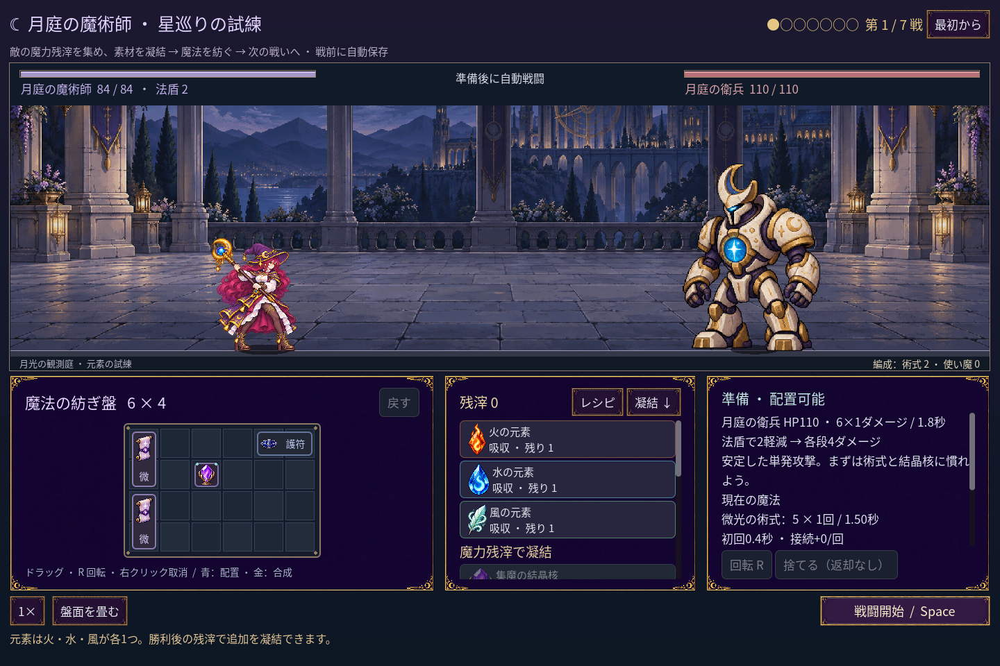
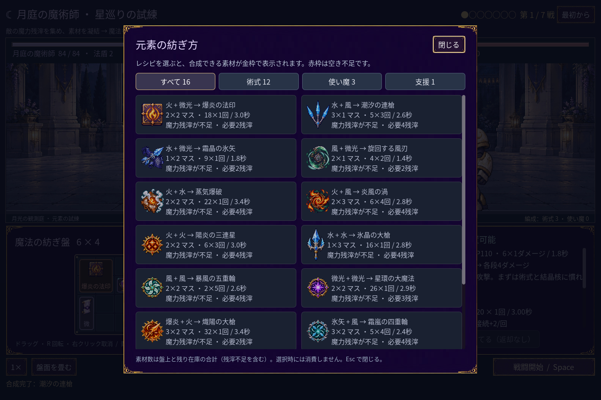
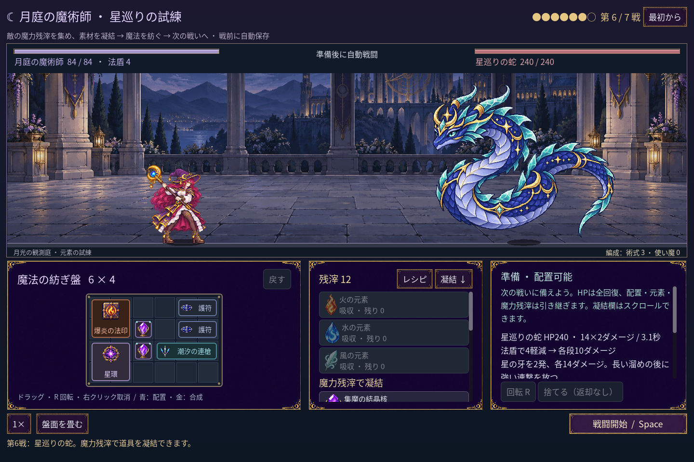

# 月庭の魔法使いの試練（開発中・正式タイトル未定）

日本語の画面で遊べる、自動戦闘ゲームの試作です。新しい魔法使いの遠征では、戦う前に元素や魔法を並べ、全七戦に挑みます。魔法の組み合わせは16種類。勝つと魔力の残滓を手に入れ、次の戦いに使う素材へ変えられます。七戦目はボスです。

勝利後は体力が全回復し、配置と残りの資源は引き継ぎます。敗北した場合は同じ戦いの準備からやり直せます。準備中の変更、勝利後の次の戦い、最終クリアの状態は専用のファイルに自動保存され、再起動時に読み込まれます。戦闘中に終了した場合は、その戦いの準備から再開します。

敵は月庭の衛兵、鏡翼の蛾、茨の石像、月灯の精霊、星詠みの書霊、星巡りの蛇、最後のボス・月冠の星守の七種類です。新しく追加した敵は一枚の姿勢画像を使い、浮遊や受撃時の動きで表現しています。連続した姿勢画像によるアニメーションは今後の課題です。[七戦の記録](docs/devlog/2026-11-10-mage-seven-battles.ja.md)

新しい遠征では敵が順に強くなります。従来の五戦版と一戦版の数値は変えていません。魔法使いには一つの待機姿勢と三つずつの攻撃・防御姿勢があり、攻撃や防御のたびに姿勢が選ばれます。AnimationPlayer は実際の発射・命中に合わせて動き、施法中の受撃は攻撃姿勢を優先します。道具の待ち時間や自動戦闘のルールは変えていません。[動きの記録](docs/devlog/2026-11-12-mage-seven-poses.ja.md)

画面にはプレイヤーに必要な操作を表示しています。自動保存に失敗した場合は「保存を再試行」と表示されます。戦闘の試算機能は開発テスト用として残しています。[画面の記録](docs/devlog/2026-11-11-player-ui.ja.md)

準備中の「戻す」または Ctrl+Z で、盤面上の移動、回転、合成を一回取り消せます。吸収、凝結、破棄、開戦、読み込みを行うと取り消し履歴は消え、再起動後にも残りません。[操作の記録](docs/devlog/2026-11-08-mage-undo.ja.md)

```powershell
npm run game:mage
```



新しい遠征では、火・水・風の元素を一つずつ持った状態から始めます。元素を微光の術式と組み合わせて魔法を作ります。「レシピ」から16種類の組み合わせを確認でき、金色の枠は選んだ配方の合成先を示します。爆炎と火から熾陽の大槍、氷矢と風から霜嵐の四重輪、結晶核と風から隣の術式を速める疾風の結晶環を作れます。



結晶核と水から月蛾の契約を作り、さらに水を重ねると月冠蛾、風を重ねると素早く一回攻撃する風月蛾に強化できます。契約一つにつき一体の使い魔が自動で攻撃し、三種類の合計で最大二体まで召喚できます。現在、敵は魔法使いだけを攻撃し、使い魔に独立した体力はありません。上位の配方を選ぶと、材料が足りる場合は先に基本の術式を作るよう案内されます。配方を選ぶだけでは材料を消費しません。基本の術式を作った後、上位の配方を再び選びます。

勝利後は「次の戦いへ」を押し、「凝結」で魔力の残滓を数に限りのある元素、術式、結晶核、法盾に変えられます。道具はクリックまたはドラッグで配置し、R で回転、スペースで開戦します。敵の攻撃を実際に軽減すると法盾が表示されます。従来の五戦セーブは元の敵・報酬・資源のルールを保ち、「最初から」で始めた遠征には七戦のルールが適用されます。

取得できる元素や凝結素材を選ぶと、右側に用途、残数、価格、現在の向きで占めるマスが表示されます。配置プレビューでは配置後の素材、残滓、法盾、影響を受ける術式を比較できます。配方帳は術式・使い魔・支援で絞り込めます。配置や合成を確定する前に資源は消費されません。戦闘後は「戦闘結果を見る」で攻撃元ごとのダメージと命中を確認できます。

遠征の保存先は `user://mage-campaign-run.json` です。従来の三敵から一体を選ぶ一戦版と予行演習は、`npm run game:mage:trial` で起動し、別の準備チェックポイントを使います。基本・月冠・風月の三種類の使い魔契約はありますが、敵は使い魔を攻撃しません。召喚を中心とする流派、奥術の循環、各職業三流派の完成は今後の課題です。[風の使い魔](docs/devlog/2026-11-10-mage-wind-familiar.ja.md) · [保存の記録](docs/devlog/2026-11-07-mage-campaign-save.ja.md) · [アニメーション計画](docs/ANIMATION_PLAN.md)



## 過去の試作

以下は森林の試作と二職業の実験の記録です。`npm run game` は v0.3 の森林試作、`npm run game:classes` は二職業の実験を起動します。旧版の12装備・5配方・7祝福・5戦と保存データの互換性は維持しています。

**2026-10-27：戦闘の見た目を追加。** 実際の命中数字、三段魔法のまとめ表示、装甲による軽減、受撃時の点滅と揺れ、勝敗時のフェードを追加しました。一時停止と1倍・2倍速にも連動します。キャラクター用シェーダーで薄い透明部分のノイズを抑え、元の PNG は変更していません。元画像のピクセル密度、体と武器の一貫性、専用の受撃・退場姿勢は引き続き課題です。[フィードバックと検査](docs/iteration-c1-feedback.md) · [以前の四姿勢の動き](docs/iteration-c1-motion.md) · [静止画の組み込み](docs/iteration-c1-static-art.md)

**2026-10-24：C0 二職業ルールの実験。** 次のコマンドで起動します。

```powershell
npm run game:classes
```

魔法使いは数に限りのある火・水・風を無料で吸収し、一撃の爆炎や三段攻撃の潮汐を作れます。騎士は限られたお金で装備を買い、六マスを使う重刃を鍛造します。どちらも配置、回転、方向による支援、自動の練習戦、攻撃元ごとの結果確認を試せます。これは以前の二職業実験の説明です。魔法使いには上記の遠征がありますが、騎士の五戦と職業ごとの完全な流派は未完成です。[ルールと操作](docs/iteration-c0-rules.md)

魔法使いは火の元素を左上の微光の術式に重ねると爆炎を作れます。水の元素を4列3行に置いて風の元素を重ねると、横三マスの潮汐の連槍になります。騎士は溜めの紋章を左上の長剣に重ねて重刃を鍛造し、二つ目の紋章を3列2行に置いて支援できます。クリックまたはドラッグで配置、R で回転、右クリックでキャンセル、スペースで開戦します。結果画面の「戦前に戻す」で同じ資源の配置を調整し、新しい実験を始めることもできます。

実験は開戦前に `user://class-prototype-run.json` へ保存します。手動の保存・読み込みも可能で、旧遠征のデータは読み込み・移行しません。ルールの検査は `npm run game:classes:test`、画面や動きの検査は `npm run game:classes:art:test` を使います。

**2026-10-23 の製品方針：複数職業と道具の組み合わせ。** 最初は魔法使いと H 方向の近接騎士を対象に、それぞれ三つ以上の流派を検討し、錬金術師は後から追加する予定です。[職業と流派の設計](docs/classes-and-builds.md)を参照してください。美術は細かな 16-bit fantasy / tactical RPG を目標とし、[八つの案](docs/art-style-exploration.md)と[オフライン比較ページ](docs/concepts/2026-10-23/index.html)を探索資料として残しています。C0 で実装したのは上記の実験範囲です。

現在の基準は[製品要件](docs/requirements.md)、[開発計画](docs/development-plan.md)、[美術仕様](docs/art-direction.md)です。従来の計画は C0 職業ルール → C1 二職業各一流派の一戦 → C2 各三流派・五戦 → C3 説明、バランス、Windows 向け完成の順でした。その後、ユーザーの判断で騎士と C2 を後回しにし、魔法使いを優先しています。[森林試作の範囲と検証](docs/iteration-03-sample.md) · [文書一覧](docs/README.md)

森林試作には画面のレイアウト、革のバッグと紙の手記、主人公と苔団それぞれ14フレームの動き、短剣・盾・砥石の専用画像、統一した大きさの森林を追加しました。残り9装備と他の敵は旧素材を仮に使用しています。

### 森林試作で実装したもの

- 6×4 のバッグ、異なる形の装備、ドラッグと回転。
- 四枠の店、金貨、購入、更新、売却。
- 同じ装備の同じ品質同士の合成、短剣と砥石の配方、最大三級の品質。
- 12種類の装備と五つの異なる道具の配方。長剣と進化した弓は三マスを占有。
- 砥石の青い点による方向支援と、火種による四方向の強化。
- 装甲、反射、回復、薬、会心、装備ごとの待ち時間。
- 自動戦闘、ダメージ数字、攻撃の動き、音、戦闘結果の表示。
- 五回の戦闘、最後のボス、勝利報酬、敗北・クリア後の再開。
- 最初の四戦に勝つたびに三択から一つ選ぶ、七種類の祝福。
- 自動保存、続きから再開、一時停止メニュー、新しい遠征の確認。
- 配方図鑑、敵の情報、祝福の説明、操作ガイド。当時の中国語画面は後に日本語へ変更。

## 起動と準備

```powershell
npm run game
```

Godot エディターで `project.godot` を開いて F6 / F5 を押しても実行できます。F6 を使う場合は、先に `scenes/main.tscn` を開いてください。

1. Godot 4.7.2 .NET 版と .NET SDK 8.0.426 を用意します。SDK の ZIP を `.tools/dotnet/` に展開し、その直下に `dotnet.exe` がある状態にします。
2. `npm ci` でプロジェクト内の CLI をインストールします。
3. ターミナルで `$env:GODOT_BIN = 'Godot.exeのパス'` を設定します。または Godot .NET エディターの完全なパスを `.tools/godot-editor-path.txt` に書きます。このファイルは Git に含まれません。
4. 最初に `npm run godot:open` を実行し、C# のビルドと素材の取り込みを完了させます。その後は `npm run game` で森林試作、`npm run game:mage` で魔法使いの遠征を起動できます。

ゲーム本体は GDScript で作っています。C# と SDK は Godot MCP のエディタープラグイン用です。起動スクリプトが SDK の環境変数を子プロセスに渡し、SDK、NuGet パッケージとキャッシュは `.tools/` 内に置きます。エディター付属の Godot NuGet パッケージは `.tools/godot-nupkgs/` にコピーします。これらは Git に含めません。

### 森林試作の操作

| 操作 | 入力 |
| --- | --- |
| 移動・購入 | バッグへドラッグ。商品をクリックしてからマスをクリックしても配置可能 |
| 装備を見る | クリックまたはマウスを重ねる |
| 回転 | R |
| 合成 | 同じ装備・品質、または配方の材料を重ねる |
| 売却 | 選択後 D / Delete、または売却ボタン |
| 開戦・次の戦い・再開 | スペースまたは右下のボタン |
| 配置のキャンセル | 右クリック / Esc |
| 配方図鑑 | Tab |
| 音の切り替え | M |
| 勝利後の祝福を選ぶ | カードをクリック / 1、2、3 |
| 一時停止・メニュー | Esc。道具を持っている場合は先に配置をキャンセル |
| メニュー内の保存・読み込み | S / L |

最初は短剣二本を重ねて強化し、盾と月露草を購入できます。戦闘中、武器の下の金色の線が次の発動までの時間を示します。

### 森林試作の保存

準備、買い物、合成、祝福の取得後に自動保存し、開戦前の配置も保存します。戦闘中に終了して再開すると、その戦いの準備から始まり、戦闘の途中からは再開しません。クリアまたは敗北すると現在の遠征は終了します。

保存先は `user://emberpack-run.json` です。テスト、`--no-save`、スクリーンショットのモードは隔離され、プレイヤーの保存を読み書きしません。破損データや未対応の形式は先に通知し、新しい遠征には確認が必要です。保存失敗時は開戦せず、読み込み失敗時は現在のバッグを変更しません。

### 検証

```powershell
npm run game:test
```

バッグの配置、金貨、合成スペース、方向、祝福、フレームレートに依存しない戦闘、64ビットの乱数状態の保存、破損データと書き込み失敗の保護を検査します。マウスでの配置、五戦のクリア、保存・読み込み・再開も確認します。

当時の結果は、基本ルール **126項目**、保存 **148項目**、画面操作 **210項目**、美術資産の契約 **465項目**、合計 **949項目**でした。画面の検査は五つのウィンドウサイズ、マウス操作、再開時の消去、一時停止、同じ乱数種での戦闘結果の一致を含みます。1280×800、1440×960、1920×1080 の実行画面を確認していますが、他の DPI、環境、すべての美術品質の確認を意味するものではありません。

## プロジェクト資料

- [C0 二職業ルール実験：範囲と操作](docs/iteration-c0-rules.md)
- [C0 のルールと保存の契約](docs/class-prototype-contract.md)
- [二職業と各三流派の設計](docs/classes-and-builds.md)
- [八つのピクセルアート設定案](docs/art-style-exploration.md)
- [オフライン比較ページ](docs/concepts/2026-10-23/index.html)
- [設定変更と新しい試作の計画](docs/art-retheme-plan.md)
- [製品要件](docs/requirements.md)
- [開発計画](docs/development-plan.md)
- [美術仕様](docs/art-direction.md)
- [最初の Demo 計画（過去の資料）](docs/demo-plan.md)
- [v0.2 の範囲と確認](docs/iteration-02.md)
- [v0.3 美術試作の範囲と確認](docs/iteration-03-sample.md)
- [開発記録と各版の画像](docs/devlog/README.ja.md)
- [ブログ草稿](docs/blog/emberpack-making-of.ja.md)
- [参考資料の調査](docs/reference-research.md)
- [素材の出典](docs/asset-credits.md)
- [ローカル MCP の設定](MCP_SETUP.md)

この試作はドラッグによる合成、独自の青い点による方向支援、装備配方を使っており、参考ゲームの数値やルールを完全に再現したものではありません。長期的な育成、ペット、複数職業の完成版はまだありません。
