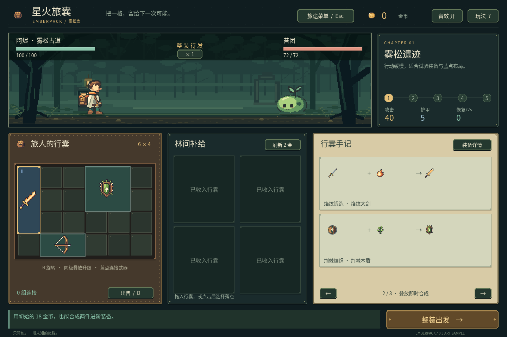
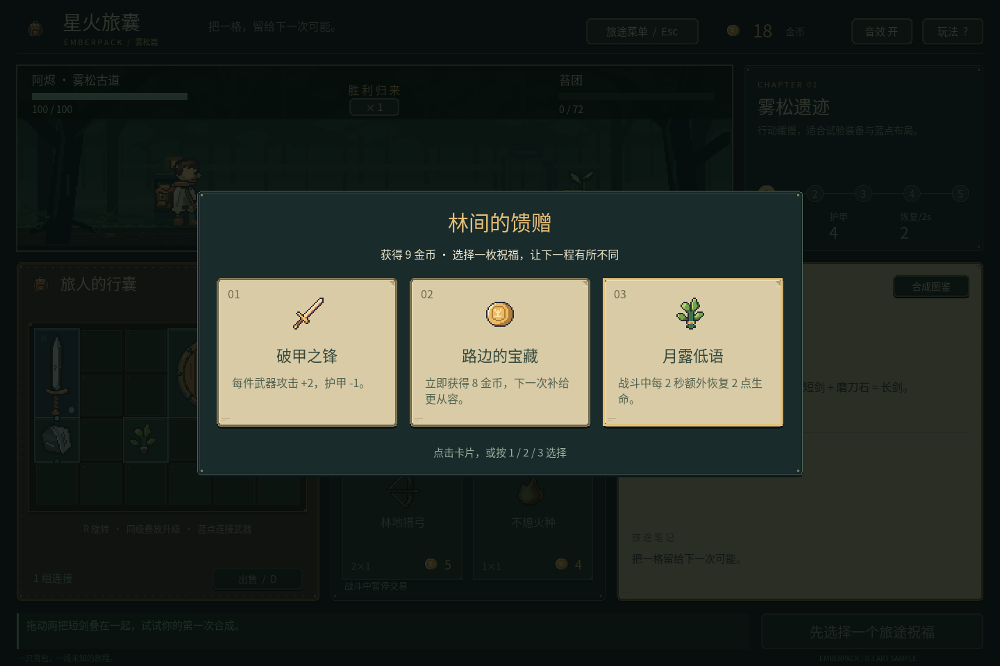
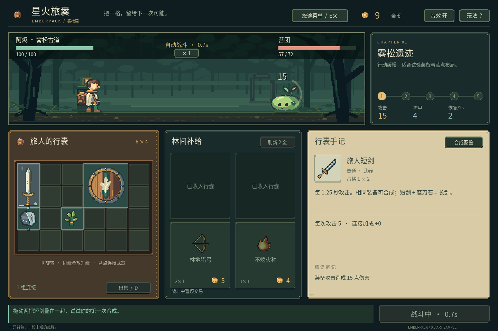

# 星火旅囊 · Emberpack

一个可玩的 Godot 像素背包合成 RPG Demo。参考《靠装勇者》的构筑循环，使用原创世界、美术和界面。当前为 **0.3 美术样板**，沿用 v0.2 的 12 装备、5 配方、7 祝福与五战规则。

**2026-10-24：用户已选法师 A「月庭礼装」＋骑士 A「旌旗长枪」。** [角色基准与下一步制作](docs/character-baselines.md)。[离线对照页](docs/concepts/2026-10-24-characters/index.html)仍保留六案；`npm run art:review` 默认并排显示所选两案。外观基准已确认，专用战斗帧、背景与动画待制作。[六案说明与实际不足](docs/character-design-review.md)。

**2026-10-24：可玩的 C0 双职业规则实验。** 运行：

```powershell
npm run game:classes
```

法师可免费吸收有限火/水/风元素，编织单次焰爆与三段潮汐法术；骑士用有限金币购买武装，锻造占六格的重刃。两者都可摆放、旋转、方向支援、自动训练一战，并查看实际来源复盘。界面中的文字物件和法/刃/靶符号是规则示意，正式人物与背景尚未制作；召唤、循环、盾反、连击及职业五战仍待开发。[本轮范围、操作与验证](docs/iteration-c0-rules.md)。

法师入门：点「火元素」再点左上微光术式，生成焰爆；把水元素放在第4列第3行，再把风元素叠上去，生成横向三格潮汐连枪。骑士入门：点「蓄势徽记」叠到左上长剑，锻造重刃；第二枚徽记可放在第3列第2行连接强化。点击/拖放物件，R旋转、右键取消，空格开战。结算后「恢复战前」可调整同一资源配置；「新法师/骑士实验」开始新配置。

实验在开战前写入独立 `user://class-prototype-run.json`，也可手动保存/读取准备；不会读取或迁移旧远征。`npm run game` 继续启动下方的森林样板。新增检查用 `npm run game:classes:test`。


**2026-10-23产品方向：多职业背包构筑。** 初期魔法师与H近战骑士各至少三种流派，炼金术士后续。详见[职业与流派设计](docs/classes-and-builds.md)。美术以精细16-bit fantasy / tactical RPG为目标，[八套概念](docs/art-style-exploration.md)与[离线对照页](docs/concepts/2026-10-23/index.html)保留为探索资料。C0实验只交付上述规则；下方历史截图与操作仍描述森林样板。

后续以[产品需求](docs/requirements.md)、[开发计划](docs/development-plan.md)和[美术规格](docs/art-direction.md)为基线，按 C0 职业规则与接口 → C1 双职业各一流派的一战切片 → C2 各三流派五战 → C3 教学、平衡与 Windows 交付推进。M1-A/B 森林样板已完成；旧未完成路线已按新需求重排。[样板范围与验证](docs/iteration-03-sample.md) · [全部文档入口](docs/README.md)。


本轮加入原生窗口排版、皮革行囊与纸质手记、主角/苔团各 14 帧动画、短剑/盾/磨刀石的专用占格图，以及统一像素尺度的森林。其余 9 件装备和其他敌人仍使用登记过的旧素材占位。


## 已实现

- 6×4 格背包、不同形状装备、鼠标拖放与旋转。
- 四格商店、金币、购买、刷新与出售。
- 同种同级合成、短剑与磨刀石配方、最多三级品质。
- 12 种装备与五条异物配方：焰纹大剑、荆棘木盾、逐风猎弓、浓缩暖心药等；长剑与进阶弓占三格。
- 磨刀石蓝点决定加成方向，旋转后左右变上下；火种四向强化。
- 护甲、反伤、回血、药水、暴击，装备独立冷却。
- 装备独立冷却、自动战斗、伤害数字、攻击动作、音效与战况反馈。
- 五波敌人、最终 Boss、胜利奖励、失败/通关后重开。
- 前四波胜利后三选一祝福，七种祝福带来攻击、防御、恢复与经济取舍。
- 自动保存、读取继续、暂停菜单与新远征确认。
- 中文界面、可翻页的合成图鉴、敌人提示、祝福说明和操作指南。



上图只使用初始两把短剑、磨刀石和 18 金币，即可做出焰纹大剑与荆棘木盾。



## 本机启动

```powershell
npm run game
```

在 Godot 编辑器中打开 `project.godot`，按 **F6/F5** 也可运行主场景；F6 需要先打开 `scenes/main.tscn`。

当前本机 Godot 路径：

```text
D:\Program Files\Godot_v4.7.2-stable_mono_win64\Godot_v4.7.2-stable_mono_win64.exe
```

## 新环境准备

1. 准备 Godot 4.7.2 .NET 版和 .NET SDK 8.0.426。SDK ZIP 解压到 `.tools/dotnet/`，该目录应直接包含 `dotnet.exe`。
2. `npm ci` 安装项目内 CLI。
3. Godot 路径与上面不同时，在当前终端设置 `$env:GODOT_BIN = '你的Godot.exe路径'`。
4. 首次执行 `npm run godot:open`，让编辑器完成 C# 构建与素材导入；之后可以用 `npm run game` 直接游玩。

游戏主体使用 GDScript；C# 工程和 SDK 用于 Godot-MCP 编辑器插件。启动脚本仅为子进程设置 SDK 环境，SDK、NuGet 包和缓存保留在 `.tools/` 内；这些文件不提交到仓库。编辑器自带的 Godot NuGet 包会复制到 `.tools/godot-nupkgs/`。

## 操作

| 操作 | 输入 |
| --- | --- |
| 移动/购买 | 鼠标拖到背包；商品也可点击后再点击格子 |
| 查看装备 | 点击或悬停 |
| 旋转 | R |
| 合成 | 将同种同级装备或配方材料叠放 |
| 出售 | 选中装备后按 D / Delete，或点出售按钮 |
| 开始战斗/下一波/重开 | 空格或右下按钮 |
| 取消放置 | 右键 / Esc |
| 合成图鉴 | Tab |
| 音效开关 | M |
| 选择战利品祝福 | 点击卡片 / 1、2、3 |
| 暂停与旅途菜单 | Esc（手持装备时先取消放置） |
| 菜单内保存 / 读取 | S / L |

第一次可以先把两把短剑叠放升级，再购入护盾和月露草。战斗中背包内武器的底部金线显示冷却进度。

## 保存远征

整装、购物、合成与领取祝福后自动保存；开战前会保留整装快照。退出战斗再继续时回到该场开战前，不能从战斗中途存档。通关与战败会结束当前存档。

本机存档位于 Godot 的 `user://emberpack-run.json`。测试、`--no-save` 与截图模式使用隔离环境，不读取或覆盖玩家存档。损坏或不支持版本的旧记录会先提示；开始新远征需要二次确认。保存失败时不会开战，读取失败时不会改变当前背包。

## 验证

```powershell
npm run game:test
```

测试包括背包合法性、金币原子性、合成空间、方向旋转、祝福领取、帧率独立战斗、64 位随机状态保存、损坏记录和写入失败保护，以及通过鼠标交互构筑、五波通关、保存/读取和重开。

当前验证结果：核心逻辑 **126 项**、存档 **148 项**、界面交互 **210 项**、美术资源契约 **465 项**，共 **949 项检查**。界面检查包含五种窗口尺寸、原生鼠标事件、重开清理、表现暂停，以及同种子战斗与纯规则结果一致性。实机截图确认了 1280×800、1440×960、1920×1080；不代表其他 DPI、平台或所有美术体验已经验收。



## 项目资料

- [C0双职业规则实验：实际范围与操作](docs/iteration-c0-rules.md)
- [C0冻结规则与保存契约](docs/class-prototype-contract.md)
- [双职业与每职业三流派设计](docs/classes-and-builds.md)
- [八个精细像素设定候选与概念图](docs/art-style-exploration.md)
- [离线概念双图对照页](docs/concepts/2026-10-23/index.html)
- [换设定与新实机样板计划](docs/art-retheme-plan.md)
- [产品需求文档](docs/requirements.md)
- [开发计划与里程碑](docs/development-plan.md)
- [美术规格与提升计划](docs/art-direction.md)
- [首个 Demo 计划（历史）](docs/demo-plan.md)
- [0.2 迭代范围与验收](docs/iteration-02.md)
- [0.3 美术样板范围与验收](docs/iteration-03-sample.md)
- [日语开发记录与历代截图](docs/devlog/README.ja.md)
- [日语博客草稿](docs/blog/emberpack-making-of.ja.md)
- [实机与 Wiki 研究](docs/reference-research.md)
- [素材来源](docs/asset-credits.md)
- [本机 MCP 配置说明](MCP_SETUP.md)

本 Demo 使用即时拖放合成、自定义蓝点协同与装备配方，不是对原作数值与规则的完整复刻。当前尚未加入长期养成、宠物和多职业。
