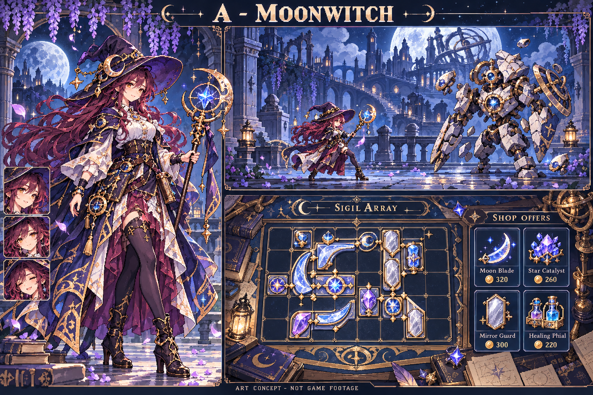
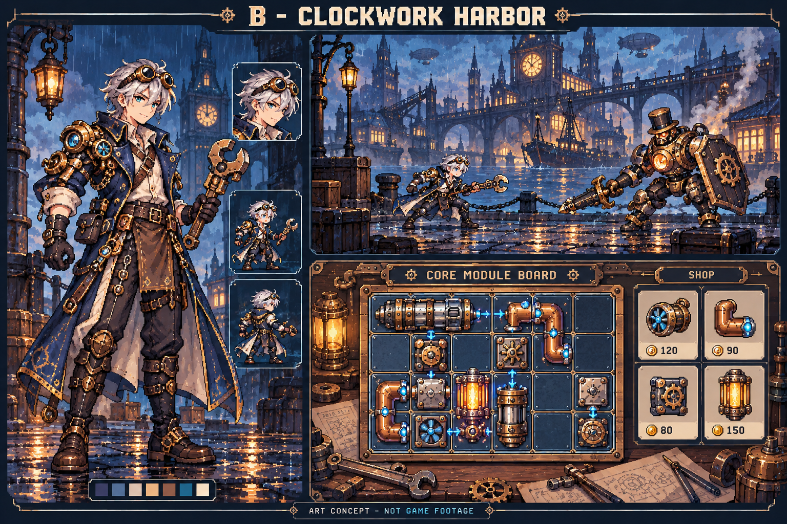
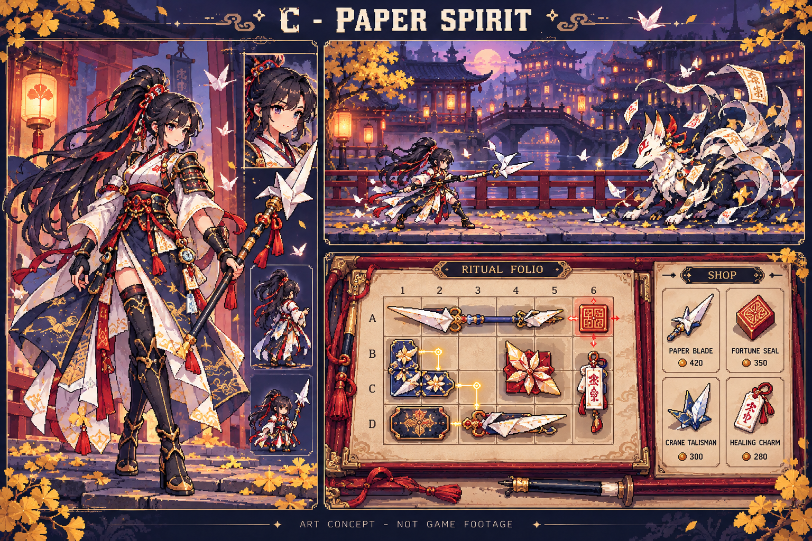
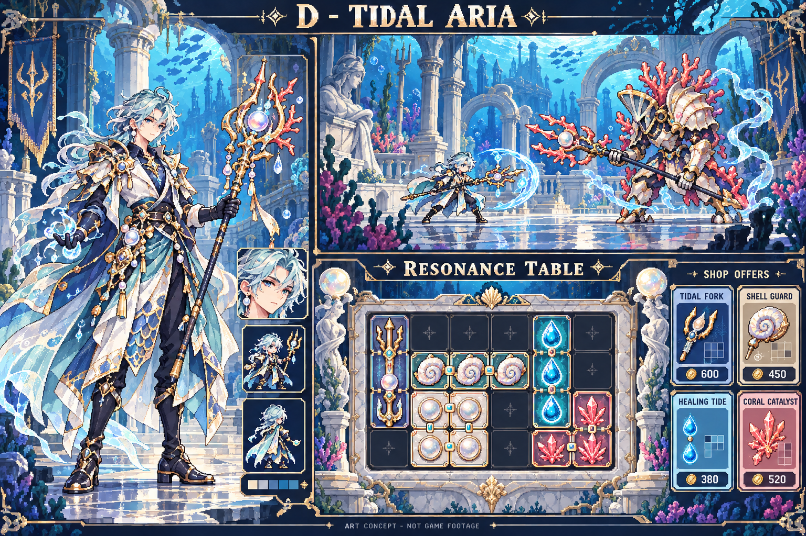
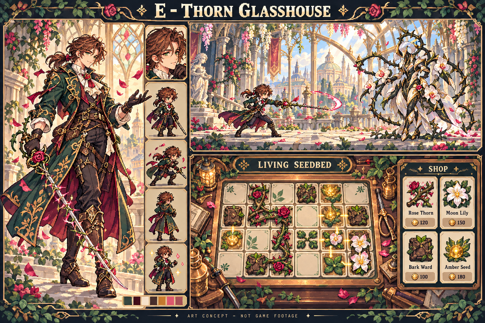
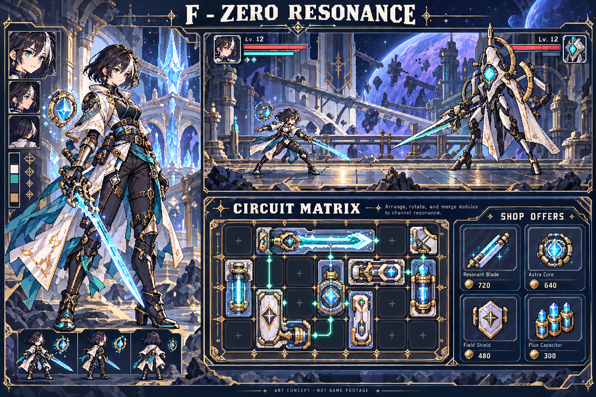
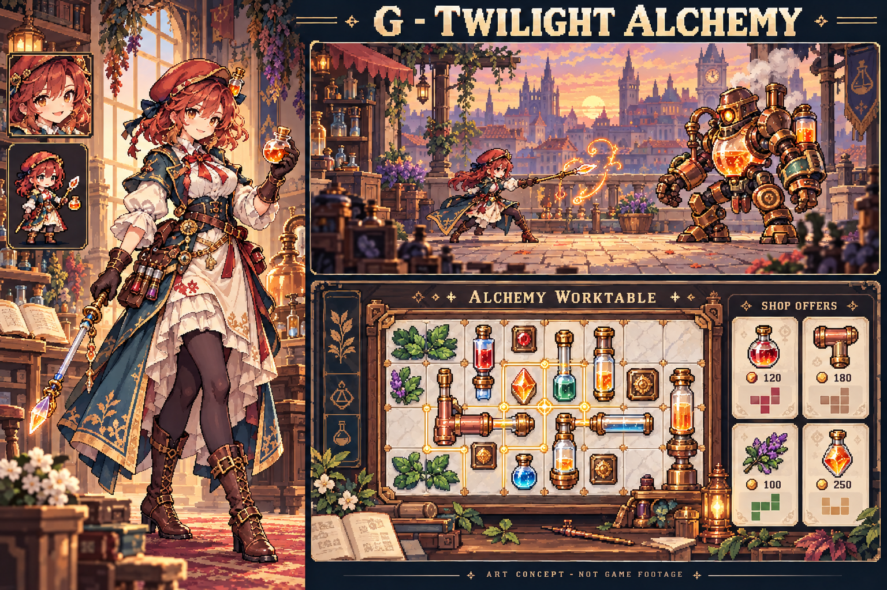
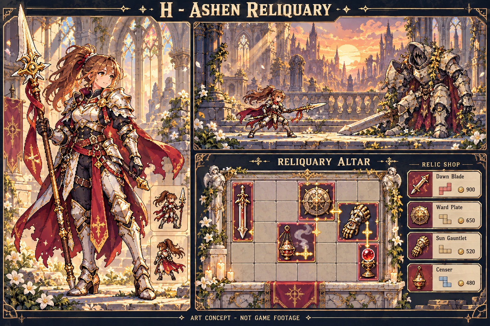

# 美术与设定探索：精细像素角色 × 格位构筑

概念日期：2026-10-23（JST）。状态：**八案探索完成，首发为魔法师与H近战骑士；2026-10-24有独立C0规则原型，正式美术未实装**。本页补充[美术规格](art-direction.md)、[需求文档](requirements.md)和[开发计划](development-plan.md)；旧v0.3与新C0的事实分别见[森林样板](iteration-03-sample.md)、[规则原型](iteration-c0-rules.md)。概念PNG与对照页继续保留原始探索快照。

**用户后续决策：背包仍是核心，不同角色有不同职业、玩法和背景，每个角色至少三种构筑流派。** 不再八选一，也不是一套装备换八种皮肤。初期魔法师与 H 圣匣近战骑士分别开发；A 可作法师视觉参考，但未指定必须采用月相魔女人设。H 的圣堂遗物题材已选，性别、最终兵器及正式游戏标题待定。后续 G 炼金术士包含自我强化、不同药水组合等方向，其他候选保留为角色探索储备，不同时承诺八案实装。职业规则见[职业与构筑设计](classes-and-builds.md)，制作顺序见[多职业美术计划](art-retheme-plan.md)。

共享的是「6×4 格位摆放、旋转、合成、方向协同、自动战斗」的操作语言；各职业的获取和资源规则可以不同，法师不必全部购买装备。『星火旅囊 / Emberpack』保留为历史名称，以下八个名称都是探索工作名，未做商标或同名作品查重，不是八个正式游戏标题。

所有配图均为视觉概念稿，用于比较角色、场景和矩阵载体；**不是 Godot 实机截图，不代表已制作动画或可直接导入的游戏素材**。不要把生成图中的装饰性格位当作已经验证过的可玩布局。用户提供的两张参考图用于观察和图像生成的风格参考，本页不转载原图、不外链原图，也不据此推定公开素材授权。

八张概念图已生成并保存在 [2026-10-23 对照页](concepts/2026-10-23/index.html)所在目录。下载仓库后用浏览器打开该 HTML，可单图查看或并排比较；GitHub 文件预览不会执行对照功能。制作记录见[日语日志](devlog/2026-10-23-art-exploration.ja.md)，原始提示见 [prompts.json](concepts/2026-10-23/prompts.json)，尺寸与 SHA-256 见 [manifest.json](concepts/2026-10-23/manifest.json)。

**配图的阅读边界：** 八张 PNG、prompts、manifest 与离线对照页保留为 2026-10-23 最初探索快照，不按后续决策修改生成事实。图中的大立绘可能比最终战斗精灵更修长，背景可能过密；它们不是像素精确的 sprite 图集。格数、物件占格、连线、价格、资源条与 MP 都只是构图占位，不能据此认定游戏已有对应机制，也不构成禁止后续职业资源的依据。新物件、资源与协同必须按职业规则设计，在 6×4 背包与实际窗口中验证。大像素立绘与专用战斗精灵分别制作，不能直接切图。

## 1. 共同的美术基准

用户明确偏好参考中的 **16-bit fantasy** 和 **tactical RPG**。这里将它们理解为角色细节与可读性的方向，不是对原图尺寸或历史主机色数的测量结论。

- **角色先好看、再放进场景。** 成年人比例，清晰的眼睛与表情、可辨识的发型和配饰，肩腰腿的轮廓有层次。衣装有布料、皮革、金属的材质区别；可战斗的鞋、手套、护具和方便活动的衣摆比堆装饰更重要。各案可制作不同性别版本，当前示意造型不锁定主人公性别。
- **要有精细像素结构。** 用明确的像素簇表现头发、布褶与甲片，高光集中在眼睛、武器、少量饰件。避免把普通插画缩小或加马赛克当作最终像素素材，也不退回当前样板的简化面部与大色块身体。
- **人物、地面、背景共用视觉尺度。** 近景石块、木板、叶片的颗粒不能细到像另一张画；远景降低饱和度、对比度与细节密度。角色脚底有可读的站立面和接触阴影，不能浮在背景上。
- **背包构筑区域保持平整、可读。** 操作区共享矩形 6×4 格；各职业物件和获取流程独立设计。题材可以改变格子的材质与意义，不能因为叫「星盘」就擅自改成圆形规则，也不能为了装饰让格线、落点和非法位置难以识别。现有 12/5/7/5 仅是旧样板预算，不是假定的新职业池。
- **像素画与文字分别处理。** 角色与物件等比、最近邻、整数倍显示；中文文字采用原生分辨率排版。装饰主要放在矩阵外框与非交互边缘。
- **主角在实际战斗尺寸中验收。** 大图看起来精致还不够：实际显示时眼睛、发型、武器、站姿都要能认出，动作的准备、攻击、受击要分得清。

具体源 sprite 的画布、人物占高、头身比例与调色板数量，需要为两个首发职业分别用主角静态帧、背景和实际窗口验证；不把概念图的像素颗粒当作生产尺寸。每职业三种造型用于人设比较，与每职业至少三种玩法流派分别验收。

## 2. 八案探索概览与当前采用范围

下表保留八案的视觉意图与主观设计判断，不是市场评分。**第 3–10 节保留最初以现有物件映射说明造型的探索描述，不能将其中的旧装备映射和「不新增」边界理解为最新职业限制。** 具体新玩法以职业文档为准；当前采用范围是魔法师视觉参考 A、首发近战题材 H、后续炼金术士 G，其余候选暂不排入实装。

| ID / 工作名 | 主角身份 | 背包格位的题材表现参考 | 视觉关键词 | 制作关注点 | 视觉特点 |
| --- | --- | --- | --- | --- | --- |
| A 月蚀咒庭 | 月相魔女 | 矩形咒印星盘 | 深紫、月白、旧金、月光庭院 | 帽檐、长发与法杖动作不能互相遮挡 | 最直接贴合 16-bit fantasy 的梦幻角色感 |
| B 雾港机巧师 | 机巧师 | 核心模块盘 | 石油蓝、铜、暖灯、蒸汽港城 | 机械部件与背景管线容易太碎 | 格位、旋转与接线的功能映射很自然 |
| C 千纸夜行 | 纸术巡灵 | 折纸符阵 | 靛蓝、朱红、纸白、夜雨神社 | 薄纸、发带与衣摆要统一像素尺度 | 东方氛围鲜明，方向协同有符路语言 |
| D 潮音回廊 | 潮汐调律师 | 珊瑚共鸣盘 | 青蓝、珍珠白、珊瑚粉、沉没回廊 | 水下透明效果可能压低轮廓对比 | 色彩轻盈，和常见森林冒险差异较大 |
| E 荆棘温室 | 植物使 | 活体花床 | 墨绿、米白、莓红、玻璃温室 | 根系与叶片必须让出格线与物件边界 | 合成、相邻强化有直观生长意象 |
| F 零号共鸣 | 同步者 | 回路矩阵 | 深蓝灰、象牙白、冷青、轨道圣殿 | 防止滑向普通科幻面板和满屏霓虹 | 功能清晰，适合简洁的战术界面 |
| G 黄昏炼金室 | 炼金术师 | 炼成工作台 | 琥珀、灰蓝、墨绿、斜阳工坊 | 瓶罐、小标签与桌面杂物需克制 | 最容易解释购买、合成与配方发现 |
| H 圣像余烬 | 圣匣骑士 | 遗物祭台 | 象牙白、绯红、暗金、废墟圣堂 | 甲胄、披风与宗教装饰的层级较复杂 | 最贴近 tactical RPG 的英雄辨识度 |

## 3. A｜月蚀咒庭

**背景。** 月光正在从一座被遗忘的庭院消失。巡夜魔女带着破损星盘穿过回廊、玻璃花房与天文塔，回收散落的咒印，重新点亮夜空。第一章可以只发生在同一庭院，不需要为选题增加地图规模。

**主角。** 成年月相魔女：有明显眼神的脸、紫黑长发、偏斜帽檐、短披肩与便于移动的长靴。衣装以深紫布料、月白内衬和少量旧金扣件形成层次。保留漂亮的轮廓，同时让双手与脚步动作不被大袍子盖住；也可改为同一服装语言的成年男巫。

**格位器具。** 看起来像天文仪器的**矩形咒印星盘**，内部仍是清楚的 6×4 石板槽。圆环只做外框装饰。可作为法师背包的视觉语言，容纳元素、咒印或契约；不要求显示为皮革行李包。

**物件与合成。** 早期图示以月刃咒印、镜盾印、露滴瓶和引辉晶映射旧物件，只用于讲清视觉。新的魔法师不能停留于旧剑盾改名：应按元素编织、契约召唤、奥术循环设计吸收、组织和释放方式，具体元素/契约/资源及代价由 C0 确定。月相循环没有因为 A 图出现就自动成为需求。

**方向协同。** 引辉晶左右两端发光，把强化传给相邻攻击咒印；旋转后改为上下。四向强化物则是刻有四枚短月牙的星灯。方向由器件的端口说明，连线只显示实际生效的相邻格。

**场景与色板。** 深紫夜空、月白石阶、旧金仪器与偏蓝绿色的灌木。近景保留修剪灌木和碎裂砖面，中景为拱廊，远景是天文塔与大月；角色面部与法杖是局部最亮的区域。矩阵底面使用偏暗紫石板，避免月光白把装备剪影冲淡。

**制作难点与留白。** 帽檐、长发、法杖和披肩可能占据同一轮廓区，必须在小尺寸先验证。星盘不能让人误以为要沿圆环摆放。庭院身世只留视觉线索，不先扩写大量对白。适合优先做「一名魔女、一段月庭、三件咒印」样板。

## 4. B｜雾港机巧师

**背景。** 终年起雾的高架港城靠旧式机关维持运转。年轻的成年机巧师修复失控装置，把回收零件装进核心盘，守住夜班工坊与通向灯塔的轨道。

**主角。** 当前图示为银灰短发的成年男性机巧师：抬起的护目镜、海军蓝外套、象牙白衬衣、黄铜肩部护具、扳手与结实长靴。脸部保持明亮、利落，金属与布料分区明确；不用巨大工具包遮住上半身。后续也可比较侧扎发或其他性别版本，保留相同工具与服装语言。

**格位器具。** **核心模块盘**是一张 6×4 黄铜插槽台。旋转模块会改变插口方向，但矩阵不增加布线小游戏、供电条或新的能量规则。

**物件与合成。** 刃轮代替基础剑、护罩片代替盾、磨削核心代替磨刀石。两枚刃轮升级为长刃机构；长刃机构与热芯形成高温刃组。恢复物是密封维修胶囊，沿用恢复行为，不引入机器人维修或主角种族的新限制。

**方向协同。** 模块边缘有左右成对的铜触点，旋转后上下导通；四向模块以四根短导管标记。导流时只亮实际触点，不把所有缝隙都画成发光线路。

**场景与色板。** 石油蓝雾、铜褐机器、煤灰屋瓦，窗灯与熔炉提供琥珀暖光。战斗地面是整齐的维修栈桥；港口吊机、桥梁与船影退到远景。UI 用铆接边框和浅灰蓝槽底，物品区不铺密集齿轮纹样。

**制作难点与留白。** 齿轮、管道、铆钉容易让画面变成高频噪声；每件模块需要一个主轮廓，背景机器只保留大块形状。人物无需随构筑换装，机械宠物和可驾驶机甲留在范围外。

## 5. C｜千纸夜行

**背景。** 山城的灯火依赖守夜人留下的纸符。一次风雨后，旧符化为失控纸灵。巡灵术师沿着石阶与廊桥回收散符，在阵盘中重新折出守护形态。

**主角。** 成年纸术巡灵：黑色高马尾、朱红束带、白色内衫、靛蓝短外衣、护腕和方便登阶的靴子。用锐利而温和的眼神与侧身施术姿势靠近 tactical RPG 的战斗角色感；避免让大袖遮住全部动作。发型、性别可替换，红白蓝的服装层级保留。

**格位器具。** **折纸符阵**是铺在木框上的 6×4 方形符槽，不是随身包裹。纸的折痕解释矩形占格，阵框解释明确边界。

**物件与合成。** 纸刃、护符、药笺分别映射攻击、防御、恢复。两张同类纸刃叠折升级，纸刃与定形印合成长纸槊；长纸槊与灯火符合成赤纸战刃。折纸外形要保持各物品的原有占格，不能凭气氛图改成自由摆放。

**方向协同。** 符路在纸面两端呈现成对的朱砂箭尾，旋转纸符就旋转作用方向；四向物以十字折痕与四个落印表示。实际生效的路径可以用短线连接，不能让装饰性的书写笔画看起来也能导通。

**场景与色板。** 靛蓝夜雨、纸白灯罩、朱红栏杆、灰青石阶。近景石板给角色可靠的站立面，中景是窄廊与树影，远景灯笼逐渐降低亮度。飘纸只少量出现在非操作区域。

**制作难点与留白。** 白纸与背景亮灯容易混在一起，黑发与深夜背景也需要边缘分离。中文界面与符号应有明确分工，符纸花纹不冒充必须阅读的文字。具体宗教、历史与民俗对应暂不定稿，先使用原创纸术世界。

## 6. D｜潮音回廊

**背景。** 海底城的回声器官逐渐失去声音，古老守卫也随之失控。潮汐调律师穿过沉没回廊，把残存的声核重新排列，唤醒一段安静的水下街区。

**主角。** 当前图示为浅青卷发、偏中性气质的成年男性潮汐调律师：珍珠耳饰、象牙白与海军蓝分层长衣、海沫色衣摆、珊瑚调音三叉戟。漂亮感来自明亮眼神、发型和珠光材质。后续可用同一套珊瑚饰件与衣甲语言比较其他性别或更短的服装轮廓。

**格位器具。** **珊瑚共鸣盘**的内部是 6×4 平整石槽，珊瑚只沿外框生长。保留地面站立式自动战斗；本轮水下设定不等于要增加自由游泳系统。

**物件与合成。** 贝刃核、潮盾、露珠囊分别对应攻击、防御、恢复。贝刃与调音珊瑚合成长鸣刃，长鸣刃与热泉芯合成赤潮刃。外形可以有音叉和贝壳元素，但不把原有冷却改成按节拍操作。

**方向协同。** 双口珊瑚向左右共振，旋转后向上下；四向螺壳周围有四枚短鳍。共鸣通过局部像素波纹表示，只让受益物件亮起，不让全盘水波遮住格位。

**场景与色板。** 青蓝水体、珍珠白石柱、珊瑚粉点缀与少量暗紫阴影。近景是残破回廊地砖，中景是海草与断柱，远景建筑变淡。背景不使用覆盖角色的高强度光束。

**制作难点与留白。** 水下泛蓝容易把所有色彩压平；人脸、装备与敌人需要独立的明度层级。漂浮动画不能替代真实的攻击和受击帧。海洋种族、呼吸设定和游泳动作都可后置，不影响当前战斗规则。

## 7. E｜荆棘温室

**背景。** 一座无人维护的皇家温室正在吞没城墙。植物使来到这里寻找可控的种子，把它们种入试验花床，利用生长出的器官对抗暴走的园艺守卫。

**主角。** 当前图示为栗色低马尾的成年男性植物决斗者：玉绿与酒红长衣、米白内衫、皮手套、荆棘细剑与少量植物饰件。不同性别版本都避免被宽大园丁服淹没身形；若后续更强调园艺身份，可再比较短披肩与围裙式护具。

**格位器具。** **活体花床**是一块 6×4 矩形育苗槽。土壤、瓷砖或培养格明确分区，根须只在现有相邻强化生效时出现短连接，不能让玩家误以为所有植物都必须连根。

**物件与合成。** 刃叶对应剑、硬壳果对应盾、露滴球对应药水。刃叶与催生石合成长荆刃，长荆刃与暖种核合成赤蕊刃；壳果与草苗合成带刺护果。题材中的「生长」用于合成表现，不新增等待成熟的计时经济。

**方向协同。** 催生根结只向两端伸出根须，旋转改变相邻强化方向；四向种核用四片叶托表示。物品的主体不遮住根须端点，生效与失效采用不同亮度。

**场景与色板。** 墨绿叶影、米白玻璃骨架、旧铜工具与莓红花点。战斗区域是温室内的砖路，背景大型叶片向两侧收拢，中间保留角色轮廓和天空透光。花床底面用低饱和棕灰，避免与叶刃混为一体。

**制作难点与留白。** 同样的绿色太多会削弱物品辨识，叶片也容易盖住占格轮廓。每种植物先用形状区分，再用少量颜色辅助。种田、天气、采集基地和温室经营不纳入当前 Demo。

## 8. F｜零号共鸣

**背景。** 环绕星球的旧文明圣殿每天都会重启，失序守卫阻断了离开的通路。能够与遗迹共鸣的同步者，用破损回路重新组织自己的战斗能力，寻找一次不会被重置的黎明。水晶反应炉、仪式般的建筑和远处星球共同形成科技幻想感。

**主角。** 当前图示为黑色短发带象牙白挑染的成年女性同步者：黑白分层军官式战斗服、冷青腰带与能量剑。眼睛与脸部清晰，身体姿态像战术 RPG 角色；性别与发长均可再比较，保留干净剪影与明确材质。

**格位器具。** **回路矩阵**是 6×4 的旧石陶瓷面板，配合蚀刻金属边框。技术感来自可见的端口与结构，不依赖连续发光的全息屏。

**物件与合成。** 刃片程序体、守护节点、修复容器分别映射现有物品。两个刃体升级，刃体与校准芯合成长刃体，长刃体与热核形成灼光刃体。这里的「程序」是世界语言，不新增编程指令系统。

**方向协同。** 校准芯两侧露出明确插口；旋转后改变上下连接。四向节点保留四个独立端口。连线采用短直角路径，仅在相邻格中出现，与现有方向规则一一对应。

**场景与色板。** 深蓝灰遗迹、象牙白立柱、暗金断路与少量冷青亮点。近景是石质平台，中景是水晶反应炉与环形仪器，远景是紫色星球与轨道建筑。细节维持精细像素幻想感，发光主要用于角色、端口和反应炉。

**制作难点与留白。** 过多青光会让物品、攻击和界面提示彼此争夺注意。科技主题也容易抹掉手绘像素的材质，必须保留石、陶瓷、金属的像素分区。重启只是叙事氛围，不额外加入时间循环元进度。

## 9. G｜黄昏炼金室

**背景。** 黄昏后的工坊里会出现白日看不见的造物。炼金术师整理前人的半成品，把材料排进炼成台，用一次次配方试验清除失控构造体，修好通向钟楼的门。

**主角。** 当前图示为铜红卷发的成年女性炼金术师：赭红贝雷帽、青蓝长外套、米白衬衣与围裙裙装、深色袜裤和皮手套，一手持药瓶，一手持晶体炼成细剑。漂亮感来自精致脸部、衣装层次和自信动作。可制作相同服装体系的其他性别版本。

**格位器具。** **炼成工作台**内部是 6×4 耐火瓷砖面，外围才摆放量杯、书册和支架。它的视觉意义是材料在工作区内反应，不是把一堆成品塞进行李。

**物件与合成。** 早期图示以刃胚、护板、催化石、药剂与热芯解释旧规则映射，不能当作炼金术士的最终玩法。后续职业要探索自我强化、不同药水组合等至少三种流派，材料、催化、反应顺序或消耗规则须另行定义；不因图上出现桌面器材就默认加入燃料经济。

**方向协同。** 两端导管的催化皿向左右强化，旋转后向上下；四向灯座按四边出光。炼成纹样以局部反应环表现，完整配方过程不遮挡结果占格。

**场景与色板。** 斜阳琥珀光、灰蓝阴影、墨绿木柜与深棕台面。近景是清楚的工坊地砖，中景有窗、玻璃器皿和柜体，远景钟楼只保留剪影。瓶罐的亮色集中在交互物品，背景容器降低饱和度。

**制作难点与留白。** 桌面杂物可能让玩家分不清装饰与可拖动对象；操作区需要严格留白。瓶子过多也会让攻击、防御与恢复物只剩颜色差异，要保留刃、板、瓶的不同剪影。自由实验与工坊经营不在当前预算。

## 10. H｜圣像余烬

**背景。** 被遗弃的圣堂仍有微弱誓火。圣匣骑士把残存遗物放上祭台，借用它们的力量穿过回廊、断桥与倾斜钟塔，阻止守护圣像彻底失控。世界的情绪是宁静、庄严而带有希望，不以血腥或恐怖为主。

**主角。** 当前图示为金棕高马尾的成年女性圣匣骑士：象牙白与旧金分段甲、深色内衬、绯红披风和长枪。脸部与眼神可辨，披风让出武器与腿部动作。后续不同性别版本沿用修长而坚实的战术英雄轮廓，并在小尺寸减少金边与甲片数量。

**格位器具。** **遗物祭台**是 6×4 矩形石座，格槽有低矮金属包边；祭台外围可以有圣像碎片，但内部不铺密集纹章。玩家排列的是可以响应誓约的遗物，主角仍在自动战斗中使用其力量。

**物件与合成。** 誓刃碎片、圣盾片、祈露瓶、磨炼石与余火核提供遗物的视觉词汇，早期旧装备映射不是最终职业池。新的 H 近战骑士按重刃破阵、盾誓反击、连击追猎组织遗物、武器与成长，区别要落在实际获取和触发上。信仰值、复活或召唤不因圣堂图示自动成为规则，也不凭旧「纯换皮」边界排除职业必需的机制。

**方向协同。** 祝祷座有左右两扇小型导光翼，旋转改变上下作用；四向余火灯有四道短金纹。协同时只亮起对应遗物和端口，装饰纹章不能暗示额外范围。

**场景与色板。** 象牙白石柱、炭灰阴影、暗金边饰、绯红披风与暖金夕照。近景为破损石砖和小片野花，中景是断裂拱门，远景是彩窗与夕阳。人物的白甲需要用深色暗部和轮廓从浅色建筑中分离，实装时降低人物后方彩窗的亮度。

**制作难点与留白。** 金边、甲片、披风和光效可能堆成一团；动画先保住脸、剑盾与脚步，再加少量飘动装饰。圣像与符号使用原创设计，具体宗教系统不预设。该案对英雄品质要求高，适合以一张可读的战斗待机帧作为首个验收门槛。

## 11. 当时建议优先比较 A / C / H（历史）

以下保留八案展示时的判断，不是当前选题入口。后续用户已确定初期魔法师与H近战骑士，A仅为法师参考，C留作后续储备；不再等待从三案选出唯一世界。

这三个方案分别覆盖梦幻法术、东方纸术与战术骑士，便于判断用户真正喜欢的是哪一种氛围，而不只是把原背包换成不同边框。

- **A 月蚀咒庭：** 优先选择梦幻、漂亮的魔女主角与月光场景时考虑。与用户点名的 16-bit fantasy 参考最容易形成清楚的共同语言。
- **C 千纸夜行：** 优先选择东方服装、雨夜、纸符与鲜明红白蓝关系时考虑。它的矩阵载体和方向协同都有独立的世界解释。
- **H 圣像余烬：** 优先选择有战斗姿态、甲胄和英雄感的主人公时考虑。与 tactical RPG 的角色目标最直接，场景可以庄严而不沉重。

若用户更在意玩法解释，G 的炼成台也值得优先；若更在意旋转与端口的直觉，B / F 更合适。这些都不构成题材决议，最终由用户选择，也可以在选定主方向后吸收另一案的局部色彩或服装元素，避免把八案全部混进一个世界。

## 12. 当前制作入口：双职业 C0–C3

1. **C0：职业规则与视觉简表。** 为法师与H骑士分别列资源来源、配方/触发、六路线支持矩阵、身份与背景约束，定义共用接口和旧档兼容。首切片暂拟元素编织、重刃破阵，由C0冻结。
2. **C1：每职业三造型与专用战斗帧。** 分别比较脸、发型、衣甲与武器，再制作大像素立绘与战斗精灵；三造型不是三流派，不从概念图切成完成资产。
3. **C1：双职业一战切片。** 法师有真实获取/编织流程，骑士有补给/武装整备；各有独立背景、矩阵表现和逐帧动作。共享6×4输入与协同反馈，验证新增职业规则，不能只把旧剑盾改名。
4. **C2：补齐各三流派与五战。** 通过切片后，扩展召唤、循环、盾反、连击与所需最小资产，验证合法获取链、空间取舍、保存和战斗可解释性；两条切片不能冒充六路线完成。
5. **C3：教学、平衡与交付。** 各职业教学、预览、撤销和复盘按实际规则制作，完成实测与Windows包。保留旧运行截图，新增运行证据另建版本，概念与实机分别归档。

完整范围以[产品需求](requirements.md)、[职业设计](classes-and-builds.md)和[开发计划](development-plan.md)为准；视觉按[RV标准](art-direction.md)逐职业验收。人物、地面和像素尺度要统一，脸与武器可读，职业取得/组合确有差异，格位和协同清楚；概念图既不证明这些已实现，也不阻止职业规则设计。正式标题、源尺寸、色板和内容数量按后续原型记录，不把探索候选写成完成内容。
