> 公開前のドラフト：本文の事実と画像を確認し、一人称や文体は公開者に合わせて調整してください。作業時間は計測していないため、所要時間の数字は記載していません。

# 一マスの構築から世界観を作り直す――Godot製 RPG の開発記録

> 2026-10-24 更新：初期の「Emberpack／星火旅囊」と森林は開発経緯として残しています。現在の目標は初期二職業・各最低三構築です。C0で元素編織と重刃が動き、外観はユーザーが魔法使いMA「月庭礼装」と騎士KA「旌旗長槍」を選びました。専用戦闘sprite・背景・動作、残り四つの構築と職業五戦は未完成です。概念原図、規則fixture、静的審稿台を区別して掲載しています。ファイル名は過去リンクを保つため残しています。

バックパックに武器を詰め、同じ装備を重ねて強くし、配置を変えて次の敵に挑む。そんな遊びを、まず一周できる小さなゲームとして形にしたいと考えました。Godotで制作している「Emberpack／星火旅囊」は、森林遺跡を旅するバックパック構築RPGのプロトタイプです。Codexと作業を進めながら、機能を増やす前に、買う・置く・合成する・戦うという循環を確かめていきました。

参考にしたのは「Overgeared Hero（靠装勇者：背包合成RPG）」です。[YouTubeの実機動画](https://www.youtube.com/watch?v=9WkzU8AMfuQ)を探し、YouTubeが提供するストーリーボードから27枚のサンプリング画像を確認しました。動画全編を再生して調べたわけではありません。画面の構成や戦闘と整理の切り替わりは観察できましたが、操作の細部や合成の正確な発動タイミングまでは読み取れませんでした。

装備の占有マスや合成の分岐は、ユーザーから教えてもらった[塔塔王国のWiki](https://tatakingdom.tw/zh-TW/games/overgeared-hero)で確認しました。特に参考になったのは、装備ごとに形が違うこと、異なる素材を組み合わせること、特定の位置に置いた武器を強化することです。Emberpackでは操作を学びやすくするため、装備を重ねるとその場で合成するルールを採用しています。これは今回のデモ用の設計です。

開発環境はGodot 4.7.2の.NET版です。ゲーム本体はGDScriptで書き、Godot-MCPを含むC#側のビルドに.NET環境を使っています。.NET 8 SDK 8.0.426はプロジェクトの`.tools/dotnet/`に展開し、`godot-cli`もnpmのプロジェクト内依存として導入しました。SDKやCLIをグローバルにインストールする構成にはせず、起動スクリプトから必要な環境を指定しています。

最初のv0.1では、装備を8種類、遠征を5戦に絞りました。6×4のバックパックに装備をドラッグし、Rキーで回転させ、ショップで購入や更新を行います。同じ種類・同じレベルの装備を重ねる合成と、短剣に砥石を合わせる合成を用意し、準備が済んだら自動戦闘へ進む。勝てば補給を受け、最後の敵を倒すか、途中で敗れるまで続きます。

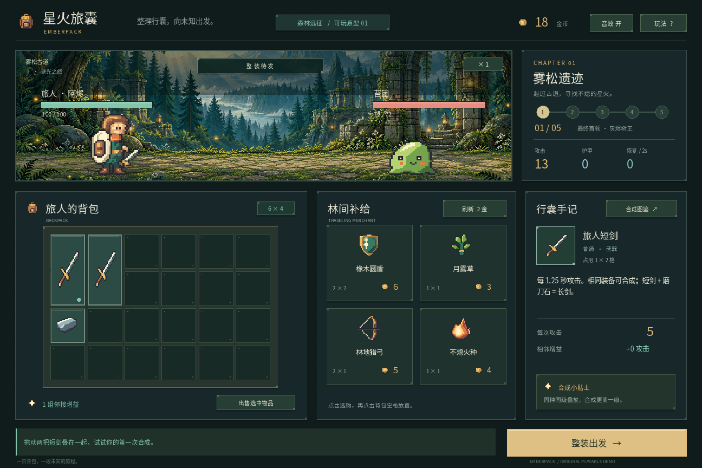

この段階では、操作した結果がすぐ分かることを優先しました。置けない場所へのドロップでは装備と所持金を保ち、攻撃時には装備の発光、ダメージ表示、敵の反応を重ねます。戦闘中もバックパックを見せ、組んだ装備が働いていることを伝える構成にしました。

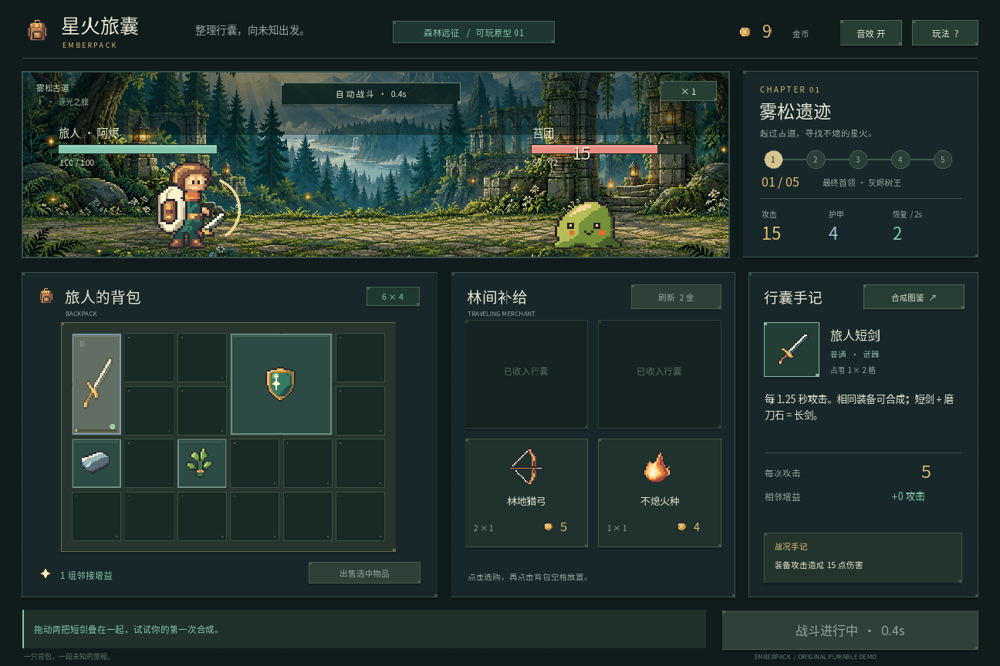

美術は原作の素材を流用せず、Emberpack用に制作しました。キャラクターと装備アイコンは、色を割り当てたピクセル行列をコードで定義し、GodotのImageから生成しています。森林遺跡の背景は内蔵のimagegenで作成しました。深緑と青緑を土台に、象牙色の文字と暖かな金色を合わせ、情報の多い画面でも装備が見つけやすい方向を目指しています。[美術方針と背景生成のプロンプト](../art-direction.md)も残しています。

文字にはNoto Sans CJK SCを使用し、フォントのライセンスと出典を同梱しました。画像生成、コードによる描画、既存フォントの利用は制作方法が異なるため、[素材のクレジット](../asset-credits.md)で区別しています。

v0.2では、装備を12種類に増やし、異なる素材を使う合成レシピを5通りにしました。長剣は2マスから3マスに変更しています。強化したいと思っても、バックパックの整理が必要になるためです。砥石も全方向への加算から、青い接続点が示す方向だけを強化する方式へ変えました。回転は詰め込みのためだけでなく、効果をどこへ向けるかを決める操作になりました。

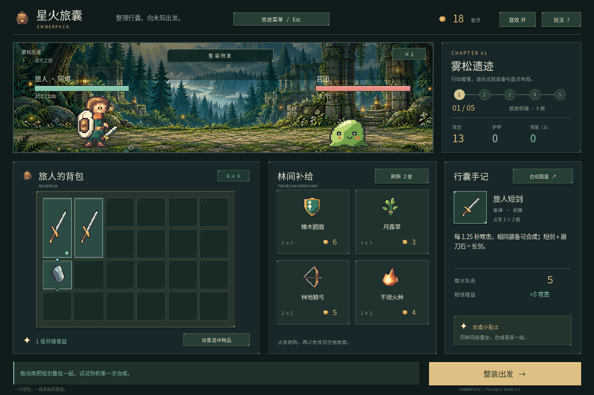

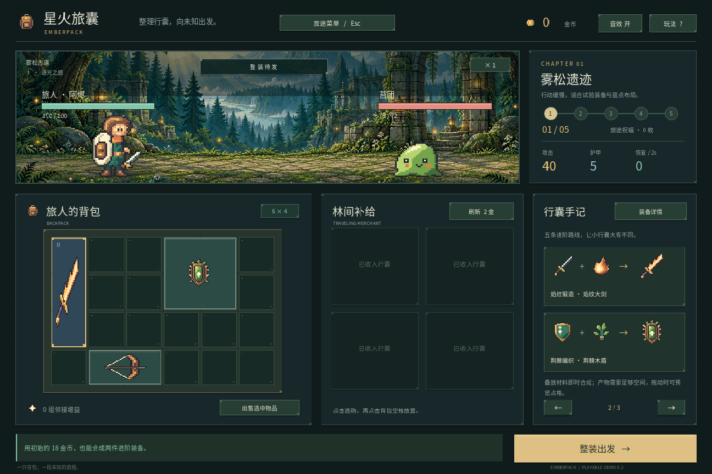

戦闘後には、7種類の祝福から提示される3枚のうち1枚を選びます。攻撃や防御を伸ばすもの、回復や所持金を補うものがあり、一部には別の能力が下がる条件もあります。毎回の買い物だけでは単調になりやすい構築に、次の戦いを見越す選択を加えました。

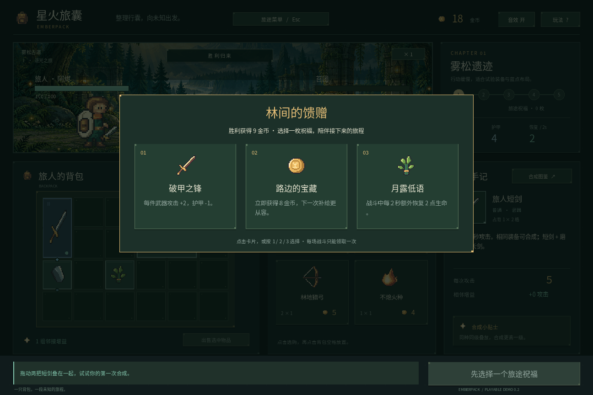

途中で止められるよう、ポーズメニューとJSONセーブも実装しました。保存するのは準備中か戦利品の選択中です。装備の位置や向き、ショップ、所持金、HP、祝福に加え、乱数の状態も記録します。64ビットの乱数値はJSONの数値変換による精度落ちを避けるため、十進数の文字列にしています。

読み込みは、バージョン番号、装備の重なり、座標、祝福の選択状態などをすべて確認してから反映します。書き込みには同じディレクトリの一時ファイルと旧データのバックアップを使いました。接続時の見直しでは、壊れた保存データを新しい遠征で静かに上書きしないこと、保存に失敗したまま開戦しないことも保護の対象にしました。

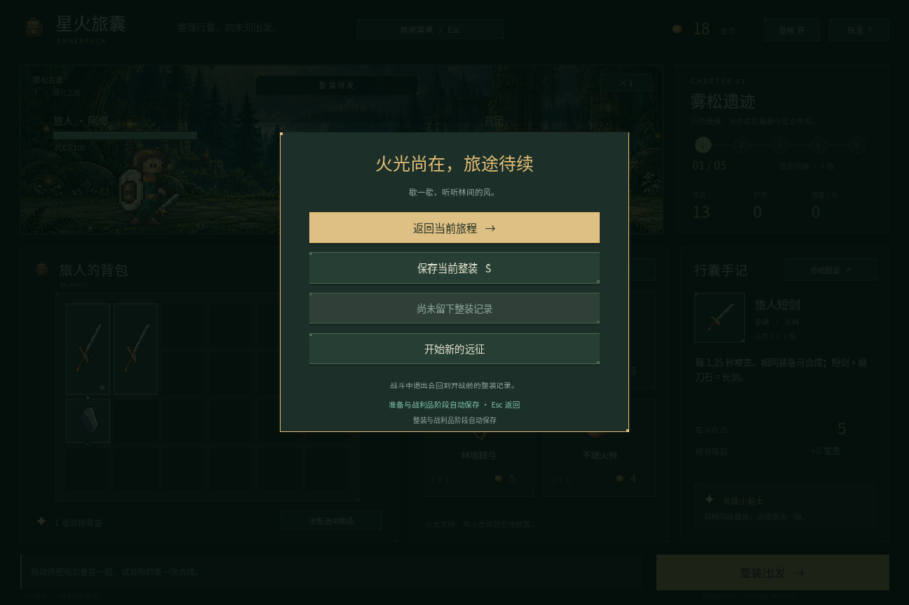

小さな不具合から学ぶこともありました。合成後に、消費された側の装備IDを選択したままにしてしまい、続けて回転や売却ができなくなったことがあります。また、素材の組み合わせだけを見て「合成可能」と表示した結果、完成品を置く空間が足りない場面で誤解を招きました。選択は完成品へ引き継ぎ、プレビューにも完成後のサイズ判定を使うよう直しました。

UIの自動確認では、ヘッドレス実行の仮想ウィンドウが64×64で、ゲームの論理画面1440×960と異なる点にはまりました。実際の入力経路へマウスイベントを送る際は、画面の変換を通した座標が必要でした。ハンドラーを直接呼ぶ確認だけでは気づきにくい差でした。

環境設定にも見落としがありました。.NETの初回起動がユーザーのPATHにツール用の項目を追加していたため、その項目を取り除き、自動追加も無効化しました。「プロジェクト内に展開した」という説明だけでは、初回実行の副作用まで確認したことにはならないと分かりました。

確認項目はv0.1で127件、v0.2ではコアルール126件、保存148件、UI111件の合計385件になりました。購入の失敗で所持金が減らないこと、合成の境界、祝福の二重取得、保存失敗時の旧ファイル維持、5戦の進行などを確認しています。C#ビルドはエラー0件で、上流側の非推奨API警告が3件残っています。これらの数字は確認できた範囲を示すもので、不具合がすべてなくなったことを示すものではありません。

現時点では、デスクトップで遊びの核を確かめるためのデモです。モバイル端末での操作や表示は未検証で、ゲーム内UIも中国語が中心です。次は実際に遊んだ感想をもとに、レシピの説明、装備ごとの役割、祝福の強さを調整したいと考えています。最初から大量の要素を揃えるより、一マス動かした理由が戦闘結果につながる感覚を、もう少し磨いていくつもりです。

実装と更新の記録は[GitHubリポジトリ](https://github.com/zhanghang211202/godot-ai-agent-demo)にまとめています。

## 追記：次の実装の前に、要件とアートの基準を揃える

Demo 0.2 のあと、要件文書と開発計画を整え、アートも改善したいというフィードバックを受けました。そこで参考Wikiを再確認し、三本のYouTube動画のstoryboardを追加で調べました。動画全編を見たわけではなく、観察できた情報と分からない規則を分けて残しています。

改善前の画面では、背景の描き込みとキャラクターの密度が合わず、長い装備を正方形の図から引き伸ばす問題もありました。次は主人公と苔スライム、三つの装備、一画面分のUIを先に実機へ接続し、比率と動きを確かめてから全体へ広げる計画です。文字とUIは読みやすい解像度で、ピクセル素材は専用の形と等比倍率で扱う方針にしました。

v0.3で美術と操作を整え、v0.4で構築・敵の仕組みを増やし、v0.5で初見プレイと配布を検証します。これらは今後の目標で、現時点で新しいアートや炎上システムができたわけではありません。[今回の設計記録](../devlog/2026-10-21-planning.ja.md)と[要件文書](../requirements.md)に、現在との差を記載しました。

## 2026-10-22：最初のアートサンプルが動いた

次の工程として、主人公と苔スライムを64×64の原画へ揃え、待機・攻撃・受傷・退場を一体あたり計14フレームにしました。剣・盾・砥石も占有範囲に合った専用画像へ変えています。皮革のバッグと紙の手記を加え、文字は実際のウィンドウサイズで描くようにしました。

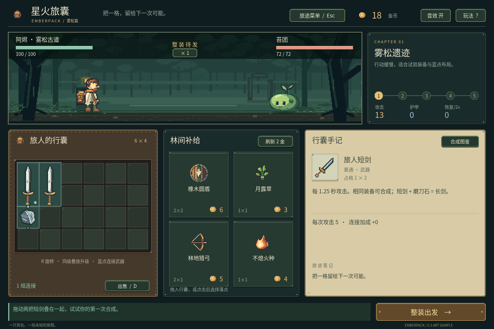

接続して初めて見える問題もありました。ソースを書き込む際の文字コードで中国語が疑問符になり、速度ボタンが敵の体力バーを覆い、中間の横幅では森林画像を範囲外まで読んでいました。実機キャプチャと追加のサイズ検査を使って直しました。画像がきれいに一枚できたことと、画面として動くことは別の確認が必要でした。

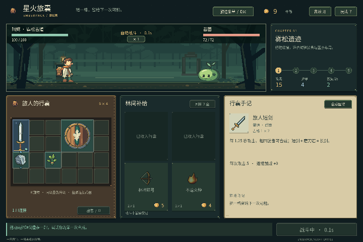

ルールと保存のコードは保ち、今回の確認は合計949項目になりました。ただし、完成したのは主人公・苔スライム・三つの装備を中心にしたサンプルです。残りの装備と敵は旧素材を含み、段階的な説明や属性比較はこれからです。燃焼や新しい敵能力もまだ追加していません。[実装記録](../devlog/2026-10-22-art-sample.ja.md)には、素材一覧と失敗・修正、検証できた範囲を残しました。

## 2026-10-23：主人公の魅力から、世界観を選び直す

次の指摘は、機能よりも「この主人公で遊びたいと思えるか」という点でした。ユーザーが提供した二枚のローカル参考画像を確認し、特に 16-BIT FANTASY と TACTICAL RPG の作例を方向の基準にしました。顔と目、まとまりのある髪束、布と金属の違い、成人の体形、武器の輪郭を読めることが重要です。参考画像から元のスプライト解像度を測定したわけではありません。

遊びの核は残し、バックパック以外の道具で説明できる世界を八つ考えました。月の魔女と咒印星盤、霧の港と機械のモジュール盤、紙術師と折り紙の符陣、海底の王庭と共鳴盤、温室と生きた花壇、軌道聖殿と回路、夕暮れの錬金作業台、騎士と遺物の祭台です。名前はいずれも仮称です。

内蔵 imagegen で、大きな人物立ち絵、同じ人物を置いた戦闘風の場面、格子状の準備道具を一枚ずつまとめました。[八案の比較](../art-style-exploration.md)と[オフライン比較ページ](../concepts/2026-10-23/index.html)を用意し、生成に使ったプロンプトと画像の寸法・ハッシュも残しました。参考として預かった二枚の原画像は公開リポジトリーに含めていません。

きれいなコンセプトができても、そのまま実装素材にはなりません。大きな立ち絵は戦闘用より体形が細長く、背景も細部が多いため、小さい表示では整理が必要です。盤面の格数、価格や線のつながりも生成画像上の提案で、実装済みルールの証拠ではありません。大立ち絵を縮小して全アニメーションに使わず、専用の戦闘スプライトを作り、背景と実際のウィンドウで顔・髪・武器が読めるか確かめます。

開発順序は、世界観の選択、同じ主人公の三つの造形案、キャラクター・背景・UIと一戦の実機サンプル、その後の全量制作へ変更しました。今回更新したのは文書とコンセプト資料で、ゲーム側の差し替えや新アニメーションはまだ行っていません。6×4の配置、回転、合成、方向付き支援、自動戦闘、12装備・5配合・7祝福・5戦の枠は保ちます。[今回の記録](../devlog/2026-10-23-art-exploration.ja.md)に検証と未実施の項目を分けました。

## 2026-10-23：八つから一つを選ぶのではなく、職業ごとの世界にする

コンセプトを見たユーザーから、ゲーム自体を複数の職業へ広げたいという方針が出ました。バックパックは引き続き核に置き、各キャラクターが異なる資源の集め方、組み合わせ方、戦い方と背景を持ちます。魔法師は完成武器を買うだけでなく元素を吸収して強い魔法を編み、後続の錬金術師は自分への強化や薬の混合を中心にする、という方向です。

初期は魔法師とH案の近接騎士の二職業に絞り、各職業に最低三つの構築を計画しました。魔法師は元素編織・契約召喚・奥術循環、騎士は重刃破陣・盾誓反撃・連撃追猟を仮案としています。これらの名称と細則は設計案で、実装済みの機能ではありません。錬金術師は後続に置き、八枚の画像をそのまま八職業の制作約束にはしません。

職業差は、顔と技の色を変えるだけでは足りません。召喚は実際の行動主体と上限を持ち、循環は返還と消費を示し、盾の反撃は元の防御イベントへ結びつける必要があります。各構築に取得経路、空間の機会費用、得意と弱点、確認すべき条件を記した[設計文書](../classes-and-builds.md)を追加しました。「手で魔法を作る」は、まず戦前の組み合わせとして解釈し、戦中は自動実行を保つ設計仮説にしています。

開発順序は職業の仕様と共通基盤、一職業一構築ずつの一戦切片、二職業六構築の五戦、教学・調整・Windows配布へ整理し直しました。最初の二構築が動いても、六構築の完成とは数えません。従来の12装備・5配合・7祝福は現在のサンプルの事実として残し、新職業の物量は最小の必要リストから決めます。今回は文書だけを更新し、ゲームコードと保存形式には触れていません。[今回の要件整理記録](../devlog/2026-10-23-dual-class-planning.ja.md)に検証範囲と未決項を残します。

## 2026-10-24：元素を編み、重刃を鍛える最初の一戦

最初に動かしたのは、新しい人物の完成版ではなく職業の資源ルールです。独立したGodotシーンに法師と騎士を置き、法師は回数の限られた元素源から吸収し、騎士は限られた所持金で武装を買う形にしました。どちらも6×4へ実物を配置し、置けないときは材料・回数・お金を失いません。

火と基礎術式から四マスの集中爆発を作り、水と風から横三マスの三段法術を作ります。騎士は長剣と蓄勢の印から六マスの重刃を鍛造します。同じ印をもう一つ買い、鍛造せず方向支援に残す選択もあります。原料を使うのは戦前の組み合わせで、MPや施法後の元素回収はまだ実装していません。

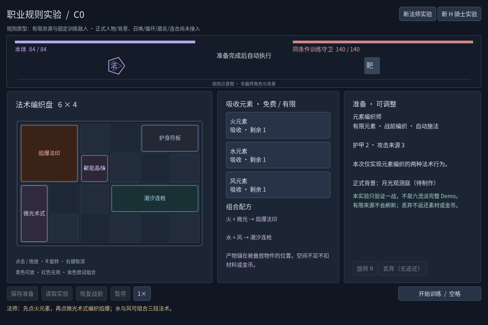

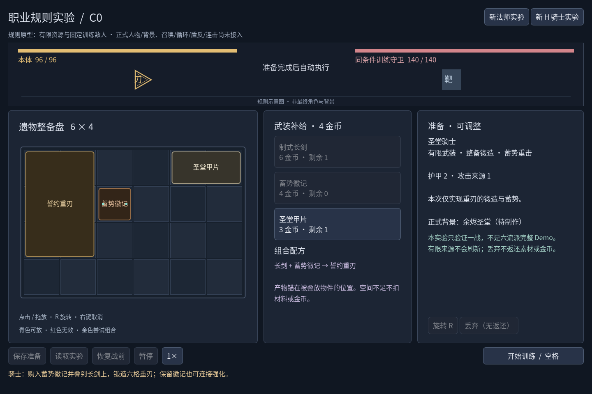

同じ訓練相手に自動戦闘を行い、法術や武器ごとの有効ダメージ、発動数、命中数を結果へ出しました。固定fixtureのルール内時間は法師8.60秒、騎士11.00秒でした。これは開発にかかった時間でも、二職業が釣り合った証拠でもありません。取得操作と結果JSONを残し、どの配置からその数字になったか追えるようにしています。

操作を接続した際には、ドラッグ中にRを押すと見た目だけ回転し、落とすと古い方向が使われる問題が見つかりました。Godotのドラッグ用データと、現在の選択状態が別の辞書だったためです。同じ物件・同じ供給元のときだけ現在の方向を採用し、実際の入力イベントによるドラッグで確認しました。ボタンにフォーカスがある場合も、空白キーで訓練を開始できるようにしています。

保存は旧遠征と分けました。新しい実験ファイルは職業、物件、残り取得回数に加え、使った材料と捨てた材料の帳簿も確かめます。強い武器だけをJSONへ足しても、元の材料が一致しなければ読みません。旧遠征を騎士へ自動変換する処理は入れず、従来の入口で再開します。

新しい確認623項目と、実際に再実行した旧サンプル949項目はすべて失敗0でした。ただし巨大な指数を含む壊れた保存データの検査では、Godotの解析警告が二回出ています。実機の規則fixtureを9枚と結果JSONで保存しました。人物と背景はまだ図式で、召喚・循環・盾反撃・連撃も未実装です。[実装記録](../devlog/2026-10-24-class-rules.ja.md)と[実際の範囲](../iteration-c0-rules.md)に、次に確かめるべき境界を残しています。

## 2026-10-24：六つの人設稿を、全身と顔と小さな輪郭で見る

次は人物の魅力を具体的に比較しました。内蔵imagegenで魔法使いとH騎士をそれぞれ三案ずつ生成し、[オフライン比較頁](../concepts/2026-10-24-characters/index.html)とGodotの静的審稿台へ並べました。魔法使いは帽子の礼装、旅装、両手の元素。騎士は槍旗、剣盾、重刃です。三つの外観が三つの構築を実装したという意味ではありません。最終的な顔、性別、衣装もまだ選んでいません。

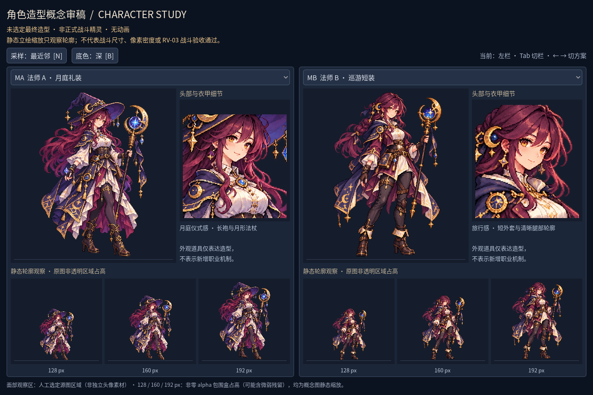

顔を見せる欄にも修正が必要でした。原図の上三分の一を使うと、長槍や大剣の先と余白が入り、肝心の顔が小さくなりました。六枚の目と髪束がある領域を一枚ずつ指定すると、比較できる大きさになりました。これは描画時の観察範囲で、切り出した素材を完成した顔アイコンやspriteとして扱ってはいません。

立ち絵の細部は豊かになった一方、小さくすると金飾りや長い裾が雑音になります。旅装の法師にも長杖が残り、軽装の騎士にも厚い甲と大きな盾が残りました。原図のalphaにも弱い残留があり、まだ生産用に整理された透過素材ではありません。こうした差を[実図の審査](../character-design-review.md)へ書き、綺麗な概念ができた段階と、戦闘用の論理ピクセルを設計する工程を区別しました。

今回の確認は審稿台148項目、Chrome上の比較頁22項目がいずれも失敗0です。Godotの三解像度と起動入口で四枚を記録しました。旧規則1572項目は今回再実行していません。選択後は専用戦闘フレームを別に描き、各背景・地面・UIで読みやすさを調べてから動作へ進みます。[日本語の開発記録](../devlog/2026-10-24-character-studies.ja.md)にプロンプト、測定、修正、未検証の環境を残しました。

## 2026-10-24：二人ともAを基準にする

比較の結果、ユーザーは「二人ともA」と決めました。魔法使いは広い帽子、紫紅の長髪、重ねた裾と月牙の杖。騎士は栗色の高いポニーテール、象牙と金の甲、赤いマントと槍旗を残します。[採用する特徴と制作順](../character-baselines.md)を別に記し、比較頁の案内とGodot審稿台の初期表示をMA＋KAへ揃えました。HTMLの職業内比較は引き続き他案も見られます。

長槍の人設を選んでも、動いている重刃ルールを槍の攻撃へ置き換えたことにはしません。重刃を使う切片はKAの顔・髪・衣甲を保ち、両手で重刃を持つ専用姿勢を別に描きます。長槍の正式動作やルールは後で検証します。人設の選定と、実装素材が戦闘画面で読めることは別の工程です。

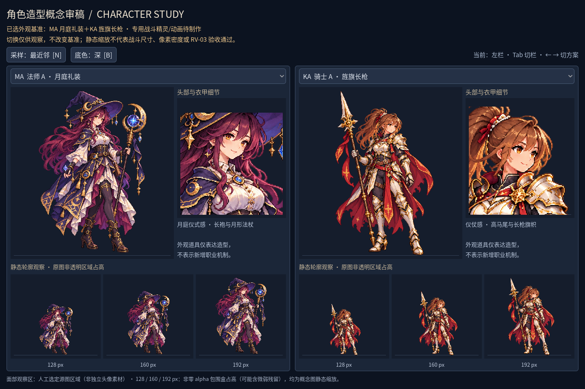

選定反映の作業は途中で停止したため、2026-10-25に再開して完了しました。審稿台148項目とブラウザー22項目を実際に再実行し、失敗は0でした。選定前の原PNG、生成プロンプト、マニフェストと撮影は保持しています。[選定反映の記録](../devlog/2026-10-25-character-selection.ja.md)に確認内容をまとめました。
