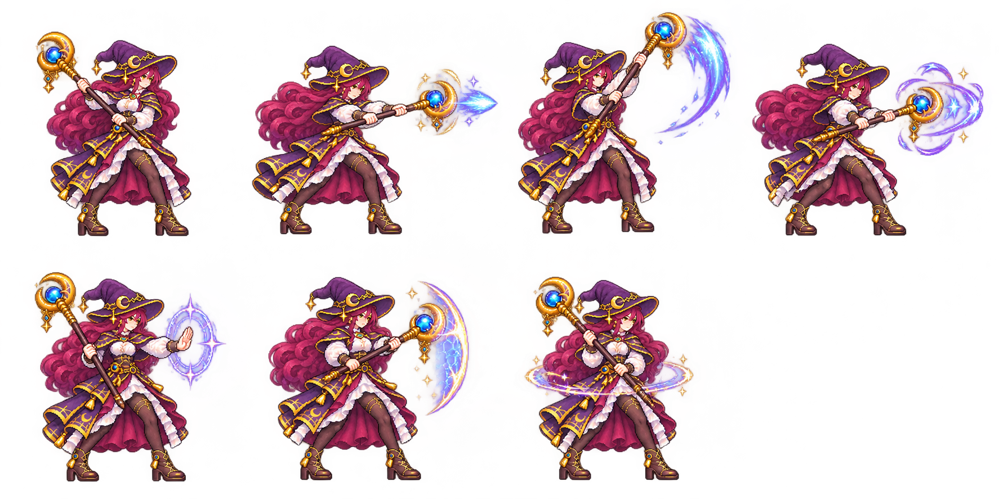
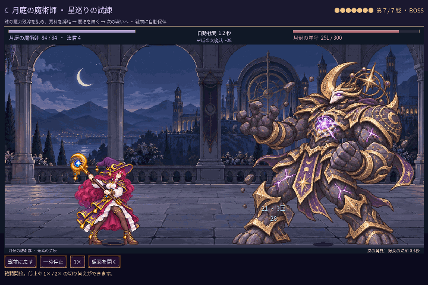

# CodexとGodot MCPを使って、AIとゲームを作ってみた

こんにちは。今回はCodexにお願いしながら、Godotでゲームを作ってみました。

きっかけは『Overgeared Hero（靠装勇者）』というゲームです。バッグに武器や道具を並べて準備すると、キャラクターが自動で戦います。道具の置き方や組み合わせで戦い方が変わるのが面白くて、「こんなゲームをAIと一緒に作れるかな？」と思ったのが始まりです。

参考にWikiを調べ、YouTubeでは動画のプレビュー画像を何枚か確認しました。動画全体を見たわけではないので、細かいルールはそのまま再現せず、自分なりのゲームとして作っています。

## 今回使ったもの

- **Codex**：作りたいものの整理、プログラムの作成、修正、動作確認。
- **Godot**：ゲームを作って動かすためのソフト。今回は.NET版を使いました。
- **[Godot MCP](https://github.com/IvanMurzak/Godot-MCP)**：CodexとGodotをつなぐ道具。ゲームの状態や、動きを作る設定などを確認できます。
- **GPTの画像生成**：Codexに絵をお願いすると、必要に応じて画像を作る道具を使い、キャラクターや背景などの候補を作れます。

.NET SDKなどの開発用の道具は、プロジェクト内に置いています。Codexにはファイルを直接編集してもらうこともあったので、すべての作業がGodot MCP経由というわけではありません。

## どのように作ったか

### 1. まずは一回戦えるようにする

まずは、道具を並べて一回戦えるところから作りました。横6マス・縦4マスの場所に道具を置き、向きを変えたり、組み合わせたりして戦いに備えます。戦いが始まると、キャラクターは自動で攻撃します。

作っている途中で、道具を動かしながら向きを変えると、置いた後の向きが違ってしまう問題も見つかりました。「置けない場所に置こうとしたとき、材料をなくさない」といった細かい条件も含めて、Codexに伝えて直してもらいました。

### 2. キャラクターと背景を決める

最初はバッグに道具を入れる設定でしたが、途中で「キャラクターごとに違う戦い方ができるゲームにしたい」と考えました。まず作ることにしたのは魔法使いです。道具を買うだけではなく、火・水・風の力を集めて、魔法を作る設定にしました。

主人公と背景は、昔のゲームのようなファンタジーの絵をいくつか作ってもらい、好みのものを選びました。ただ、キャラクターの絵をよく見ると、手が足りなく見えたり、別のポーズで杖が短くなったりすることもありました。動いたときに別人に見えないかも含め、絵を見ながら調整しています。

待機、攻撃、防御の姿勢を一枚にまとめた画像です。

### 3. 魔法を組み合わせ、戦いを増やす

マス目の中では、集めた力を重ねて魔法を作ったり、魔法を強くする道具を隣に置いたりできます。たとえば水と風を組み合わせると、続けて攻撃する魔法になります。水と結晶の道具を組み合わせると、一緒に戦う小さな仲間を呼べます。

戦いに勝つと、敵から魔力のかけらを手に入れます。画面では「残滓（ざんし）」と表示されているもので、次の戦いに向けて、新しい材料や道具に変えることができます。

今のゲームは全部で七回戦い、最後にボスが登場します。いくつかの道具の組み合わせで最後まで進めるか確認しましたが、遊んでいてちょうどよい難しさになっているかは、まだ調整が必要です。

### 4. 魔法を出す動きを直す

魔法使いの動きには、GodotのAnimationPlayerを使っています。待機姿勢から、三つの攻撃姿勢を選んで魔法を出します。複数の魔法が同時に出るときも動きは一つですが、それぞれのダメージは計算されます。魔法の盾で敵の攻撃を弱めたときは、三つの防御姿勢から一つを表示します。魔法を出している途中なら、攻撃の動きは変えずに盾の光だけを重ねます。

動きを作ると、別の問題も出てきました。途中のポーズの絵は、前後の絵と顔や髪が違って見えます。体全体を傾ける動きも試しましたが、こちらも不自然だったのでやめました。今は杖を構えたポーズから魔法を出すポーズに直接切り替えています。まだ少し急に見えるので、今後も直していきたいところです。

### 5. 画面を見ながら直す

実際の画面を見ると、敵が思ったより小さかったり、道具を並べる場所が画面を取りすぎていたりしました。「敵をもっと大きく」「戦いの画面を広く」と伝えて直してもらい、開発中に使っていた表示も減らしました。

Godot MCPを使って、CodexとGodotがつながっているか、プログラムにエラーがないか、キャラクターが動くタイミングはどうなっているかも確認しました。

## 作ってみた感想

最初は「似た遊びを作れるかな？」というところから始めましたが、魔法を組み合わせて準備し、ボスと戦うところまでできました。途中で設定を変えたり、画面を見て気になったところをそのまま言葉で伝えたりしながら進められたのは面白かったです。

一方で、きれいな絵でも動かしてみると違和感が出たり、最後まで勝てる組み合わせがあっても難しさがちょうどよいとは限らなかったりします。動きとゲームのバランスは、もう少し遊びながら直していきたいです。

最近はAnthropicの**Claude Fable 5.2**でゲームを作った例も見かけました。[紹介記事](https://cellcog.ai/blog/fable-5-2-one-shot-game-cost/)によると、Anthropicの開発者が短い指示から、自分の目線で敵を狙うゲームを作ったそうです。開発者の報告では約8時間、APIの料金にすると約550ドルかかったとのこと。今回のゲームでは使っていませんが、こういう例を見ると、3Dのゲームも試してみたくなります。

今回のソースコードは[GitHub](https://github.com/zhanghang211202/godot-ai-agent-demo)で公開しています。

次は、新しいモデルと3Dの形を作るソフト「Blender」を組み合わせて、3Dのゲーム制作にも挑戦してみたいと思います（結構お金がかかりそうですが……）。
