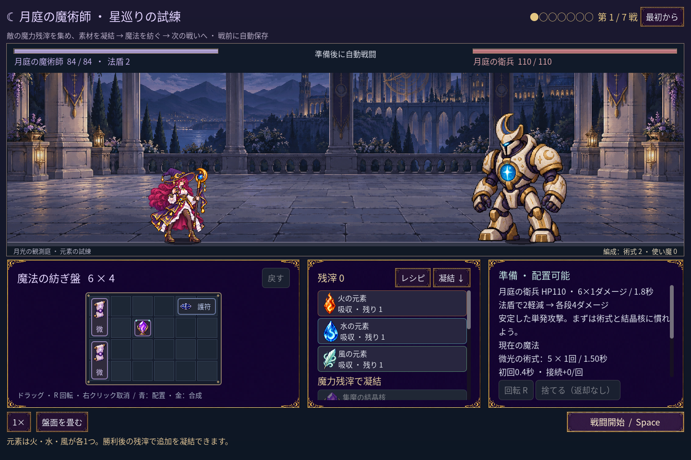
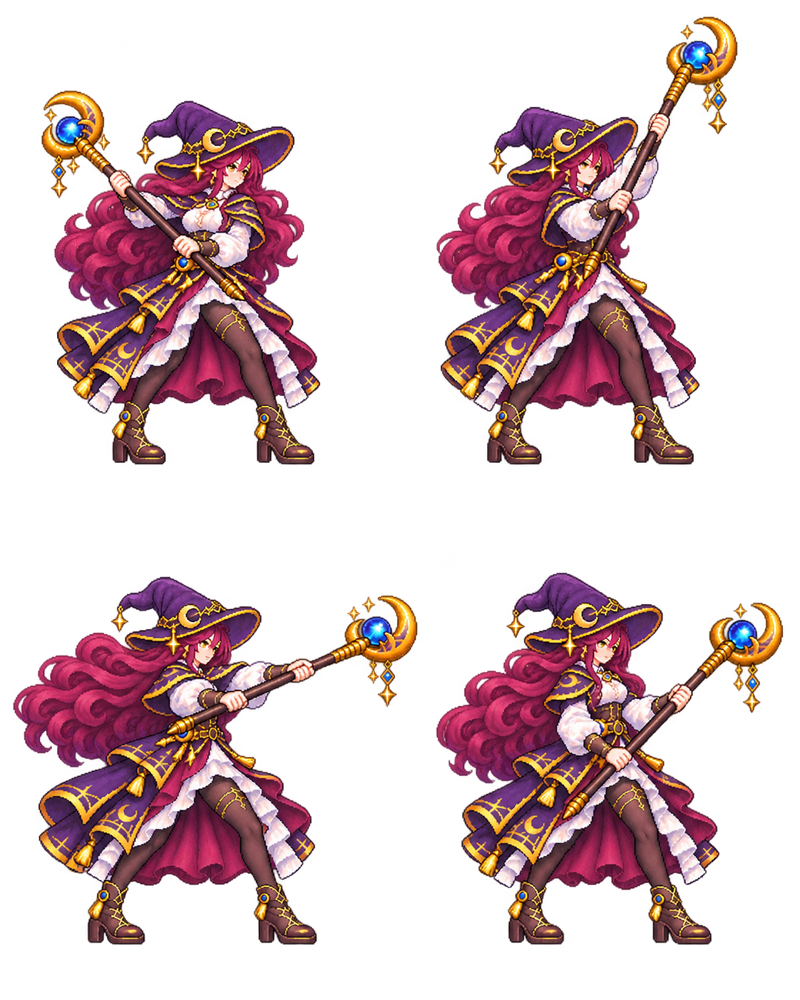
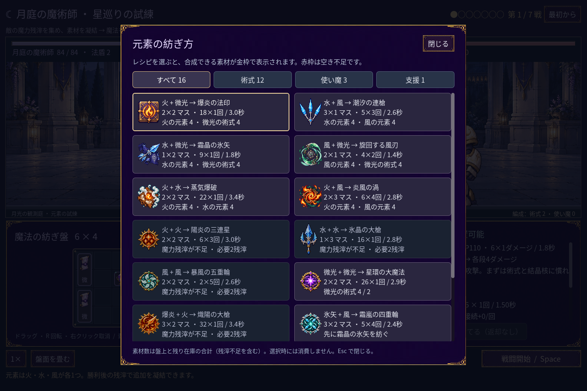
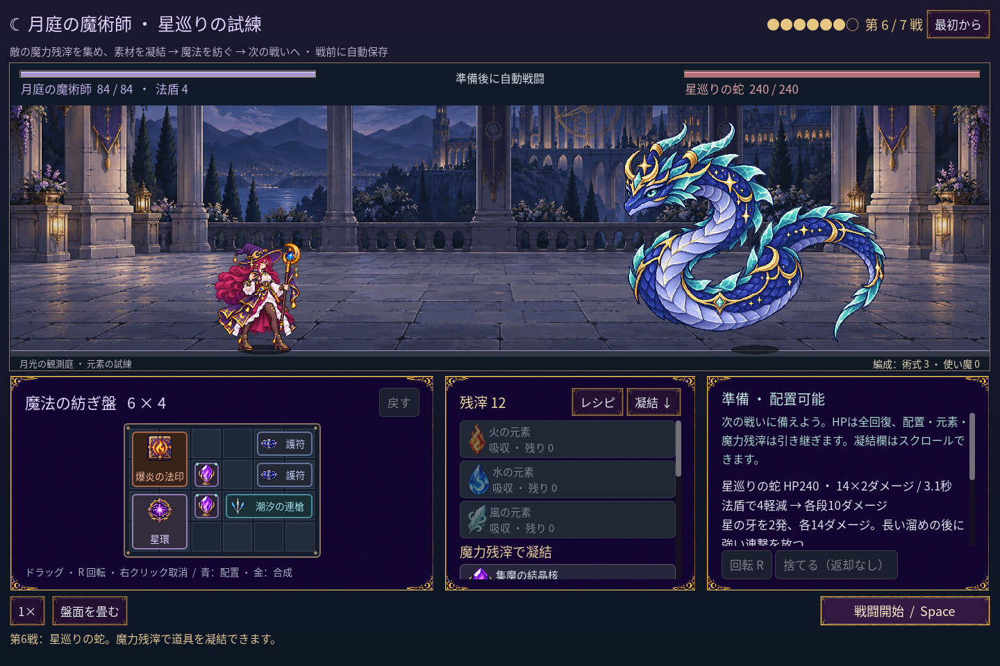
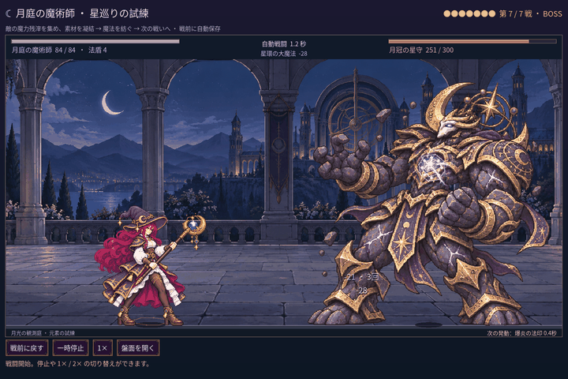

# CodexとGodot MCPを使って、AIとゲームを作ってみた

こんにちは。今回は、AIにやりたいことを言葉で伝えながら、ゲームを作ってみた話です。

きっかけは『Overgeared Hero（靠装勇者）』というゲームでした。バッグの中に武器や道具を並べ、組み合わせて準備すると、あとはキャラクターが自動で戦います。道具の並べ方で戦い方が変わるのが面白く、「似た遊びをAIと一緒に作れないかな？」と思いました。

参考にWikiとYouTubeの動画を調べました。動画は全部を見たわけではなく、YouTubeの小さなプレビュー画像を何枚か確認しています。分からない細かいルールは決めつけず、まずは遊べる小さなゲームを目指しました。

## 今回使ったもの

- **Codex**：作りたいものの整理、プログラムの作成、修正、動作確認。
- **Godot**：ゲームを作って動かすためのソフト。今回は.NET版を使いました。
- **[Godot MCP](https://github.com/IvanMurzak/Godot-MCP)**：CodexとGodotをつなぐ道具。ゲームの状態や、動きを作る設定などを確認できます。
- **GPTの画像生成**：Codexに絵をお願いすると、必要に応じて画像を作る道具を使い、キャラクターや背景などの候補を作れます。

.NET SDKなど、開発に必要な道具はプロジェクト内に置きました。Codexはゲームのファイルを直接編集することもあり、すべての作業をGodot MCP経由で行ったわけではありません。

## どのように作ったか

### 1. まずは一回戦えるようにする

最初から大きなゲームを目指すと、どこまでできたのか分かりにくくなります。そこで、横6マス・縦4マスの場所に道具を置き、向きを変えたり、組み合わせたりして、自動で戦うところから作りました。

「置けない場所に道具を置こうとしても、材料はなくならない」といった細かい条件も、言葉で伝えました。実際に、道具を動かしている間に向きを変えると、置いた後の向きが違ってしまう問題が出たので、直してもらいました。

### 2. キャラクターと背景を決める

最初はバッグに道具を入れる設定でしたが、途中で「キャラクターごとに違う戦い方ができるゲームにしたい」と考えました。まず作ることにしたのは魔法使いです。道具を買うだけではなく、火・水・風の力を集めて、魔法を作る設定にしました。

主人公と背景は、昔のゲームのようなファンタジーの絵をいくつか作ってもらい、好みのものを選びました。できた絵はそのまま使うのではなく、手が二つあるか、杖が途中で切れていないか、動くと別人に見えないかを確認しています。

ゲームで使っている、杖を振るときの四つのポーズです。

### 3. 魔法を組み合わせ、戦いを増やす

マス目の中では、集めた力を重ねて魔法を作ったり、魔法を強くする道具を隣に置いたりできます。たとえば水と風を組み合わせると、続けて攻撃する魔法になります。水と結晶の道具を組み合わせると、一緒に戦う小さな仲間を呼べます。

戦いに勝つと、敵から魔力のかけらを手に入れます。画面では「残滓（ざんし）」と表示されているもので、次の戦いに向けて、新しい材料や道具に変えることができます。

今のゲームは全部で七回戦い、最後にボスが登場します。いくつかの道具の組み合わせで最後まで進めるかも確認しました。ただ、最後まで進めても、遊んでいてちょうどよい難しさとは限らないので、そこはまだ調整中です。

### 4. 魔法を出す動きを直す

魔法使いの動きには、Godotでキャラクターを動かすためのAnimationPlayerを使っています。複数の魔法が同時に出るときは、ダメージの計算はそのままに、魔法使いの動きだけを一つ選びます。魔法の盾で敵の攻撃を弱めたときは、光る盾が出るようにしました。

ただ、動き作りは簡単ではありませんでした。途中の動きとして作った絵は、顔や髪が前後の絵と違って見えました。体全体を傾ける動きも試しましたが、不自然に見えたのでやめました。今は杖を構えたポーズから魔法を出すポーズに直接切り替えています。まだ動きをなめらかにしたいところです。

### 5. 画面を見ながら直す

画面を確認して「敵をもっと大きく」「道具を並べる場所より戦いの画面を広く」「開発用の表示を減らして」と伝え、少しずつ直しました。一度お願いするだけで思い通りになるわけではなく、できたものを見て、気になるところを伝える作業の繰り返しでした。

Godot MCPを使って、CodexとGodotがつながっているか、プログラムにエラーがないか、キャラクターが動くタイミングはどうなっているかも確認しました。

## 作ってみた感想

言葉でお願いするところから、実際に動くゲームまで作れたのは面白い経験でした。途中で設定を変えたり、「この絵の手がおかしい」「動きが変」と伝えて直したりできるのも、AIと一緒に作る良さだと思います。

一方、絵がきれいでも動かすと変に見えることがあります。プログラムに問題がなくても、ゲームの難しさがちょうどよいかどうかは、遊んでみないと分かりません。今は魔法使いを中心に遊べるところまでできましたが、動きや難しさはまだ直していきたいです。

最近はAnthropicの**Claude Fable 5.2**でゲームを作る例も話題になっています。Anthropicの開発者は、短いお願いから、自分の目線で敵を狙うゲームを作ったと報告しています。[紹介記事](https://cellcog.ai/blog/fable-5-2-one-shot-game-cost/)によると、約8時間かかり、プログラムからAIを使う場合の料金にすると約550ドルだったそうです。これはその開発者の報告で、今回のゲームにはFable 5.2を使っていません。

今回のソースコードは[GitHub](https://github.com/zhanghang211202/godot-ai-agent-demo)で公開しています。

次は、新しいモデルと3Dの形を作るソフト「Blender」を組み合わせて、3Dのゲーム制作にも挑戦してみたいと思います（結構お金がかかりそうですが……）。
