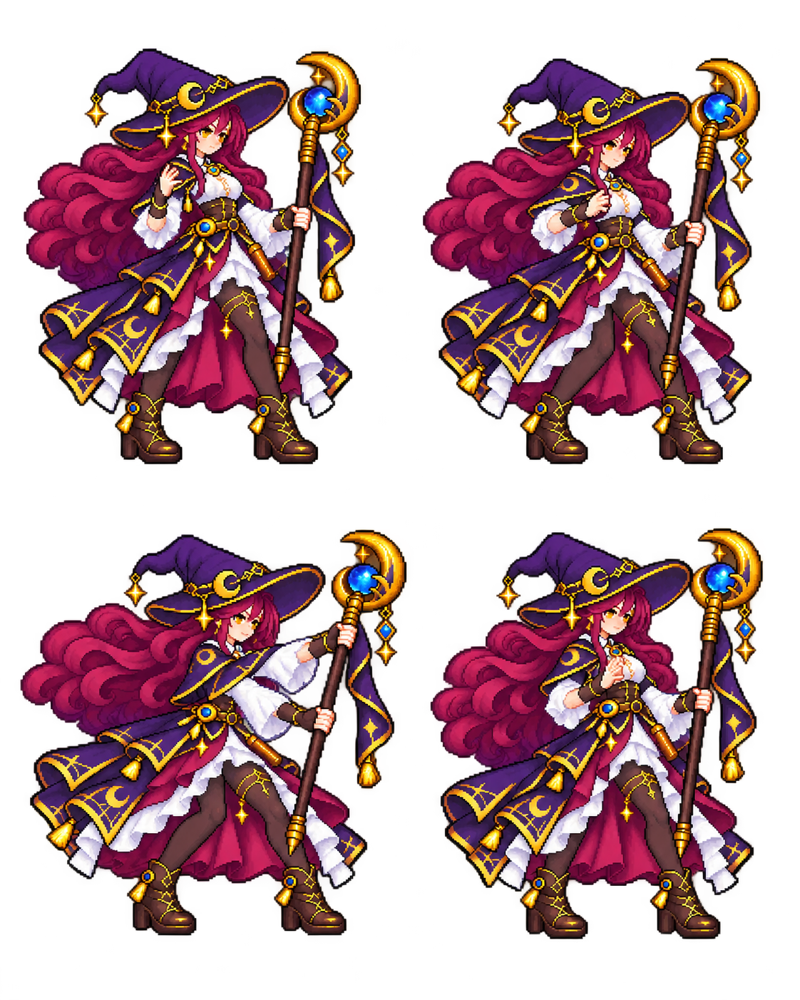

# ピクセル整理の不採用記録

生成：2026-10-26、評価完了：2026-10-27（JST）。内蔵imagegenの編集モードで、既存の専用動作図集を参照し、輪郭・色階・手と長い武器の一貫性を改善する試験を行いました。全三案を不採用とし、ゲームの原図は置き換えていません。

法師は見た目の色面が少しまとまりましたが、alphaが0より大きく128未満の画素は65,104から113,715へ増加しました。alpha≥128の可視RGB色数も304,850から296,361にとどまり、規定パレットや論理格子へ整理されたとは言えません。元と同じ1122×1402です。二つの手は残っていますが、輪郭整理の合格にはしません。

長剣案は顔と衣甲を簡略化しすぎ、重刃案は色にじみとセル端問題の改善が十分ではありませんでした。こちらの不採用PNGは公開資産へ加えていません。[逐字プロンプトと出力識別子](prompts.json)は三案とも残しました。[測定](measurements.json)はPNGを読んだ観測で、原画の加工ではありません。

実装側では別に、元PNGを変えずにキャラクター専用Shaderでalpha<0.5を描かず、残った内部を不透明にする描画処理を導入しました。これで源画のRGB色にじみ、論理格子、人物比率まで修正できたことにはなりません。実際の確認は[戦闘フィードバック記録](../../devlog/2026-10-27-c1-feedback.ja.md)へ分けました。
