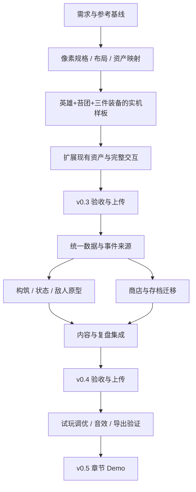

# 星火旅囊 / Emberpack：开发计划

版本：1.0 · 2026-10-21（JST） · 对应[产品需求 v1.0](requirements.md) · 当前实现：v0.2 / `0e90bcb`。

本计划从已有可玩 Demo 继续推进。下一轮先解决美术一致性、操作说明和反馈，再增加构筑与敌人机制，最后做平衡与离线试玩包。**M1–M3 均尚未实现**；下面的任务与验收是计划，不是完成报告。

## 1. 里程碑与范围

| 阶段 | 交付 | 主要内容 | 退出条件 |
| --- | --- | --- | --- |
| M0 · 本轮文档 | 需求和路线基线 | 参考证据、现状差距、需求、美术规格、可执行任务、验收方式 | 文档互相一致，区分已做/未做，链接和资产引用有效 |
| M1 · v0.3 | 可运行的视觉与交互升级 | 样板先行，统一像素比例、角色动画、现有装备和祝福资产、界面层级、教学与预览 | 现有 12 装备/5 配方/7 祝福/5 战仍可玩；样板与最终实机通过对比验收 |
| M2 · v0.4 | 能验证的三种构筑 | 数据统一、1 种灼烧、3 敌人机制、16 装备/8 配方/9 祝福、商店锁定/权重、复盘 | 三种合法构筑能完整走一局；来源统计、说明、存档与规则一致 |
| M3 · v0.5 | 可分享的章节 Demo | 小样本试玩、难度与经济调优、声音收尾、Windows 导出、缺陷修复 | 首次用户可独立上手；五战流程稳定；干净环境离线运行；证据和说明齐全 |

按依赖顺序推进，不先承诺日历工期。样板通过后记录实际产出速度，再为剩余素材估算工作量；每个阶段都可独立试玩、截图和上传。若某阶段过大，按下列任务拆分提交，不以一次大改覆盖全部系统。

## 2. M0：本轮文档工作

- [x] 重查用户 Wiki、官方说明和三条 YouTube 实机的多段 storyboard。
- [x] 审计 v0.2 的代码、规则、UI 与实际截图。
- [x] 建立产品需求、分阶段计划和美术规格。
- [x] 将首版 Demo 计划明确标成历史资料，建立新的文档入口。

本轮不制作新游戏资产、不改游戏规则。已有 v0.2 截图用作现状证据，不作为未来美术的成品预览。提交前的链接、文档一致性与 Git 检查结果写入日语开发日志。

## 3. M1 / v0.3：先建立能运行的美术基线

### M1-A：布局与资产接口

**对应 FR-03 / 06 / 13，NFR-03 / 05。**

任务：

- [ ] 保留 `EmberRun`、`EmberSave` 的对外规则行为；先记录固定整装、合成、奖励和战斗 fixture 的基线。
- [ ] 从 `main.gd` 提取资产目录/映射、尺寸和颜色主题；拆出背包、商店、详情、奖励及菜单显示组件，按功能渐进替换。
- [ ] UI 按输出窗口布局、中文文字原生绘制；像素资产使用约定尺寸和整数倍率，消除方图长条拉伸。
- [ ] 先完成 1280×800 与 1440×960 的布局，检查 1920×1080；采用可伸缩容器或统一布局计算，不再散落固定点击坐标。
- [ ] 修正模态遮罩未铺满视口、交互区与显示区不一致、战斗时仍像能购买等问题。

交付：组件边界说明、资产注册表、可运行旧资产适配层、三种尺寸的布局检查。暂不在重构中加入新状态/配方/敌人技能。

退出条件：同一输入 fixture 的背包、资源和战斗结果不变；现有检查无回归；能在两种主验收尺寸正确拖放和选奖励。

### M1-B：一张完整的实机美术样板

**对应 FR-13 / 14。**

- [ ] 统一原创墨绿森林、旧铜金、象牙白、围巾橙的色板与左上光源。
- [ ] 制作英雄和苔团的待机/攻击/受击/退场帧，接入脚底锚点和等比显示。
- [ ] 制作短剑、盾、磨刀石的缩略图与真实占格图，不通过拉伸表达长度。
- [ ] 做一套背包皮革边、商店卡、手记纸张与主按钮状态，控制装饰密度。
- [ ] 调整森林背景的颗粒、地面和角色对比；定义场景层与角色层共享尺度。
- [ ] 接入剑击、箭矢、恢复、反伤、合成五类反馈样例，效果只消费事件，不能驱动伤害。

交付：一个可运行的整装和战斗样板，实际截图/短录屏、色板和源图。**先在实机上验证尺寸、识别和节奏，再批量制作其他素材。**

退出条件：美术规格 VA-01 至 VA-06 在**当期样板资产范围**内通过（英雄、苔团、三件装备及五类反馈样例）；12 装备与全部角色的全量验收留到 M1-C。主角不被拉宽，长装备不变形，地面不漂浮；不看说明也能分辨剑击、弓箭、恢复、反伤。仍用 v0.2 的真实规则，火焰效果不得冒充尚未实装的灼烧。

### M1-C：扩展资产与上手体验

**对应 FR-02 / 03 / 05 / 06 / 13。**

- [ ] 扩展现有 12 装备的专用缩略图和占格图、7 个祝福的独立图标。
- [ ] 将狼、哥布林和树系敌人扩展到同一标准；精英与 Boss 有可见轮廓/动作区别，控制重复素材成本。
- [ ] 完成按实际操作推进的可跳过教学，退出教学后可正常存档继续。
- [ ] 独立设置文件先保存教学已完成/已跳过标记，跨启动不强迫重复教学；允许从菜单重看。其余音量与显示设置在 M2-A 扩展，远征重开不清教学设置。
- [ ] 详情补足护甲、反伤、回复、药水数值及单件/全局作用范围。
- [ ] 拖放展示占格、合成产物及空间失败原因；显示购买、旋转、合成的属性前后变化。
- [ ] 配方图鉴标记拥有与缺少材料、产物大小；图鉴空间检查基于当前放置方案，不声称能自动求解所有搬动组合。
- [ ] 增加整装最近一步的移动/旋转/背包内合成撤销，按需求限定清除时机，撤销后自动保存。

退出条件：不增加规则内容也能明显改善上手与画面；12/5/7 的内容预算保持；教学、撤销、预览与存档专项检查通过；按美术规格保留整装/战斗/合成/祝福/菜单截图。

v0.3 不提前加入商店权重和锁定、灼烧、三种敌人技能或新增 4 件装备，避免同时改表现、经济和战斗。

## 4. M2 / v0.4：让构筑与敌人产生真实区别

### M2-A：统一数据、事件与保存格式

**对应 FR-01 / 06 / 08 / 12，NFR-01 / 05。**

- [ ] 建立统一装备定义：稳定 ID、类别/标签、占格、价格、单件数值、全局数值、触发条件、配方、美术键、描述模板。
- [ ] 划清武器自己的伤害/间隔与全局暴击、护甲、回复；从同一数据生成详情、图鉴和模拟配置。
- [ ] 统一战斗事件字段：事件 ID/时间、来源物品 ID、目标、类型、数值、是否暴击、状态 ID；定义反伤/状态伤害不再递归触发反伤的边界。
- [ ] 普通无存档首局生成随机种子；测试与截图显式使用固定种子；继续沿用保存的随机序列。
- [ ] schema 2 提供 schema 1 → 2 迁移，新增商店锁定/字段给确定默认值，迁移前保留原档备份，未来版本拒绝读取。
- [ ] 扩展 M1 已建立的独立设置文件，加入音量等选项；保持教学状态、音量不因死亡重开消失。

交付：装备和事件 schema 文档/数据、合法/损坏旧档 fixture、迁移测试。迁移成功后旧背包/金币/商店/祝福与 RNG 不变，不能通过迁移重新抽商店。

### M2-B：三路线与三类敌人机制的规则原型

**对应 FR-07 / 08 / 09 / 10。**

- [ ] 写出焰刃、猎弓、荆棘的核心装备、资源投入、空间占用、优势/短板和合法购物序列。
- [ ] 只加入灼烧一种新状态。定稿前明确：首次 tick 时刻、伤害周期/持续时间、重新施加是刷新还是叠层、是否受护甲、来源归属、与死亡/反伤的结算顺序。
- [ ] 做狼的连击、哥布林的阶段护盾、Boss 的蓄力重击三类原型；暂定名称与数值可调整，但三者必须产生不同的准备需求。
- [ ] 加入新装备 4 件、异物配方 3 条、祝福 2 个，总量为 16 / 8 / 9；每条路线都有可获得的资源链。
- [ ] 先跑规则模拟，确认存活、超时和经济可行，再制作四件新增装备的正式像素资产与新效果。

交付：内容清单、机制定义、测试 fixture、对应图鉴与敌人提示。平衡不在此阶段一次定死。

退出条件：三条路线各有不加钱的通关例；新机制提示与实际一致；伤害来源可追溯；同种子在 1×/2×一致；灼烧不能导致反伤无限循环、死后多次结算或暂停期间继续伤害。

### M2-C：商店、复盘和集成

**对应 FR-04 / 11 / 12。**

- [ ] 四格商店改为按前/中/后段配置权重，支持单格锁定；刷新仅替换未锁定商品，购买解除该格锁定。
- [ ] 公示刷新/出售/锁定规则，确保经济没有买卖套利；固定教学初始商店可以保留，正式随机局与教学种子区分。
- [ ] 结算增加逐来源伤害、反伤、治疗、承伤、战斗时长和致死/超时原因；区分原始伤害、有效伤害、过量治疗等统计口径。
- [ ] 允许结算回看背包和物品详情，再重开；不要覆盖已结束远征为进行中的可继续存档。
- [ ] 统计输出与事件累计核对；商店锁定、奖励、状态配置版本都覆盖保存/迁移测试。

退出条件：五场有完整预告→准备→战斗→奖励/复盘，规则/图鉴/动画/统计吻合；内容达到 16 / 8 / 9，实际截图与开发日志可追踪。

## 5. M3 / v0.5：试玩、平衡、打包

**对应 FR-07 / 14 / 15，NFR-02 / 06。**

- [ ] 固定不少于 30 个种子，三条明确记录的购物策略分别跑完整流程；输出种子、策略、胜负、死亡关卡、战斗时长、剩余生命、金币与装备轨迹。
- [ ] 找出明显无效物品、唯一必选配方、无反制敌人和购买/出售套利；调一次只改变相关参数，记录前后差异。
- [ ] 邀请 3–5 位首次试玩者，记录首购/旋转/合成/协同理解/失败解释等实际行为，收集时长与困难点；没有外部试玩时明确记为未验收，不用自动脚本代替。
- [ ] 按观察调整教学、物品描述、战斗速度和难度；检查小窗口、长文本、弹层、音量与暂停行为。
- [ ] 以多声道/事件音色替代所有效果共用一个播放器的截断问题；补环境声与适度音乐，提供总音量和静音，保留素材来源。
- [ ] 制作 Windows 导出预设，排除 MCP、SDK、测试素材与文档缓存；在没有编辑器依赖的干净环境验证离线启动、存档和五战流程。
- [ ] 附操作、存档位置、版本、已知问题、许可与问题反馈方式，生成包校验值；上传仓库的发布资产，不把 `.tools` 或本机路径放入分发包。

退出条件：满足需求验收矩阵；没有阻塞流程或资源丢失缺陷；实际试玩问题有修复或明确记录；发布包、源码提交、日语记录和截图版本一致。

## 6. 验证与证据矩阵

| 范围 | 方式 | 保存证据 |
| --- | --- | --- |
| 规则/经济/背包 | `npm run game:test` 加相关边界用例 | 检查结果、固定种子和失败复现；当前 385 是 v0.2 历史基线 |
| UI 输入与暂停 | 实际输入路径 smoke + 鼠标实测 | 拖放/旋转/合成/撤销/模态/尺寸检查记录 |
| 美术 | 相同 fixture 前后截图 + 一段完整战斗录屏 | `docs/devlog/screenshots/v0.3/` 等新目录；不覆盖 v0.1/v0.2 |
| 新状态与敌人 | 固定种子、时间边界、来源统计 | 灼烧/连击/护盾/蓄力的预告、触发和结算一致性 |
| 存档 | 合法旧档迁移、坏档/未来版本/写入失败 | 迁移前备份、字段一致性和不覆写保护 |
| 平衡 | 同种子三策略批量模拟 + 实际试玩 | 可复现 CSV/JSON、脚本版本、样本限制、观察记录 |
| 性能 | 开发机实测，记录硬件/分辨率/战速 | FPS/帧时间采样；不能只凭截图声称 60 FPS |
| 打包 | 无编辑器的 Windows 干净环境 | 包版本/校验值、启动与离线流程记录 |

功能变更运行相关检查；构建插件相关变更运行 `npm run godot:build`。当前 C# 构建有 3 项上游弃用 API 警告的历史记录，不将其写成零警告。只改文档时检查链接、格式与一致性，不重复运行与变更无关的游戏测试来增加数字。

## 7. 风险、取舍与应对

| 风险 | 应对 / 触发后的取舍 |
| --- | --- |
| 资产量增加仍无统一风格 | M1-B 实机样板作为批量制作前置；不以概念图替代接入验收 |
| UI 重构同时改变规则导致难定位 | M1 保持规则数据与数量；每个组件迁移后保留原输入 fixture |
| 三路线实际仍由同一万能套装支配 | 先看相同种子购物记录和敌人机制，再调收益；必要时减少新物品，保留明确取舍 |
| 缺货导致构筑无法形成 | 阶段权重与锁定改善规划；不保证每局都能拿到任意完整套装；用多种子验证 |
| 新档格式伤害老玩家 | 迁移前保留备份；失败不改原档；不能迁移时明确提示而非静默重开 |
| 动画延迟反过来改变模拟 | 伤害由规则时间决定；表现跟随事件和战速；暂停统一停表 |
| 一直扩系统导致 Demo 无法交付 | 固定 1 英雄/1 区域/5 战/16 装备预算；扩包、职业和宠物进入后续候选 |
| 小样本或脚本结果被夸大 | 记录样本、策略局限和未验证环境；不写虚构胜率、工时或用户反馈 |

## 8. 每个里程碑的完成清单

- [ ] 对应 FR 和退出条件达到，未完成内容有明确说明。
- [ ] 相关回归和手测通过，保存原始结果，区分错误/警告/未测。
- [ ] 同一 fixture 的实机截图归档，标出运行模式和源提交；动画阶段增加短录屏。
- [ ] 更新需求状态、素材清单、README 与已知问题。
- [ ] 用日语记录决定、遇到的问题、修复与验证，博客草稿与事实一致。
- [ ] `git diff --check`、提交范围与敏感/本机文件检查通过。
- [ ] 提交并推送到[指定仓库](https://github.com/zhanghang211202/godot-ai-agent-demo)，记录提交号；发布包验证后再附版本下载。

## 9. 下一次开始开发时的首个任务

执行 **M1-A → M1-B**：先把现有绘制的尺寸和资产映射抽出来，在同一场景接入等比主角/苔团、三件专用装备图、皮革背包和简化森林背景。首个交付是可以实际操作与战斗的美术样板；样板通过后再扩到全部现有内容。

后续候选是多职业、宠物、扩包/暂存或分支节点。它们不属于 v0.5 的承诺范围，应根据试玩证据再选择。
