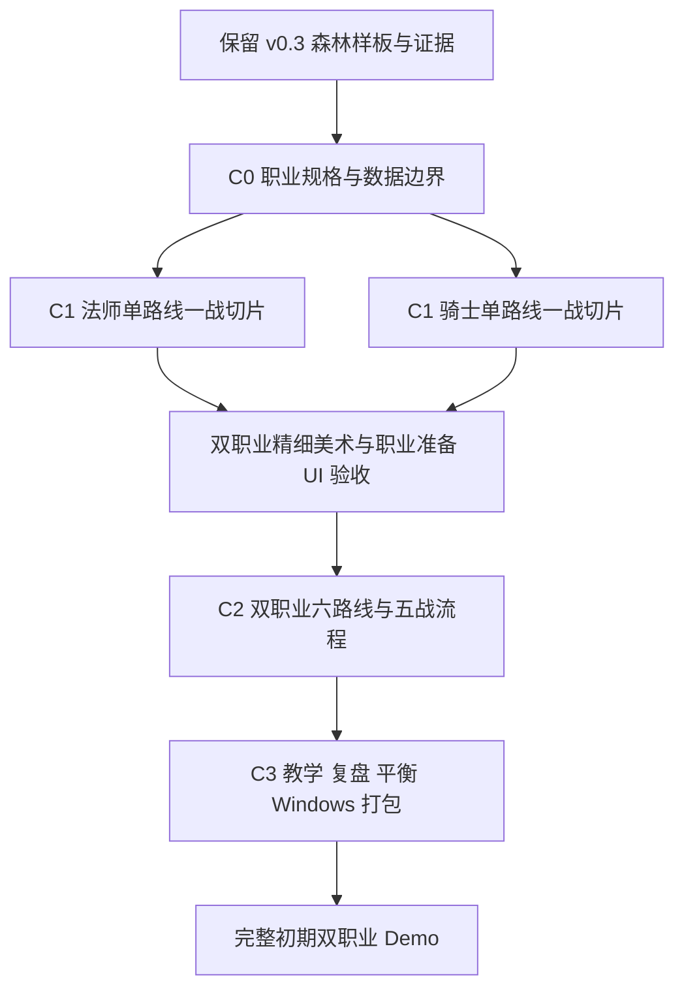

# 背包构筑 RPG：开发计划（新标题待定）

版本：2.2 · 更新：2026-10-24（JST） · 对应[产品需求](requirements.md)、[职业与构筑设计](classes-and-builds.md)、[美术规范](art-direction.md)。

**默认游戏是v0.3森林美术样板；已新增独立C0双职业规则实验，C0整体和C1仍未完成。** 旧样板见[历史交付](iteration-03-sample.md)，新增可玩实验见[C0实际交付](iteration-c0-rules.md)。勾选只表示有实际证据的交付，不表示后续计划通过验收。

2026-10-24：`npm run game:classes` 可玩法师有限吸收/编织与骑士有限采购/重刃，两者各有准备、一战、来源复盘和独立检查点。已验证资源/空间失败原子性、确定时序、拖放旋转与三窗口布局。场景为明确标注的规则示意，不含新人物精灵/背景、召唤/循环/盾反/连击或五战奖励。[原型规则契约](class-prototype-contract.md)记录本轮冻结的小范围；六路线最小内容预算与其余机制接口仍需完成，不能直接将C1/C2勾选为完成。

## 1. 本轮产品决定与历史范围

用户已经决定：游戏以背包空间构筑为核心，不同角色拥有不同职业、资源取得方式、构筑机制与背景，不能只给同一套装备玩法更换人物贴图。**初期角色是魔法师与 H「圣像余烬」方向的近战骑士；每职业至少三种可行构筑。** 炼金术士等角色进入后续扩展。正式游戏标题、角色姓名、性别和具体造型尚待确定。

A–H 不再是只能选一个的互斥世界题材。A 的幻想魔法语言可供魔法师参考，H 的圣堂与骑士题材已被用户选入初期职业；其他概念仍可作为后续角色素材。原「等待用户八选一后才能开发」流程到此结束，后续需要确认的是两名初期角色的具体造型，而非重新选择是否采用双职业。

共同交互保留 **6×4 格位、摆放、旋转、合成、方向协同、自动战斗**。职业设计可以新增资源与战斗规则：法师通过吸收、拾取与奖励取得元素，在战前手搓拼配法术；骑士以装备整备、商店与补给构筑近战体系。「手搓」暂按准备阶段的组合操作解释、战中仍自动执行，这是设计假设。具体消耗、触发、持续时间和目标规则要先通过规则原型验证，不把概念直接写成已实现行为。

| 内容 | 状态与处理 |
| --- | --- |
| M0 需求与参考整理 | 已交付；继续保留研究证据和历史文档 |
| M1-A/B · v0.3 森林样板 | 已交付；保留布局、资源接口、动画与实机证据，旧简化人物不是新质量目标 |
| 当前样板规则 | 已实现 12 装备 / 5 特殊配方 / 7 祝福 / 5 战；是兼容与回归基线，不是未来双职业总量上限 |
| 原 M1-C 教学、预览、撤销与全量素材 | 未完成；按新职业设计拆入 C1–C3，避免先量产旧主题资产再返工 |
| 原 M2 / v0.4 焰刃、猎弓、荆棘及 16 / 8 / 9 数量计划 | 未实现；已被新的双职业六路线计划取代，不再作为当前交付承诺 |
| 原 M3 / v0.5 试玩与打包 | 未实现；必要验证工作保留并纳入 C3，不沿用旧单英雄范围 |
| 新职业、元素资源、法术组合与召唤 | 法师元素/编织与骑士重刃已有独立C0一战原型；召唤及其他三路线、正式角色/背景、五战仍未实现 |

新的 C0–C3 阶段与历史 M0–M3 分开编号，避免把旧样板完成误读为新职业完成。发布版本号在实际交付时确定，不用旧 v0.4 名称暗示新内容已到位。当前不承诺日历工期，也不机械规定「每职业 12 件、总共 24 件」；C0 必须先给出支持六路线的最小内容清单，再冻结当期生产预算。

阶段对应关系：C0–C3是新需求的工作拆分，当前M1纯美术回归仍保留12/5/7/5；职业资源、新状态和敌人机制的实施属于后续M2/v0.4规则工作。C1中视觉样板可先验证，但含新职业规则的完整一战切片必须等相应规则工作到位，不能把它作为M1纯美术完成来交付。

## 2. 新里程碑与依赖

| 阶段 | 可审查产物 | 退出条件 |
| --- | --- | --- |
| C0 · 职业设计与接口 | 双职业六路线规格、资源与空间原型、数据/事件/存档边界、最小内容清单 | 六路线差异与取得链写清；核心边界规则可测试；新旧存档处理方案明确 |
| C1 · 双职业一战切片 | 每职业先一条路线，精细主角、独立背景、职业准备 UI 与真实一战 | 两职业各能完成资源取得→空间整理→自动战斗→结果解释；美术通过运行验收 |
| C2 · 双职业六路线五战 Demo | 六路线全链路、五战流程、所需敌人、来源复盘与职业存档 | 每职业三条路线均有合法取得与通关例，空间和战斗策略有可观察差异 |
| C3 · 教学、平衡与发布 | 分职业教学、预览/撤销、试玩调整、音效与 Windows 包 | 双职业完整初期 Demo 验收；干净 Windows 环境离线运行、证据和说明齐全 |

开发可串行推进法师与骑士的一条路线切片，但 C1 不能称为完整初期双职业 Demo。**完整初期 Demo 必须同时交付两职业各三路线，共六路线，并验证五战通关可行性。** 不把六条路线做成六个固定套装选择按钮来代替局内构筑；路线可以共享组件或混搭，但核心取舍必须成立。

## 3. C0：先让职业区别成为可执行规则

### C0-A：六条路线与内容预算

路线的详细设计以[职业与构筑设计](classes-and-builds.md)为准，以下是开发检查入口；这些均为计划，不代表已接入当前森林样板。

| 职业 | 路线 | 必须在原型中体现的取舍 |
| --- | --- | --- |
| 魔法师 | 元素编织 | 元素收集、配比与法术组合产生不同施法结果；高阶组合需要资源和格位投入 |
| 魔法师 | 契约召唤 | 契约、召唤媒介和供能争夺有限空间；召唤单位有独立规则与战斗表现 |
| 魔法师 | 奥术循环 | 供能、蓄能与施法节奏形成循环；有启动与持续输出的配置取舍 |
| 近战骑士 | 重刃破阵 | 重型武器与破阵支撑占用格位，慢速重击与投入时机影响战斗结果 |
| 近战骑士 | 盾誓反击 | 盾、护具与誓印构成防御和反击联动；生存投入与主动伤害有取舍 |
| 近战骑士 | 连击追猎 | 轻武器与追击组件形成连击节奏；空间布局与持续进攻投入影响收益 |

- [ ] 为每路线写明核心组件、可替代组件、起手、形成过程、优势、短板及与其他路线的混搭边界。
- [ ] 为每路线绘出「取得来源→进入背包→摆放/合成/转化→战斗触发→胜负贡献」链，不能只有最终装备截图。
- [ ] 定义法师吸收/拾取/奖励的时机、可选结果、携带上限、未使用元素去向、转换及失败处理；商店不能成为法师所有核心资源的唯一来源。
- [ ] 定义骑士的装备、升级与补给来源；同一经济流程不能无成本复制所有法师资源，职业差异要在准备阶段可见。
- [ ] 明确元素、契约、法术和装备各自是否占格，如何旋转、合成与接收方向协同；资源栏不能成为绕过空间取舍的无限仓库。
- [ ] 为六路线编制最小组件、配方、奖励、敌人和动作清单，标记共享与专属资产，再冻结 C1/C2 内容预算。
- [ ] 指定 C1 的两条试做路线。可优先用元素编织与重刃破阵验证两类取得流程；其余路线仍属于 C2 必交范围。

退出条件：不靠临时加钱、强塞成型套装或忽略格位，就能解释六条路线从空白到形成的合法过程；尚未决定的数值与触发语义有明确待验证项。

### C0-B：数据、战斗与存档边界

- [ ] 职业定义包含稳定 `class_id`、可用资源/取得流程、初始配置、背景与美术键；构筑标签用于描述玩法，不强制玩家开局锁死流派。
- [ ] 将组件、占格、配方、资源转换和触发定义集中管理，详情、预览、图鉴与战斗读取同一来源。
- [ ] 为新增战斗机制定义触发时机、资源消耗、目标、持续/移除条件、死亡与暂停边界；状态效果由具体路线需要决定，不因历史旧计划默认先做灼烧。
- [ ] 统一事件来源与归属：职业、物品/法术、召唤物及其拥有者、目标、时间、类型、数值与关联事件。动画消费事件，不反向决定伤害。
- [ ] 召唤路线先验证单位数量边界、出场/退场、独立行动、归属统计与存活结算，避免把普通伤害特效当作召唤玩法。
- [ ] 保留现有 `EmberRun`、`EmberSave` 及稳定旧物品 ID；新增职业字段不通过修改旧 ID 表达，不能将历史物品静默解释成另一职业法术。
- [ ] 明确新 schema 与迁移策略。历史档缺少职业信息时，采用明确的 legacy 模式或经确认的迁移入口，并在操作前备份；不能静默分配法师或骑士、覆盖旧档或重抽旧随机序列。
- [ ] 设计并测试未知职业、缺失资源、损坏文件、未来版本及写入失败的处理；角色切换不能把另一职业存档的资源混入当前远征。
- [ ] 保留固定种子的测试入口，正式新局与测试 fixture 分开；需要职业资源 RNG 时保存其状态，并记录可复现边界。

退出条件：接口和数据有可执行的最小原型；旧样板回归可运行；存档方案、迁移限制与失败保护有明确记录。新 schema 的版本和实际字段以实施时的存档设计为准，不在文档中编造已完成迁移。

## 4. C1：两名角色各一条路线的一战实机切片

### C1-A：职业准备流程与规则

- [ ] 从角色选择进入不同职业的新局，显示当前职业、主要资源和对应背景；正式标题未定不阻塞切片。
- [ ] 法师切片包含一次真实元素取得、一次战前法术拼配、放入或连接背包组件的空间取舍，再以自动战斗执行所配法术。
- [ ] 骑士切片包含装备取得/补给、摆放与旋转、一次合成或升级取舍，再以近战规则自动完成战斗。
- [ ] 两职业均支持现有格位操作与方向协同；给新增的职业资源明确提示，合法与非法操作都能解释原因。
- [ ] 在真实流程中验证准备、开战、暂停、加速、胜负、奖励和保存；切片场景与正式随机局如有不同，必须标注。
- [ ] 用事件与结算解释路线为何生效，避免只凭两名角色外观或相同伤害数字宣称玩法已经不同。

一战切片可以先使用明确标注的测试敌人与固定供给。它证明流程、交互与机制能成立，不能代替 C2 的完整取得链与五战通关证据。

### C1-B：精细像素角色、背景与 UI

美术执行见[美术规范](art-direction.md)及[职业视觉开发计划](art-retheme-plan.md)。参考图中的 16-bit fantasy / tactical RPG 是细节下限方向；概念板不能切成所谓成品精灵。

- [x] 魔法师与 H 骑士分别交付三套外观概念稿、[比较说明](character-design-review.md)、离线页与原生静态审稿台。此项只表示比较材料已交付，实际输出仍需归纳比例、装饰与alpha；不表示RV-02品质验收完成。
- [ ] 用户选择各职业的最终造型，按审查结果收敛脸型、发束、衣甲、武器、色板与成人比例；外观三案不充当三种构筑。
- [ ] 每职业制作大像素角色立绘与独立设计的战斗精灵；比较 96×128 / 128×160 候选源画布的实机可读性，不能靠透明边距或拉伸达标。
- [ ] 分别制作法师背景与骑士背景、职业道具和准备界面，共享格位操作与中文信息层级，人物附近背景保持可辨的对比度。
- [ ] 制作切片需要的待机、攻击/施法、受击、退场与机制反馈；按实际帧与动作验收，不用移动整张立绘代替战斗动画。
- [ ] 在 1280×800、1440×960 检查准备操作与战斗，复查 1920×1080；记录源尺寸、人物实际占高、整数倍率与所有例外。
- [ ] 双职业分别通过现行 RV 运行验收，归档实际准备/战斗截图与片段；概念图继续存于 `docs/concepts/`，不混入运行截图目录。

退出条件：两职业均能在 Godot 中完成一战且准备流程有机制差异；角色、背景、道具与 UI 在实际尺寸中统一且清楚。未完成另外四条路线时，只发布为「双职业一战切片」。

## 5. C2：双职业六路线与五战内容

### C2-A：六路线的合法形成与战斗差异

- [ ] 扩展法师契约召唤、奥术循环与骑士盾誓反击、连击追猎，并完成各自所需的最小内容、动作与规则提示。
- [ ] 所有六条路线均通过实际取得链形成，保留资源收入/支出、组件轨迹、布局变化、合成或转换记录；测试不能跳过经济与空间规则直接注入成装。
- [ ] 验证每条路线至少一次对空间投入的取舍，以及对应的战斗结果变化；只有数值倍率或颜色不同不能算独立构筑。
- [ ] 让两职业各完成五战远征，包含阶段性奖励与最后一战；职业背景独立，不据此预先承诺十套完全独立敌人或关卡资产。
- [ ] 敌人预告能提出不同准备需求，并提供合理应对；具体敌人机制由六路线原型需要决定，不机械沿用旧狼/哥布林/Boss 方案。
- [ ] 完成必要的普通敌人、精英/最终敌人区分与召唤单位表现，避免通过临时特效掩盖缺失机制。
- [ ] 验证职业内混搭、拆解和转向的边界；不能要求每局都能凑齐任意理想套装，但要防止某条路线长期无法合法形成。

### C2-B：复盘、存档与集成

- [ ] 结算区分职业资源、装备/法术、召唤物、反击与治疗等来源，口径与原始事件一致；区分原始伤害、有效伤害及过量治疗。
- [ ] 允许回看结束时的背包、法术/契约配置和详情；结束远征不能伪装成可继续进行的存档。
- [ ] 在两职业的准备、奖励、战斗退出和流程结束边界验证保存、继续、重开与角色切换。
- [ ] 完成旧档保护、显式迁移或 legacy 模式验证，保留旧样板兼容证据；说明不能迁移的字段和处理方式。
- [ ] 两职业六路线各给出一条可复现的合法五战通关记录，包含种子、获取序列、空间布局和战斗结果，并对多个种子做风险抽查。
- [ ] 复测固定种子下的 1×/2× 战斗结果、暂停/恢复与死亡结算边界；召唤、反击、持续效果不能形成无限递归或死后重复结算。

退出条件：六路线均有真实机制、取得链与通关可行性证据；图鉴、提示、预览、事件、动画和存档对同一规则的解释一致。单个成功种子只能证明可行性，不能证明平衡、稳定胜率或所有随机局都能通关。

## 6. C3：教学、调优与 Windows 发布

- [ ] 分职业渐进教学覆盖格位操作、职业资源、一次形成构筑的过程和失败解释；可跳过、可重看，教学状态与远征存档分离。
- [ ] 详情显示资源消耗、触发条件、作用对象与单件/全局范围；法师拼配预览与骑士合成预览均使用实际规则结果。
- [ ] 放置预览说明占格、方向协同和空间失败原因；准备撤销明确覆盖范围、清除时点与保存行为，不假设可撤销已经结算的随机奖励或战斗。
- [ ] 按需求固定同一组不少于30个公开记录的种子，每职业三条明确策略分别验证六路线；记录策略局限、通关/死亡/超时、资源轨迹和剩余生命，再确定是否需要补充样本。
- [ ] 排查万能套装、无效组件、无法取得的核心件、资源无限转换和经济套利；修改后重跑受影响路线并记录前后变化。
- [ ] 按需求邀请3–5位首次试玩者，观察覆盖两职业，记录资源取得、构筑取舍与失败理解；按实际样本记录独立完成门槛，未试玩职业明确未验收，不用脚本代替。
- [ ] 根据观察调优教学、说明、节奏和难度；实测性能时记录机器、分辨率、战速与采样方式，不能凭截图声称 60 FPS。
- [ ] 完成职业动作与声音反馈、必要环境声、音量/静音及暂停一致性；保留素材来源和许可。
- [ ] 制作 Windows 导出预设，排除 MCP、SDK、测试材料、本机配置与缓存；在不依赖编辑器的干净环境验证离线启动、两职业、保存和五战流程。
- [ ] 发布操作、存档位置、版本、已知问题、许可与反馈说明，记录分发包校验值；未测试平台不宣称支持。

退出条件：满足[需求验收](requirements.md)及职业路线的完整初期 Demo 要求，无阻塞流程或资源丢失问题；两职业各三路线、运行证据、发布说明、日语日志与实际代码一致。

## 7. 验证与证据矩阵

| 范围 | 验证方式 | 保存证据 |
| --- | --- | --- |
| 旧样板兼容 | 现有相关检查，旧物品与存档 fixture 对比 | 命令、实际通过/失败/警告、回归说明；历史检查数不当作本次新结果 |
| 职业取得与空间 | 合法流程 fixture、实际准备操作、资源守恒与失败边界 | 种子、组件/资源轨迹、背包布局、转换结果 |
| 六路线机制 | 单机制规则边界及合法五战策略 | 触发事件、来源统计、通关/失败记录、策略局限 |
| UI 输入 | 原生输入 smoke 与鼠标操作 | 放置/旋转/拼配/合成/预览/撤销/模态/尺寸检查 |
| 精细像素美术 | 每职业 RV 运行验收、同 fixture 对照与短录屏 | 不可变版本截图目录、源尺寸、真实占高、素材来源；概念图另存 |
| 召唤与时间 | 出入场、目标与归属、死亡、暂停、1×/2× | 原始事件与结果一致性，不以视觉特效替代模拟检查 |
| 存档 | 旧档、两职业、未知/损坏/未来版本及写入失败 | 备份、迁移/legacy 处理、字段一致性和不覆盖保护 |
| 平衡与试玩 | 同种子多策略比较及真实首次试玩 | 可复现记录、样本范围、观察结果与未验证内容 |
| 打包 | 干净 Windows 环境离线测试 | 包版本、校验值、启动/保存/双职业五战结果 |

按变更运行相关检查，游戏规则改动使用 `npm run game:test` 及必要新机制用例，构建插件相关变动使用 `npm run godot:build`，编辑器与环境继续经 `scripts/godot.mjs`。C# 构建警告按实际输出记录，不默认写零警告。仅改文档时检查链接、格式与跨文档一致性，不重跑无关游戏测试来增加数字。

## 8. 风险与取舍

| 风险 | 应对与取舍 |
| --- | --- |
| 双职业变成同一商店玩法换皮 | C1 同时验收资源来源、准备交互与战斗规则差异，三者缺失则不算职业切片完成 |
| 六路线要求引发内容无界扩张 | C0 冻结最小组件清单，优先共享底层接口和可复用素材；完整初期范围保持两职业各三路线，后续角色另排 |
| 职业独有资源绕开背包空间 | 明确组件与资源的占格/容量规则，验证删去支撑件或压缩格位后的实际代价 |
| 召唤被低估为一个特效 | C0 提前验证单位生命周期、行动与来源归属；在 C2 前暴露系统成本 |
| 高细节人物挤压 UI 或破坏像素尺度 | C1 在目标窗口验证源帧、实际占高、整数倍率与留白，不拉伸角色或压缩中文说明 |
| 某路线被万能套装支配 | 比较同种子的取得、空间与战斗事件，先找到重复收益与无代价机制，再调整相关参数 |
| 职业资源随机性使路线无法成形 | 验证多种子与替代组件；必要时调整阶段来源/可选奖励，不保证每局任意理想套装 |
| 新 schema 伤害历史档 | 先备份，显式迁移或 legacy；失败保留原档，禁止静默改职业与重开 |
| 新主题素材与旧截图混淆 | 保留历史截图，按角色与版本归档实际新运行画面，AI 概念继续单独标注 |
| 脚本或小样本被夸大 | 记录测试策略、种子、环境与限制，不编造工时、外部反馈或胜率 |

## 9. 每个里程碑的完成清单

- [ ] 该阶段退出条件达到，职业/路线状态和未完成项明确；C1 与完整 Demo 的称谓不混用。
- [ ] 相关检查与手测完成，保留原始结果，区分错误、警告与未测。
- [ ] 涉及运行表现时，实际截图存于 `docs/devlog/screenshots/` 的不可变版本目录，标注角色、模式和源提交；必要时附短录屏。
- [ ] 更新需求、职业设计、计划、美术规范、素材清单、README 与已知问题中受到影响的内容。
- [ ] 用日语记录具体决定、观察到的问题、修复、验证结果与限制；博客草稿与证据保持一致。
- [ ] `git diff --check`、提交范围、本机/敏感文件检查通过；不提交工具缓存、玩家存档或未经授权公开的用户参考图。
- [ ] 提交并推送到[指定仓库](https://github.com/zhanghang211202/godot-ai-agent-demo)，记录提交号；分发包经独立验证后再公开。

## 10. 下一次开发的起点

当前先完成人设选择：[六案](character-design-review.md)已可在离线页与 `npm run art:review` 比较，最终选择尚待用户确认。随后按所选造型重画专用战斗静态帧，在各自的背景、地面和真实职业布局中验证；本轮三档缩小观察不代替这一步。通过静态样板后再做动作与一战接入。

规则侧从**已有C0可玩原型**继续：验证契约召唤、奥术循环、盾誓反击、连击追猎的核心触发、来源归属和生命周期，冻结六路线最小支持矩阵；不重复已经完成的两路线一战。进入正式双职业一战切片前完成相应规则与人设边界，按实机结果量产。炼金术士仍为后续扩展，不加入本次初期双职业发布承诺。
