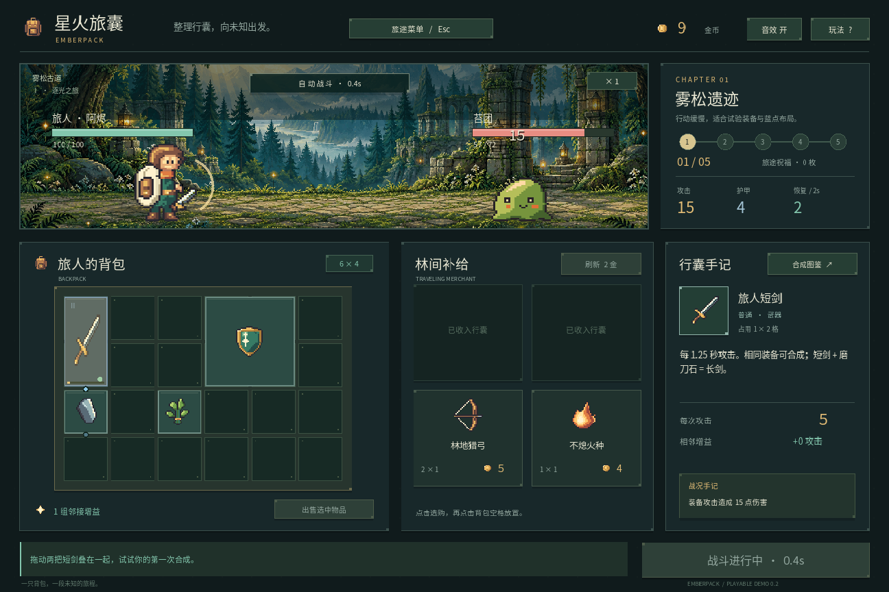

# 2026-10-21：要件、開発計画、アート改善の基準を作る

対象：Emberpack Demo v0.2（実装基準 `0e90bcb`）。今回は設計文書の整備であり、ゲームの新機能や新しい画像は実装していない。

## 依頼と、今回見直したこと

ユーザーから、参考 Wiki と YouTube のプレイ動画に基づく要件文書・開発計画、およびアートの改善が必要だという指摘があった。従来の最初の Demo 計画は実装順序のメモとして役立ったが、現在の機能、目指す完成形、検証基準を一緒に追える文書にはなっていなかった。

そこで、[要件文書](../requirements.md)、[開発計画](../development-plan.md)、[アート仕様](../art-direction.md)を現在の基準として整理した。ユーザーが確認しやすいように設計文書は中国語、開発経緯とブログ素材は日本語で残している。

## 参考資料をどこまで確認したか

Wiki はトップ、砥石、長剣、回復薬、小盾、英雄ローズ、毒蜘蛛の HTML を取得し、HTTP 200 と本文を確認した。検索ツール経由では一部ページが取得できなかったため、ローカルから直接取得した。数字とアイコンが混在して意味が不確かな箇所は引用しない。

YouTube は MGGames、Zy Mobile Gameplay、TanJinGames の三本の公開ページからメタデータを確認し、今回追加で八枚の 3×3 storyboard を実際に見た。五秒または十秒おきの低解像度サンプルであり、動画全編の連続視聴や字幕本文の確認ではない。前回の TanJinGames の27サンプルとは区別して記録した。

サンプルからは、戦闘中にもバッグが見えること、アイテムの発動、命中、勝利、ショップや詳細カードの情報関係を観察できた。一方、原作の合成が常に即時なのか、戦闘後なのかを確定できる情報は得られていない。本作の「重ねた時点で合成」は独自ルールとして明記した。

リンク、動画内の採取時点、採用・簡略化・延期の判断は[参考調査の追記](../reference-research.md)にまとめた。外部画像・音声をゲームへコピーしていない。

## 現状の問題を実機とコードで対応させる

既存 v0.2 の整備、戦闘、合成、祝福の画像を確認した。背景は細かい一方で、キャラクターと装備は粒度が粗く、画面内で制作密度が揃っていない。

コードでは48×48のキャラクターを96×96にした後、168×144などの縦横比が違う領域へ描いていた。長い装備も32×32の図を長方形に伸ばしている。さらに1440×960の論理画面が1296×864の既定ウィンドウへ縮小されるため、最近傍補間だけで全体のピクセル幅を揃えることはできない。

改善仕様では、文字・UIを実際の出力サイズで配置し、装備は一マス32pxの専用画像、通常キャラクターは64×64、樹形は96×96の素材から等比整数倍で描画する案にした。これは未実装の仕様案で、まず小さい実機サンプルで確認する。

ルール面では五戦の閉ループはあるが、敵の差は主に体力・攻撃力・間隔で、固有スキルはまだない。焔紋大剣も強い数値の武器であり、継続炎上ダメージは存在しない。既存の385項目はルール・保存・UIの過去の検証結果で、美術や複数構築のバランスを証明するものではない。

## 決めた順序

1. **v0.3：美術と操作の基準。** 主人公と苔スライム、剣・盾・砥石、バッグとカードを先に実機へ接続する。比率・読みやすさ・アニメーションを確かめてから、既存12装備と7祝福へ展開する。段階的な説明や属性プレビューもこの段階で行い、ルールの内容数は増やさない。
2. **v0.4：構築の違い。** データとイベント出所を統一し、炎上一種類、三種類の敵メカニクス、16装備・8配方・9祝福を目標にする。焔刃、弓のクリティカル、荊棘と回復の三方向を合法的な買い物で検証する。ショップのロック・段階別重み、戦闘結果の内訳、旧セーブの移行も含める。
3. **v0.5：人に遊んでもらう章。** 同じシード群で比較し、小規模な初見プレイを記録し、音と難度を調整してWindowsのオフライン配布を確認する。

先に大量のアイテムや職業を足すことは避け、一英雄・一地域・五戦・24マスに範囲を固定した。日付や所要時間の約束はまだ置かず、美術サンプルで制作基準を確認した後に残りの工数を見積もる。

## 今回の検証と限界

- 11文書のローカルリンク79件を確認し、参照先の欠落は0件。UTF-8の置換文字とコードフェンスの不整合も0件だった。
- FR 15項目、NFR 6項目、美術のVA 8項目について識別子の重複・件数を確認した。`git diff --check` は問題なし。
- 別のレビューで、サンプル段階に全12装備の完成条件を当てていたこと、VA番号の未定義、3〜5人のテストに対する人数条件の曖昧さを見つけた。サンプルと全量の範囲を分け、番号を定義し、実人数に応じた条件へ直した。継続時に報酬画面へ戻る分岐、チュートリアル設定を保存する段階も明確にした。
- コード・設定・ゲーム素材は変更していないため、ゲームの回帰テストとC#ビルドは今回再実行していない。385項目と警告3件はv0.2の履歴としてのみ記載した。
- 既存スクリーンショットを改善前の証拠として参照し、新規撮影や未完成アートの実機化を主張しない。
- 実際の初見ユーザーテスト、30シードの構築比較、新アートのサイズ別確認、Windows配布環境検証は今後の計画であり、未実施。

次の実装は開発計画 M1-A → M1-B。文書を書いたことと、ゲーム内で達成したことを分けて更新する。
