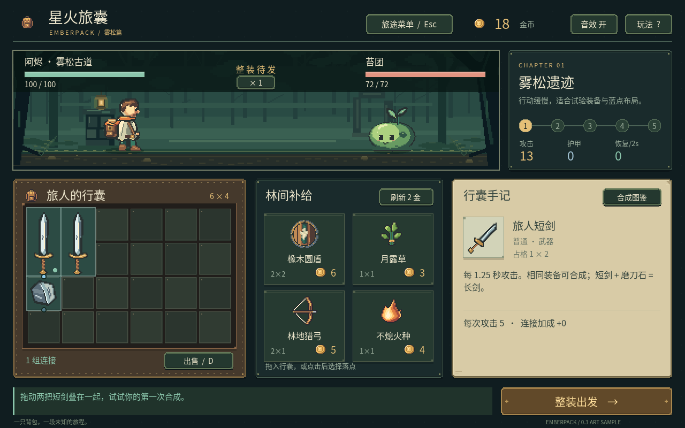

# 2026-10-22：アートの基準を、動くゲームへ接続する

対象：v0.3 アートサンプル、開発計画の M1-A/B。基点は要件を整理した `245cb6e`。フル版 v0.3 の完成記録ではない。

## 今回の範囲

まず一画面のアートサンプルを実際に動かし、残りの素材制作に使える基準を確かめた。戦闘・保存のルールは v0.2 のままで、12装備・5配方・7祝福・24マス・五戦を保っている。`run_state.gd` と `run_save.gd` は変更していない。

主役と苔団は64×64の原画で、待機4、攻撃4、受傷2、退場4フレームを用意した。短剣・盾・砥石には、実際の占有範囲に合わせたバッグ用画像と32×32のサムネイルを別々に作った。原本は既存のコード方式を拡張した独自のピクセル描画であり、今回新しく画像生成APIや外部ゲーム素材は使っていない。


以前の背景は残し、今回の実機は限定色のコード描画森林に切り替えた。512×144、地面y=126という基準をキャラクターと共有する。レイヤーは描画時に合成した一枚で、視差スクロールはまだない。

## 画面を丸ごと縮小する構造から変える

v0.2 は1440×960の論理画面を1296×864へ縮小していた。今回は実際の出力サイズでUIを配置し、中国語の文字を低解像度の絵と一緒に拡縮しない構造にした。ピクセル素材は2倍、十分な広さでは3倍で描く。

`EmberLayout` が描画と入力に共通の矩形を供給する。背包・商店・手記・モーダルはそれぞれ表示スクリプトへ分け、主スクリプトは入力、保存、ルール呼び出しと戦闘イベントの調整を受け持つ。材質も一つのテーマへまとめ、皮革と縫い目、銅の小金具、紙のページで画面の役割を分けた。



最小サイズでは装飾や余白を減らし、背包と売却ボタンを重ねない。大画面で空いた幅は手記と戦闘の余白に使い、全体を不均等に引き伸ばして埋めない。

## 接続してから見つかった問題

1. **文字が疑問符になった。** PowerShellからNodeへ渡した一部の新規ソース文字列で、出力エンコーディングにより中国語が `?` へ変わった。ルールのテストだけでは分からず、実機キャプチャで気づいた。UTF-8を保持するパッチで書き直した。[修正前の実機](screenshots/v0.3-sample/prepare-encoding-issue.png)も比較用に残した。
2. **速度ボタンが敵HPバーを覆った。** ヘッダー内の中央の空き領域へ移し、表示とクリック領域を共通の座標にした。
3. **横長の中間サイズで背景をはみ出して読んだ。** 2倍描画のまま舞台だけが512px以上に広がるケースがあった。静かな森林部分を延長したキャッシュを用意し、縦方向も原画範囲に収めた。1600×900と1440×1080を追加して再発を検査した。
4. **新しい遠征に前の光が残った。** 戦闘メニューから再開すると、同じIDの新アイテムに前の発光が短時間残る経路があった。新規開始・次戦・読み込みで共通の表示リセットを使い、動作時刻、移動、閃光、浮き文字、発動記録を消すようにした。
5. **素材の退場フレームと確認画像にも不備があった。** 主役の衣服が足元基準を越えて沈む点、苔団の待機フレーム重複、接触表が3倍ではなく1.5倍だった点を直した。アート原本とPNGの一致も検査する。

## 戦闘の見え方

武器IDを元に弓は矢、剣は斬撃、火剣は火色の斬撃を出す。回復は上昇する光、反傷は荊棘状の短い衝撃にした。火剣の外見は継続ダメージを追加しない。攻撃・回復・反傷の値と発生時刻は従来のルールが決定し、表示はイベントを消費する。

ポーズやヘルプでは、ルールの時計だけでなく、キャラクターのコマ、閃光、エフェクト、浮き文字も止める。1倍/2倍で表示の経過を合わせるが、アニメーションがダメージ判定を動かす構造にはしない。


このGIFはGodot Movie Makerの実行結果。80フレーム、16 FPS、シミュレーション5秒を録画し、二フレームおき・半分のサイズにして40フレームの720×480 GIFに変換した。GIFの時間単位に合わせ120/130msを交互に使う。音声は含まない。静止素材を並べた概念アニメーションではない。

## 実行した確認

```powershell
npm run game:test
node --check scripts/godot.mjs
node --check scripts/capture-demo-gif.cjs
git diff --check
```

| 対象 | 結果 |
| --- | --- |
| 既存のコアルール | 126成功 |
| 保存と破損・失敗保護 | 148成功 |
| UI、五戦、五種サイズ、表示リセットとポーズ | 210成功 |
| 新アート、フレーム、占格、回転、PNG・ハッシュ一致 | 465成功 |
| 合計 | **949成功、0 failures** |
| 原生アートのPNG書き出し | 9 assets、0 failures |

UI検査では、画面を変えても装備・所持金・乱数が変わらないこと、同じ入力が純ルールと同じ戦闘結果になることも確認した。原生OpenGLの実機キャプチャは1280×800、1440×960、1920×1080で確認し、キャプチャログにスクリプトエラーはなかった。GPUログは NVIDIA GeForce RTX 3070 Laptop GPU。FPS測定は行っていないため、全環境で60 FPSとは記載しない。

今回C#やプラグインは変更していないため、C#ビルドは再実行していない。新しいPNG検査は絶対パスから原画像を読むようにし、エディター用の検査で出ていた「exportでは使えない」という不要な警告も解消した。ゲーム本体はキャッシュ済みのコード生成テクスチャを使う。

文書12件のローカルリンク100件に欠落はなく、UTF-8置換文字とコードフェンスの不整合もなかった。過去の版を含む画像・GIF17件、および書き出したアート9件のSHA-256をマニフェストと照合した。既存のルールと保存スクリプトに差分がないことも確認した。

## 再現用コマンドと記録

実機静止画の出力ディレクトリは先に作る。キャプチャモードは実際のプレイヤーセーブを読まない。

```powershell
node scripts/godot.mjs play --resolution 1440x960 -- --screenshot=D:/path/to/prepare.png --auto-quit
node scripts/godot.mjs play --resolution 1440x960 -- --screenshot=D:/path/to/drag.png --auto-quit --demo-drag
```

GIF再生成には任意の変換ライブラリをプロジェクト内だけに置く。ゲームの通常起動には不要。

```powershell
npm install --prefix .tools/media --cache .tools/npm-cache --no-save --no-audit --no-fund pngjs@7.0.0 gifenc@1.0.3
# .tools/recordings/v03-final ディレクトリを先に用意する
node scripts/godot.mjs play --write-movie D:/WorkSpace/godot-demo/.tools/recordings/v03-final/frame.png --fixed-fps 16 --quit-after 80 -- --no-save --demo-battle
# Godot終了後に変換する（Movie Makerはprojectの1440×960を使用）
node scripts/capture-demo-gif.cjs .tools/recordings/v03-final D:/path/to/battle-motion.gif
```

旧版のスクリーンショットは上書きしていない。本版も公開後は変更せず、以後は新しい版フォルダーを作る。画像・GIFのサイズ、ハッシュ、用途と制限は[記録一覧](screenshots/manifest.json)へ追記する。

## 次に残っている仕事

残る9装備、狼・ゴブリン・樹系の敵、7祝福は旧素材を含む。段階的なチュートリアル、属性比較、操作の一段階取り消しも未実装。次はM1-Cでこの範囲を進める。炎上、固有の敵スキル、ショップの重み・ロックはv0.4へ残す。モバイル、別OS、全DPI、配布パッケージと初見プレイは今回検証していない。
