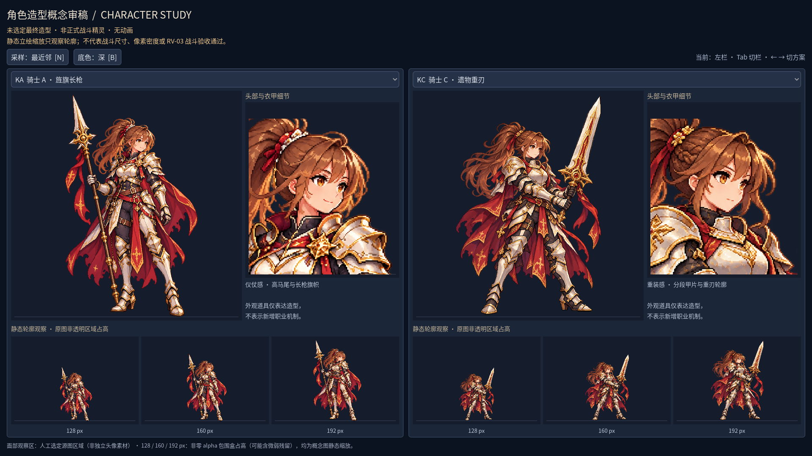

# 2026-10-24：二職業それぞれ三つの造形と、顔を見られる審稿台

記録日：2026-10-24（JST）。前段のC0規則原型は `5829e28`。今回は人物の外観比較を進めました。既定の森林サンプルとC0の取得・合成・戦闘・保存形式は変更していません。

## 今回用意したもの

内蔵 **imagegen** で、魔法使いMA/MB/MCとH騎士KA/KB/KCを一枚ずつ生成しました。六枚とも1024×1536の透過PNGで、[別の版の概念フォルダー](../concepts/2026-10-24-characters/index.html)へ保存しています。[生成時の完全なプロンプト](../concepts/2026-10-24-characters/prompts.json)と[寸法・SHA-256・alpha測定](../concepts/2026-10-24-characters/manifest.json)を添えました。ユーザーから預かった二枚の参考図鑑は公開していません。以前の八つのコンセプトや実行画像も上書きしていません。

魔法使いは紫髪と琥珀色の目、紫・藍・象牙・旧金を共通の仮基準にし、広い帽子の礼装、旅の衣装、両手で元素を扱う戦装を比較しました。騎士は栗色の髪と白金赤の装備を基準に、槍と旗、剣盾、両手の重刃を比較しています。成人女性という提示は以前のA/H概念に揃えた仮の比較条件で、最終的な性別・顔・衣装を決定したわけではありません。独立生成のため、顔や体形にも差が残ります。

この三造形は三構築の実装ではありません。盾の絵があることから盾反撃の実装済みを導くこともできません。実際の違い、動作上の課題、将来の月庭／聖堂背景は[中国語の人設審査](../character-design-review.md)にまとめました。背景は今回まだ制作していません。

## ブラウザーとGodotで別々に見る

HTML比較ページは `file://` で開けます。職業タブ、左右の選択、全身、顔の局所観察、静的な縮小像、深浅の観察地を用意しました。ネットワークや保存サービスには依存しません。

ネイティブ側は `scenes/character_review.tscn` と `scripts/art_review/character_review.gd` です。`npm run art:review` で起動し、二欄で六案を任意に選べます。Tabで欄、左右矢印で案、Nで最近傍／平滑、Bで深浅地を切り替えます。中国語は既存のNotoフォントでウィンドウ解像度のまま描きます。

概念フォルダーは `.gdignore` の配下なので、Godotのインポート資源にはせず `Image.load_from_file` で原PNGを読みました。この場面はリポジトリー上で使う開発用ツールです。ゲームの配布パッケージに概念画像が自動で入るという意味ではありません。プレイヤーの二種類の保存ファイルを読む処理はありません。

下段の128/160/192pxは、同じ立ち絵の**非零alpha包囲矩形の表示高さ**です。縦横比を保った縮小観察で、専用戦闘スプライトの画布でも人物の頭足だけの高さでもありません。実装中の整数倍率規則を緩めたゲーム仕様ではなく、縮小損失を確認するための審稿機能です。

## 見つかった問題と修正

初めは原図の上部33%を顔の観察範囲にしました。実際に騎士を1920×1080で撮ると、長槍・大剣と余白が範囲の多くを占め、顔が全身欄より小さく見えました。全案の原図座標に顔と肩付近の矩形を明示し、その領域だけを描画する方式へ修正しました。PNGの切り出し素材は作らず、元図は変えていません。修正後は目・髪束・肩甲を確認できる大きさになりました。

生成結果にも未達があります。MBは短い杖を意図しましたが長杖と広いマントが残りました。KBは小盾と軽装を意図したものの、厚い肩甲、大きな盾、高い髪束が残り、一部の腿の露出も覆う衣装の目標から外れています。MA/MCの長い髪と裾、金飾りは、小さい表示で細かい雑音になります。体形は予定より細長く、3.5–4.5頭身や規則的な論理ピクセル格子に適合したとは判断していません。

alphaも測定しました。全六枚に完全透明な画素があり、非零の値は1–254、255の画素はありません。微弱なalphaが端に残り、非零包囲矩形は人物の見える本体より広くなります。そのためalpha≥128の別の包囲矩形と画素数もマニフェストに記録しました。見た目に透明地があっても、背景色に依存しない清潔な生産素材の検証にはなりません。今回の原図はそのまま保存しています。

## 実際のGodot審稿fixture




1280×800のMA/MC、1440×960のMA/MB、1920×1080のKA/KCに加え、起動ラッパー経由のMB/KBを合わせて**四枚**保存しました。[版別マニフェスト](screenshots/character-studies-v1/manifest.json)には寸法、バイト数、ハッシュ、撮影対象が静的審稿fixtureであることを記録しています。HTMLページのスクリーンショットはGodot画像として混ぜていません。

撮影例（未使用の出力先を指定）：

```powershell
npm run art:review -- --resolution 1440x960 -- --capture-dir=D:/path/to/new-review --left=MA --right=MB --auto-quit
```

## 今回実行した確認

| 確認 | 結果と範囲 |
| --- | --- |
| `npm run art:review:test` | **148 checks, 0 failures**。六PNGの読み込み・透明性、人工顔領域、実際のキー／ボタン、三解像度の配置、縮小包囲矩形の高さと縦横比、二種プレイヤー保存の指紋不変 |
| `npm run art:review -- … --left=MB --right=KB --auto-quit` | 実際に1440×960で起動・撮影・終了。ログに撮影OK、エラーなし |
| ローカルHTML、Windows Chrome 155.0.8059.85 | **22 checks, 0 failures**。六案の復号、左右選択、職業切替、キー移動、深浅地、再読込、1440/390/320pxの配置。JS例外0、ページからのHTTP(S)要求0 |
| `node --check scripts/godot.mjs` | 終了コード0 |
| 原図・撮影・ローカルリンク／差分 | 11文書の198ローカル参照とHTMLの5静的参照、六原図＋四撮影の寸法・バイト数・SHA-256、alpha画素合計と提示集合を照合し、欠落・不一致0。`git diff --check` 成功 |

最終版のGodotチェックをラッパー経由でも再実行しました。修正前の142項目ではなく、人工顔領域を追加した148項目を上の結果としています。規則・保存コードとC#は変更していないため、過去の1572項目やC#ビルドを今回実行したとは記録しません。

GodotはWindows上の4.7.2 .NET、OpenGL互換レンダラーで実行しました。ブラウザーの390/320pxはデスクトップChrome上の狭幅確認であり、携帯端末の実機操作検証ではありません。他OS、他DPI、他ブラウザー、配布パッケージ、外部試遊とフレームレート測定は未実施です。

## 次に決める境界

比較材料は揃いましたが、最終造形はユーザー選択待ちです。衣装・顔・武器の採用点を設定表へ固定し、論理ピクセルと材質・比率を整理して、専用戦闘静止フレームを別に描く工程へ進みます。その後に各背景と連続した地面、現職業UIで読みやすさを検証し、動作と一戦へ接続します。RV-02は比較資料ができた段階で、全品質を通過した意味ではありません。RV-03以降も未完了です。

要件・開発計画・美術基線と日本語ブログを今回の状態へ揃えました。検証済みの概念・審稿ツール・文書・四枚のGodot画像を指定リポジトリーにコミットしpushします。ツール、キャッシュ、ローカルMCP構成、参考原図、保存ファイルは含めません。対応コミットはこのファイルのGit履歴で追えます。作業時間は計測していません。
