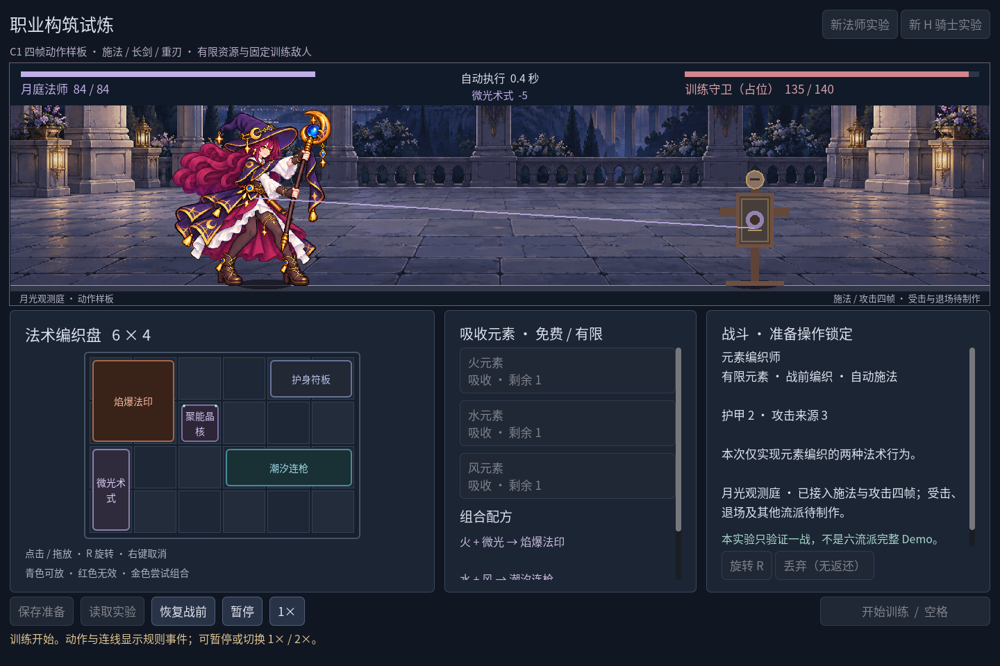

# 2026-10-26：施法・長剣・重刃の四コマを実戦へ

前段の静止素材接続は`619efef`。今回は`npm run game:classes`にMAの施法、KAの長剣と両手重刃を接続しました。各四コマで、静止待機、予備動作、命中、戻しを表示します。待機ループ・被弾・退場は未制作で、C1全体やRV-04全項目を完了したという記録ではありません。既存の中国語UIとC0規則を保っています。

初期長剣をそのまま使う[別録画](screenshots/c1-motion-v1/sword-motion.gif)も残しました。重刃の合成後の画面とは区別します。生成原図を直接並べた疑似プレイ映像ではなく、実際に規則が進むGodotの画面です。

## ユーザーの指摘を作画条件へ戻す

法師には、手が一つ足りないように見えるフレームと、杖が短くなったフレームがありました。途中の再生成でも持つ手が曖昧だったため、その版は採用せず、両手で月杖を前へ押す姿勢へ変更しました。上下の握りを離し、両前腕を見せ、下の杖身と石突きを延長しました。実画面の命中姿勢でも二つの握点と杖先が見えます。ただし全フレームの武器が同寸の剛体になったわけではなく、形状の揺れは残ります。

騎士の最初の図集では長剣が隣のフレームへ入り、別の修正版には赤や灰色の背景光が現れました。これらはゲームへ入れず、全身を小さく再配置して透明な間隔を確保しました。最終重刃の下左だけは剣先が等分中線を少し越えるため、空き間隔内で下段の取源境界をx561からx582へ動かしています。剣先を切り捨てる修正ではありません。

三図集は内蔵 **imagegen** で生成・編集し、各1122×1402の原PNGと生成alphaを保存しました。旧六案の概念を切ったものではありません。[資産一覧](../../assets/art/c1-motion-v1/manifest.json)に実寸、alpha画素数、取源領域とSHA-256があります。[提示集](../../assets/art/c1-motion-v1/prompts.json)は今回の騎士編集・重刃生成の逐字提示を保存しています。法師の先行生成の逐字提示は保持できていないため、残った仕様要約と明記し、完全な履歴とは呼びません。私用図鑑やユーザーの指摘用一時画像は公開しません。

## 動きが規則を変えないようにする

`class_motion.gd`は表示専用です。`charge`で予備姿勢を保ち、実際の命中イベントで打撃フレームへ入ります。命中表示0.16秒、戻しを含む0.42秒後に静止待機へ戻します。表示の秒数はダメージ・冷却・戦闘時間を決めません。

同じ來源UIDと同じイベント時刻の多段命中は一つの動作へまとめます。潮汐の三段ダメージを三回の構え直しにしないためです。一人の身体で並行する來源を表す都合上、後から来た命中は前の演技を上書きし、命中・戻し中の別來源の構えは抑制します。全來源の演技を順番に再現する仕組みではありません。

停止は演技と短いイベント表示も凍結し、2倍速は両方の時計へ適用します。新規職業、読込、戦前復元、次の開戦は一時姿勢を初期化します。勝利の最後の一撃は戻しを終え、中断された構えは結果画面に残しません。

各図集に共通倍率を使い、フレームごとの靴の間の中点とalpha≥128最下行を床へ合わせます。毎フレームの矩形へ倍率を合わせ直すと、武器を振るだけで身体が拡縮するためです。接地は固定できますが、生成された体形・衣甲・武器長の揺れは未解決です。厳密な論理格子と原図の部分透過・色にじみも残るため、品質合格と動作インターフェースの確認を分けました。

## 実行した確認

| 実行 | 結果 |
| --- | --- |
| `npm run game:classes:test` | Run96、Battle143、Save269、UI115、計623・失敗0 |
| `npm run game:classes:art:test` | 静止互換142、文字146、動作264、計552・失敗0 |
| JS構文 | `scripts/godot.mjs`と`scripts/capture-demo-gif.cjs`の`node --check`が終了0 |
| 動作幾何 | 三図集×三窓×四コマ＝36配置で元領域・全武器の舞台内・接地・共通倍率を確認 |
| 規則結果 | 実UIと独立Battleの全summaryフィールド一致。従来fixtureの法師8.60秒、重刃11.00秒・各140有効ダメージも一致 |
| 追加fixture | 初期長剣のみ21.35秒、140有効ダメージ |

関連自動検査は計**1175項目、失敗0**。保存負例の`1e999`で既知の`Exponent too high`が二回出ますが、拒否と原状態保持は成功しています。警告なしとは記録しません。旧森林949項目とC#ビルドは今回再実行していません。規則・カタログ・保存形式・旧森林コードは変更していません。

最終確認で停止検査を補強しました。構えは通常でも保持されるため、構え中だけ止めても命中コマの時計が止まる証明になりません。実際の命中イベントまで進めて停止し、規則summary・姿勢・経過時間・イベント表示が変わらないことを同じ264項目内で確認しました。18テキストのUTF-8、253ローカル参照、34資産/証拠の寸法・サイズ・SHA-256、三GIF各96枚/6秒も照合し、不一致0でした。`git diff --check`は成功し、既存規則/保存、旧森林、前回静止資産と過去版キャプチャーに差分はありません。

## 実行証拠と撮影の問題

[不可変版の一覧](screenshots/c1-motion-v1/manifest.json)には23PNG・3GIF・4構築結果JSON・1動作測定JSONがあります。1440×960で三構築の準備/構築/予備/命中/戻し/戦闘/結果、別に1280×800の法師命中、1920×1080の騎士準備を保存しました。三窓の全動作は幾何検査の証拠で、大窓の全動作動画を録ったという意味ではありません。すべて通常の有限取得APIを使い、プレイヤー保存を無効にしたfixtureです。

Movie Makerの固定16FPSでPNGを集め、各録画の源フレーム12～107の96枚を1/2の整数最近傍で720×480へ縮小し、GIFの色量子化と時間丸めを行いました。各6秒、無声。固定記録レートは性能測定ではありません。源録画全体の枚数は法師158、重刃196、長剣362です。

最初の法師録画は1280の窓と1440のMovie Maker画布が一致せず、端が裁かれました。この動画は公開GIFへ使わず1440×960で録り直しました。1280の単発PNGは直接viewportから得た別証拠です。撮影処理は同名PNGの上書きを拒否し、過去の版別画像も保ちます。

次は透明境界・論理密度・人体と武器のフレーム間統一を先に整え、待機ループ、被弾、退場、訓練敵の反応へ進みます。近接役は離れた立ち位置から規則の打撃を表示し、接敵移動は未実装です。職業特效・音・物件・準備UI・背景の取景、残る四構築と職業五戦も未完成。Windows／Godot4.7.2.NET／OpenGL互換以外のOS、独立export、別DPIや外部試遊は未検証です。

作業時間は測定していません。ソース・実際の証拠・日本語記録・ブログと現在の要件をまとめ、指定リポジトリーへcommit/pushする単位とします。対応commitはこのファイルのGit履歴から追跡できます。
