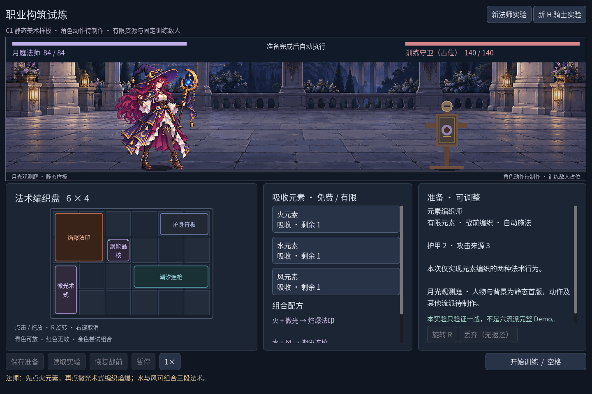
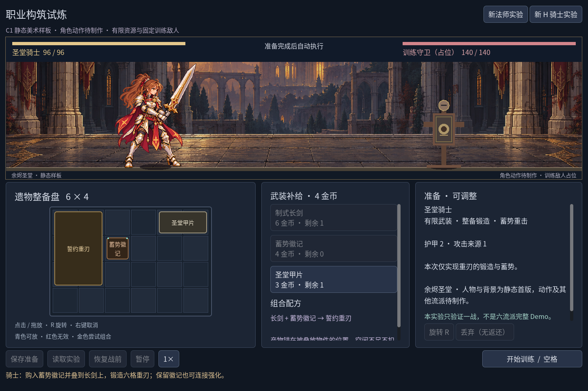
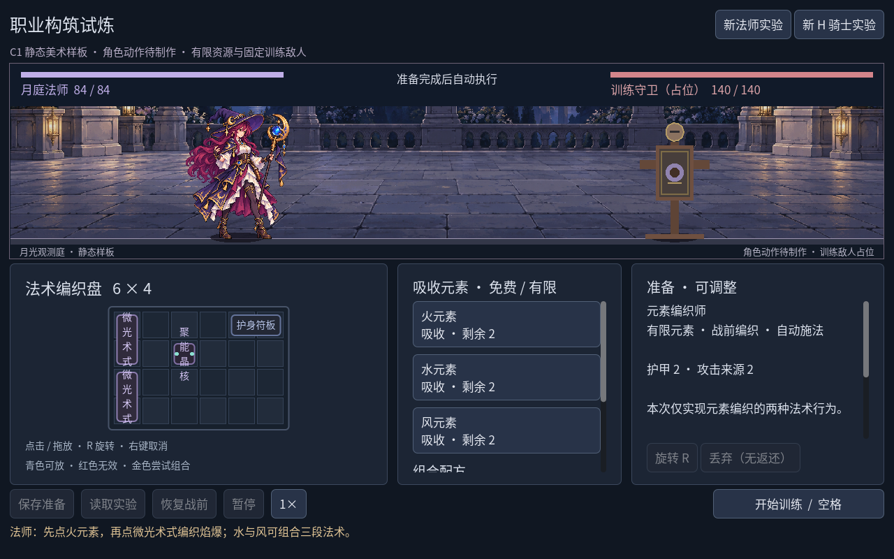
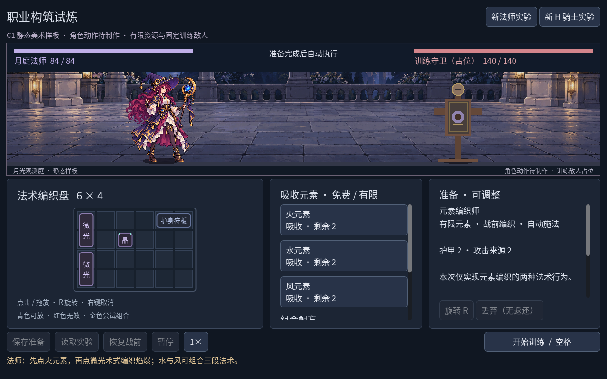

# 2026-10-26：選んだ二人を、実際の職業場面へ置く

記録日：2026-10-26（JST）。生成と接続は10月25日に始め、中断後に26日へ持ち越した確認・修正・記録を完了しました。前段の外観選定は `4787701` です。今回は比較ページだけでなく、取得・配置・合成・自動戦闘が動くGodot職業場面に、新しい静止姿勢と背景を接続しました。

## 作ったものと入口

`npm run game:classes` で起動する同じ場面へ、MAの月杖姿勢、KAの長剣姿勢と両手重刃姿勢を入れました。元の大立ち絵を切り出した素材ではなく、選ばれた顔・髪・衣装を参照し、内蔵 **imagegen** で一枚ずつ描き直した静止候補です。背景も月庭の天文回廊と、夕光の聖堂を別々に生成しました。[完全なプロンプト](../../assets/art/c1-static-v1/prompts.json)と[原図の寸法・alpha・SHA-256](../../assets/art/c1-static-v1/manifest.json)を保存しています。私用の参考図鑑は今回の生成入力にも公開物にも含めていません。

原図は人物が各1122×1402、背景が各2172×724でした。128×160の論理画布を8倍に拡大するよう指示しましたが、生成結果はその規則的な格子を満たしていません。実際の出力を高解像度の静止候補として扱い、専用論理ピクセルの生産仕様を完成したとは記録しません。原PNGには加工を加えていません。





人物は動きませんが、戦闘は既存C0の実処理です。生命、冷却、蓄勢、命中、ダメージと結果は同じエンジンが計算します。画面の線と短い明滅は規則イベントの表示で、人物の攻撃動作として数えません。木の標的はコード描画の占位敵、盤面もまだ文字アイテムです。初期六構築のうち残り四つや、五戦進行を今回追加したわけではありません。

## 見た目を実際の武器へ対応させる

騎士は準備配置に長剣があれば長剣姿勢、重刃があれば重刃姿勢を選びます。両方を持つ場合は重刃を代表表示し、戦闘中と結果ではその戦闘の設定スナップショットを参照します。すべての攻撃武器を捨てた準備では「待配武装」の表示に戻し、持っていない剣を描き続けません。読込、戦前へ戻す操作、職業の新規開始でも確認しました。

KAの紹介用長槍を、既存重刃の攻撃と取り違えないための分離です。規則、カタログ、物品IDと保存形式は変えていません。旧 `EmberRun`／`EmberSave` と森林の12装備・5配合・7祝福・5戦は従来の入口に残ります。`npm run game` は引き続き旧森林サンプルです。

## 画面寸法と地面

新しいキャッシュは原PNGを `Image.load_from_file` で読み、人物のalpha≥128包囲矩形を描画源領域にします。微弱な周辺alphaまで占高へ算入しないためで、透明画素の清掃ではありません。両背景は縦横比を保ったカメラ領域で描き、人物の足元には連続した前景の石縁と接触影を置きました。

1280×800では舞台280px、人物と武器の包囲矩形は188px高です。1440×960と1920×1080では舞台350px、同じ包囲矩形は256px高になります。MAの描画源は `(55,59,1036,1311)`、KA長剣は `(78,113,1019,1207)`、KA重刃は `(137,125,957,1222)`。人物の頭足だけの高さと、武器を含む矩形の高さは区別しました。

元画像に対しては最近傍の非整数縮小になります。これは今回の可読性試験に限る例外で、整数倍率の論理ピクセル仕様を達成した証拠ではありません。背景の上方も切られ、月や天文儀の全体は場面に入りません。次は舞台の比率を前提に、環境の主題と人物の留白を再配置する必要があります。

## 実図から修正した二つの問題

小さな盤面で「聚能晶核」が四行に折られ、隣の格へはみ出しました。旧表示は幅だけで折り返し、縦は固定21px行間のままでした。新しい舞台の高さが盤面を圧縮し、潜在していた問題が見えるようになりました。



実際のフォント幅、ascent、descentと使える矩形から行を配置し、全文が入らなければ短いラベルへ替えるようにしました。文字は14px未満にせず、完全名と説明はtooltipと既存の詳細欄で読めます。方向支援の二点は意味を保ったまま外縁へ寄せ、文字に重ならない位置を使います。



騎士の背景には石床の前面を描いた帯があり、画像の最下端へ足を合わせると側壁に立っているように見えました。聖堂だけカメラ領域の下端を源高の86%へ合わせ、水平な石床上で足と影が接するようにしました。[修正前](screenshots/c1-static-art-v1/before-floor-fix-1280x800.png)と[修正後](screenshots/c1-static-art-v1/knight-prepare-1280x800.png)を別ファイルで残しています。

新しい戦闘比較検査の最初の実行では、現在の辞書と過去のJSON結果の比較が二件失敗しました。独立エンジン同士の結果は一致しており、原因はJSONが型付き配列や整数表現を保たないことでした。両者を同じJSON表現へ揃えて比較し、全シリアライズ結果の一致を確かめました。これはダメージ規則を変えて直したものではありません。

## 実行した確認と証拠

| 実行 | 実際の結果 |
| --- | --- |
| `npm run game:classes:test` | Run96、Battle143、Save269、UI115、計**623項目・失敗0** |
| `npm run game:classes:art:test` | 静止素材／対応／九組のレイアウト142、文字境界146、計**288項目・失敗0** |
| `node --check scripts/godot.mjs` | 終了コード0 |
| 画面取得 | 最終12PNG：両職業1440の準備・構築・戦闘・結果、両職業1280／1920の準備。別に中間の不具合2PNG |
| 結果照合 | 法師8.60秒、騎士11.00秒、ともに有効140ダメージ。正規の有限取得と配合APIから形成し、旧C0の結果と一致 |
| 文書と資産 | 14文書の277ローカル参照、UTF-8、22資産／画像／JSONのメタデータを照合、欠落・不一致0。過去資料79ファイルと規則／保存6ファイルはHEADとバイト一致。`git diff --check` 成功 |

関連確認は合計**911項目**です。保存負例の `1e999` 検査では既知の `Exponent too high` 警告が読み込み・事前検査から一回ずつ、計二回出ました。拒否と状態保持は成功しており、警告なしとは書きません。C#や旧森林は変更していないため、C#ビルドと旧森林949項目は今回再実行していません。

文字試験は三ウィンドウ、12アイテム、通常／回転の72配置で、実フォントの描画範囲と支援点の非交差を確認します。その試験だけは文字を網羅するための直接配置fixtureで、取得可能性を証明しません。公開する画面の取得fixtureはすべて正常な有限取得を使い、プレイヤー保存を無効にしています。二種類の本来の保存ファイルの指紋が変わらないことも検査しました。

[不可変版のマニフェスト](screenshots/c1-static-art-v1/manifest.json)へ最終12枚・中間2枚・両職業の取得／結果JSON・[静止素材と九レイアウトの測定JSON](screenshots/c1-static-art-v1/static-art-measurements.json)をまとめました。職業レポートの`visuals`は最終状態だけで、各準備・戦闘画像に別々の測定があるという意味ではありません。生成原図は資産フォルダー、実行キャプチャーはこの版別フォルダーに分けています。

再現例（未使用の出力先）：

```powershell
npm run game:classes -- --resolution 1440x960 -- --class=mage --capture-dir=D:/path/to/new-c1-mage --auto-quit
npm run game:classes -- --resolution 1280x800 -- --class=knight --capture-dir=D:/path/to/new-c1-knight --capture-prepare-only --auto-quit
```

## まだ判断できないこと

三姿勢には細かい金縁や透過境界の色にじみが残り、背景も人物と完全に同じ論理ピクセル密度へ整理されていません。舞台が横長になると上方の主題が裁かれます。今後は源の色階・ピクセルのまとまり・輪郭を整理し、実寸を固定してから待機・施法／攻撃・受傷・退場の実フレームを作ります。大絵の位置移動を動作完成とは呼びません。

今回のWindows／Godot 4.7.2 .NET／OpenGL互換レンダラーでの実行以外、他OS、他DPI、別入力機器、独立配布パッケージ、外部試遊やFPS測定は未検証です。とくに原PNGの直接読み込みを独立exportへ含められるかは、配布確認で別途調べます。

静止候補が実際の取得・戦闘・結果の場面へ入ったことを今回の成果とし、RV-03の全品質、RV-04の動作、C1全体の完了は未達のままにします。作業時間は計測していません。コード、5原図、完全プロンプト、証拠、要件と日本語ブログを揃えて指定リポジトリーへコミット・pushし、対応コミットはこの記録のGit履歴から追えます。
