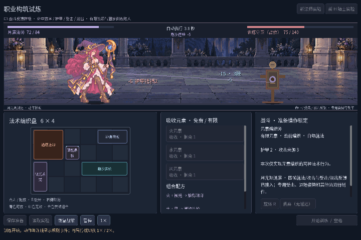
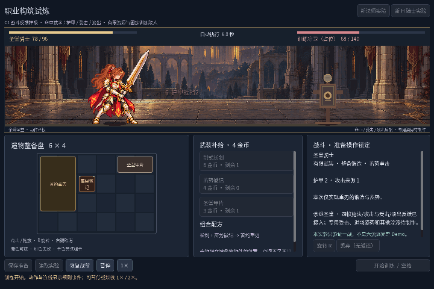
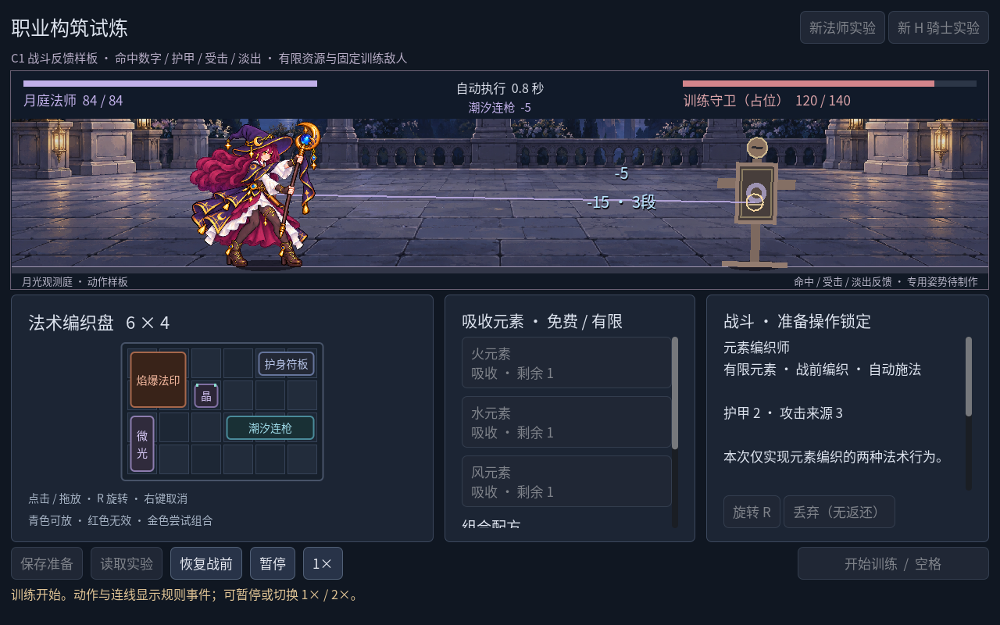
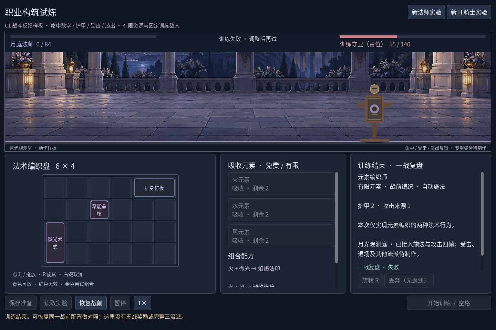

# 2026-10-27：実際の命中を読める画面へ

作業開始は10月26日、日付をまたいで27日に検証・記録をまとめました。前段は`edabf65`の四コマ動作です。今回は`npm run game:classes`に命中数値・三段表示・装甲軽減・被弾の色/揺れ・勝敗フェードを加えました。元のMA／KA、6×4操作、C0規則と保存形式は維持しています。専用の被弾/倒地姿勢を描き終えたという記録ではありません。

## 生成し直した絵を採用しなかった理由

最初に三つの既存動作図集を内蔵imagegenで整理し、色面・輪郭・手・武器長の統一を試しました。しかし法師の低alpha画素（0より大きく128未満）は65,104から113,715へ増え、可視RGB色数も304,850から296,361にとどまりました。階調や透明境界を整理した合格品とは言えません。長剣案は顔と衣甲を単純化しすぎ、重刃案も色にじみとセル端の問題を残しました。

三案は不採用です。[試験原図と測定・逐字提示](../concepts/2026-10-26-pixel-cleanup/README.ja.md)を生成資料として分け、ゲームの原PNGは置き換えませんでした。既存の二つの手と長い月杖を保ち、新しい不整合を増やさない判断です。私用図鑑やユーザーの一時画像は公開していません。

## 原画を変えず、キャラクターの描画だけを分ける

主角を独立`Sprite2D`へ移し、専用Shaderでalpha<0.5を描かず、残った内部を不透明にします。色替えと退場の透明度もここで制御し、背景・中国語UIには適用しません。元のPNGはそのままで、色数、論理格子、人体比率を直したことにもなりません。高alpha側に残るRGBの色にじみは別の課題です。

同じ1280×800準備姿勢で[元alpha](screenshots/c1-feedback-v1/alpha-original-1280x800.png)と[閾値描画](screenshots/c1-feedback-v1/alpha-cutout-1280x800.png)を撮りました。11,324画素が変化し、その範囲は`(254,154,149,188)`で人物内だけです。生成候補の失敗と、実際の描画処理の効果を混同しないようにしました。

Shaderはヘッドレスの読込だけでは十分確認できません。32×8のプログラム製テスト画像を本物のOpenGLで描き、alpha64/128/254/255を読み戻しました。元alphaの約0.251/0.502/0.996/1が、閾値有効では0/1/1/1になり、退場の0.5も通りました。これはGPUの試験fixtureで、ゲーム画面の証拠とは分けています。

## ダメージを計算し直さない表示

浮く数値は実際の有効ダメージを使い、装甲軽減はイベントの`armor_mitigated`を使います。致死時には過剰ダメージもあり得るので、原始値から適当に差し引いて軽減量を作りません。同じ來源・同時刻の三段は`-15 · 3段`へまとめます。内部の三命中や復盤は変わりません。上の既存イベント欄は単段値のままです。

数字は0.90秒、被弾は0.26秒、フェードは0.70秒で、すべて表示時間です。規則の勝敗とsummaryは即座に確定し、演出時間を戦闘時間へ足しません。戦中の停止で数値・被弾・四コマが凍り、倍率は共通です。結果時は従来どおり停止ボタンが無効で、現在の倍率で残る表示を終えます。

勝利では木標的が傾いて消え、実際の敗北では主角が消えます。時間切れは生きた役者の死亡に見せません。これは色・小移動・透明度によるフィードバックで、専用被弾/倒地フレームではありません。瞬時データは数字24件、直近ID64件に制限し、最終描画は各側最新3行までです。長い一フレームで大量に届いても、復盤の統計を変えず表示の混雑を抑えます。読込・戦前復元・新職業・新戦で消えた木標的も戻ります。

## 負ける構築も通常操作から作る

法師の左上の初期術式を一つ捨て、もう一つの術式と元の84生命を残しました。新しい元素は取りません。この配置は25.20秒で敗北し、85有効ダメージ、84被害、木標的55残でした。HPや敵の数値を書き換えた演技ではありません。[5秒の敗北映像](screenshots/c1-feedback-v1/loss-feedback.gif)に最後の被弾と主角のフェードを残しました。

## 検査と観測した不具合

最初の接続では半径のローカル変数に、動的なRefCounted値から型推論できない構文エラーが出ました。`float`を明示して修正しました。失敗した試験プロセスを止めてから再実行し、最終結果を以下にまとめます。

| 実行 | 最終結果 |
| --- | --- |
| `npm run game:classes:test` | Run96・Battle143・Save269・UI115 = 623、失敗0 |
| `npm run game:classes:art:test` | 静止互換142・文字146・動作264・新feedback62 = 614、失敗0 |
| `npm run game:classes:feedback:render:test` | 実GPU読戻し6、失敗0 |
| `node --check scripts/godot.mjs` | 終了0 |

合計**1243項目、失敗0**。保存の負例で既知の`Exponent too high`警告が二回出ます。拒否と状態保持は成功しており、警告なしとは書きません。旧森林949項目とC#ビルドは今回再実行していません。規則・保存・旧森林コードと、前回までの資産/証拠に差分はありません。

最後に29テキストのUTF-8、276ローカル参照、44件の実行証拠と2原図のサイズ・寸法・SHA-256、三GIFの96/96/80枚と6/6/5秒、結果JSONから参照する画像の存在を照合し、不一致0でした。`git diff --check`も成功しています。

新試験では実際の被弾時に停止・倍率を変え、独立Battleと全summaryフィールドの一致を確認しました。法師8.60秒/140出力/24被害、重刃11.00秒/140/36、初期長剣21.35秒/140/66を保ち、合法な敗北配置は25.20秒/85/84でした。イベント重複、三段集約、期限切れ、上限、読込と戦前復元も確認しています。

## ブログ用の保存内容と限界

[不可変版一覧](screenshots/c1-feedback-v1/manifest.json)は36PNG、3GIF、三つの実機構築結果JSON、feedback試験JSON、GPU読回JSONです。生成試験はconcepts、実際のゲーム画面はこの版別ディレクトリーへ置き、プレイヤー保存は無効にしました。

Movie Maker源画像は固定16FPSで法師166枚、重刃204枚、敗北432枚。公開GIFはそれぞれ源70～165、108～203、352～431を取って720×480へ1/2最近傍縮小・GIF量子化し、6/6/5秒、無声です。これは実行性能の計測ではありません。録画後に混雑時の最新3行制限を追加し、最終1280場面を再取得しました。敗北録画の詳細文は古い補足で、最終UIは専用姿勢が未制作と明記しています。

主角の元画像は未整理の論理密度と人体・器具の揺れを残します。待機ループ・専用被弾/退場、専用敵人/物件、職業準備UI、背景取景、残り四構築と職業五戦は未完成です。C1やRV-02/03/04全体は通過していません。検証したのはローカルWindows／Godot4.7.2.NET／OpenGL互換のみで、独立exportや他OS、別DPI、外部試遊は未検証。作業時間は計測していません。

コード、実行証拠、生成失敗の判断、現在の要件と日本語ブログをまとめて指定リポジトリーへcommit/pushします。対応commitはこのファイルの履歴から追跡できます。
