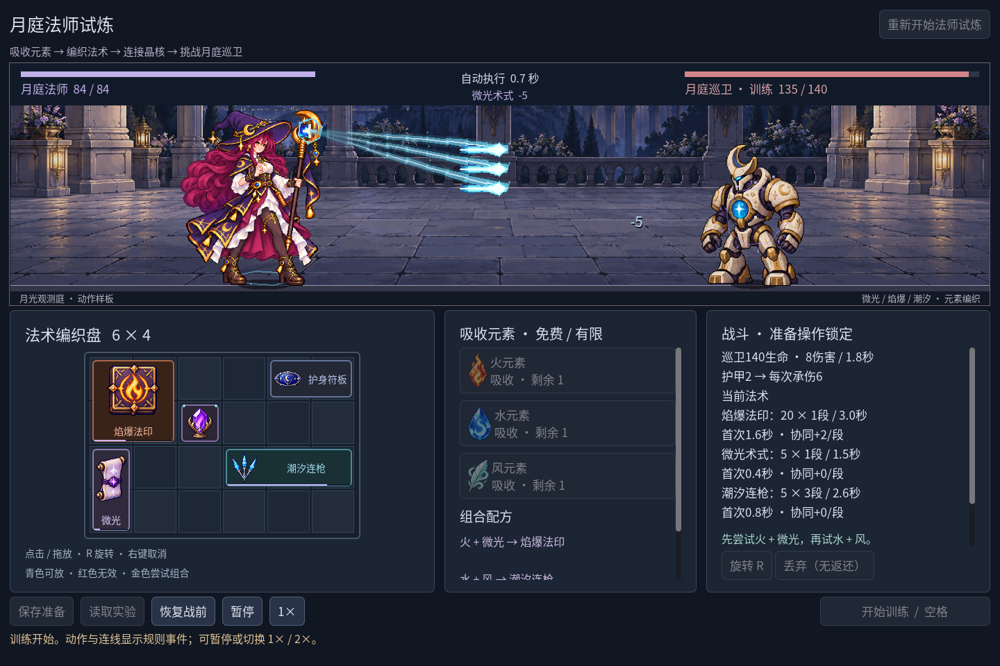

# 2026-10-27：一本の線から、追える魔法へ

前段`89ee0b9`の法師一戦を見たユーザーから「エフェクトがまだ簡素」と指摘がありました。そこでC2や騎士へ範囲を広げず、微光・焰爆・潮汐と巡衛の星弾を、準備から余韻まで読めるようにしました。入口は引き続き`npm run game:mage`です。

以前は命中後0.36秒の線、星と矩形が中心でした。今回は次の実攻撃まで残り0.64秒になると杖や敵の核へ光を集め、最後0.24秒に弧を描く飛行を見せます。命中は実イベントから作り、その後に火の粉や晶片を散らします。飛行の衝突でダメージを決めず、規則の発動時刻も変えていません。

## 小さな図柄と、違う輪郭

微光は紫の彗星と星芒、焰爆は橙金の火舌と熱い芯、潮汐は青い三本の槍と晶片にしました。巡衛は胸の核から菱形の星弾を主角へ向けます。潮汐を晶質に描いても、凍結という新状態は追加していません。

火舌・彗星・槍刃・破片はコードに小さなpixel maskを記述し、各五色と透明空白から生成しています。火舌の三変化は整数pixelのずれで作り、テクスチャをキャッシュします。1/2/3倍の最近傍表示と、2pxへ丸めた軌道を組み合わせました。今回新しいimagegen生成はなく、主人公や敵の原PNGも変えていません。人物原画の論理密度が完成したとは数えません。

地面の法陣、人物、前景の飛行/衝撃/数字という順に分けました。顔全体を白くする画面flashではなく、局所の明るい芯を短く置きます。主人公が空いている時には次の施法の準備姿勢へ入り、すでに出ている命中や収勢を別の自動発動元で中断しません。新しい人体動作を描いたわけではありません。

## 実機で直した三つの問題

最初の尾跡は菱形を並べたため、珠の連なりに見えました。[途中の実際のフレーム](screenshots/mage-vfx-v2/before-ribbon-fix.png)を残し、先細りする連続の色帯と細い明芯、少量の脱落片へ替えました。

規則は50ms刻みなので、残り時間をそのまま使うと飛行位置が四、五段階で跳びます。読み取り専用問い合わせに既存の未消費substepを加え、描画だけを補間しました。規則を先へ回したり、HP表示を待たせたりしていません。

また地面法陣を親の舞台へ直接描く案では、前景のclipを通りません。地面と前景の両方に同じclipを設け、法陣も床の内側へ置き直しました。実GPUで両層を隠したフレームと表示フレームを比較し、集光/飛行/命中の三時点とも戦闘領域外の変化は0pixelでした。差分は数字層も含み、品質の点数や性能測定ではありません。

初回の新図柄検査は破片が三色しか使っていないため失敗しました。深青の縁と中間色を加え、五色の輪郭を与えてから再確認しています。失敗を最終成功項目へ重複加算していません。

## 本当に出た命中だけを残す

飛行は次の発動元の予定を見せますが、命中は実際に出た段数だけです。検査用の独立した強い潮汐設定では、一段目で巡衛が倒れ、Battle→Feedback→描画まで一段のまま、予定された二・三段の命中を作らないことを確認しました。これは規則検査用設定で、通常のプレイヤー構築や公開映像とは区別します。

戦闘終了時は未来の飛行予告を止め、出た最終打撃の余韻だけを終えます。微光0.48秒、焰爆0.74秒、潮汐0.64秒、巡衛0.48秒で消えます。最大六つの近い施法と八組の新しい命中に制限し、無限の粒子Nodeを積みません。停止・倍速・戦前復元にも同じ時計とresetが効きます。

## 確認結果と証拠

| 実行 | 結果 |
| --- | --- |
| `npm run game:classes:test` | 96 + 143 + 269 + 115 = 623、失敗0 |
| `npm run game:classes:art:test` | 142 + 146 + 264 + 62 = 614、失敗0 |
| `npm run game:mage:test` | 62、失敗0 |
| `npm run game:mage:vfx:test` | 新しい実GPU/段階/補間/致死/保存隔離45、失敗0 |
| `npm run game:classes:feedback:render:test` | 既存役者ShaderのGPU読戻し6、失敗0 |

関連検査は計**1350項目、失敗0**です。既知の保存負例`Exponent too high`は二回出て、拒否と状態保持は通っています。`node --check scripts/capture-demo-gif.cjs`と`git diff --check`も成功しました。旧森林949項目やC# buildは再実行していません。

基準は8.60秒で勝利、有効140・被害24のままで、全統計が独立Battleと前版に一致します。三つのプレイヤー保存指紋も変化していません。1280×800/1440×960/1920×1080の実際の効果を保存し、GPU差分は1440×960で実施しました。確認環境はローカルWindows/Godot4.7.2.NET/OpenGL互換/NVIDIA RTX3070 Laptop GPUです。

公開する24PNG・1GIF・4JSONの29件を寸法・bytes・SHA-256と照合し、不一致0でした。26テキストのUTF-8と285ローカル参照も成功しています。GIF変換は旧引数の720×480、一枚の原寸切出し1056×262、範囲外cropの拒否、既存出力の無変更拒否を別途確認しました。これらの変換確認を1350項目へ加算していません。以前の35件の美術/実行証拠も既存manifestと一致しました。

公開GIFはMovie Makerの1440×960・固定24FPSの243枚の元PNGから18～161の144枚を使い、`[208,152,1056,262]`を原寸で切り出し、GIF paletteへ量子化した無声6秒です。FPSは録画の固定条件で、実行性能の測定ではありません。全UIのPNGと、選択フィールドへ抜き出したネイティブcapture報告、完全なGPUテスト報告を[不可変版の一覧](screenshots/mage-vfx-v2/manifest.json)で区別します。

音、背景を照らす動的光、専用被弾/倒れの元コマ、新しい敵機構は未実装です。一戦・二配方の範囲を保ち、他OS/DPI/独立配布や外部プレイは未検証です。コードと実機証拠、ブログ下書きをまとめ、指定リポジトリーへcommit/pushします。
