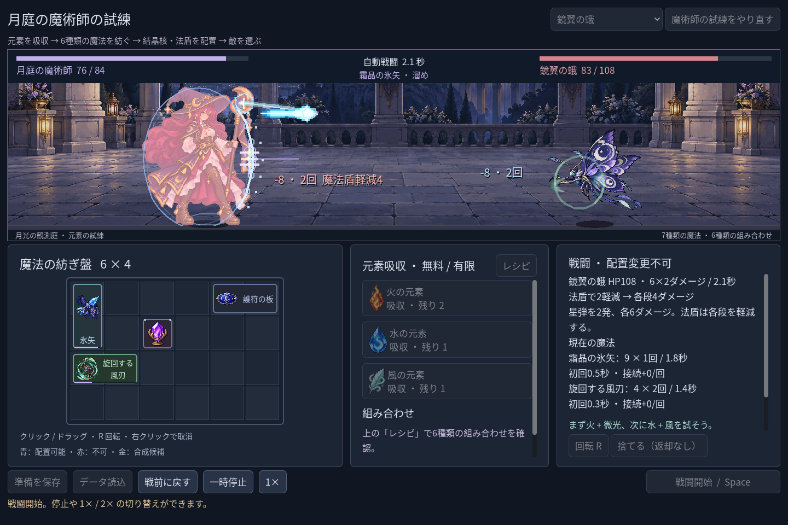
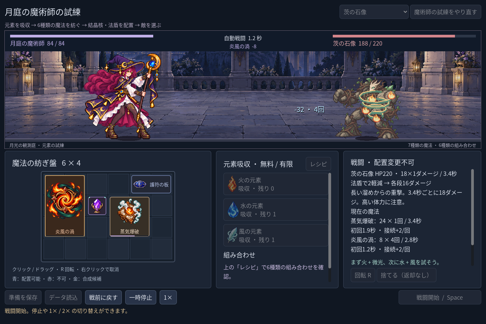

# 2026-11-02：ブログ内の画像表示を日本語 UI に揃える

ユーザーから、GIF だけでなくブログ内のすべての画像について、日本語化するか、隠すか、削除してほしいとの依頼がありました。ブログ草稿にあった24点の埋め込みを確認し、中国語 UI の旧スクリーンショット、文字のあるコンセプト図、全フレームの文字を確実に隠せない旧 GIF は本文から非表示にしました。元の画像、GIF、各時点の開発記録はそのまま残しています。

本文には、目視で日本語 UI を確認した6枚の実行画像を表示しています。旧森林版は2026-11-02に日本語化後に撮影したものであり、2026-10-22の当時の画像ではないと明記しました。法師のレシピ、合成プレビュー、合成後の3枚と新たに撮影した蛾・石像戦の2枚は Godot の自動操作 fixture です。人がプレイした様子とは記載していません。

新しい画像は `node scripts/godot.mjs mage-capture -- --capture-dir=... --encounter=mirror_moth --capture-build=frost_gale --auto-quit` と、`--encounter=thorn_golem --capture-build=steam_tornado` の別実行から取得しました。どちらもプレイヤーのセーブを無効にした有限素材の fixture で、実行レポート上は蛾戦9.5秒、石像戦12.1秒で勝利しました。後者には通常の素材廃棄が含まれます。表示画像とレポートは `screenshots/2026-11-02-blog-japanese-v1/` に、ハッシュ付きで保存しています。Godot の `Image.load_from_file` には既知のエクスポート互換性警告が残り、エクスポートは確認していません。

確認では、Markdown の画像埋め込みが6点、すべて日本語 UI の2つの証拠フォルダー内の PNG であり、ファイルが存在し manifest の SHA-256 と一致することを検証しました。ブログ本文に GIF や HTML 画像・動画埋め込みはありません。リンク先の開発記録や比較ページは今回の表示変更の対象外です。
