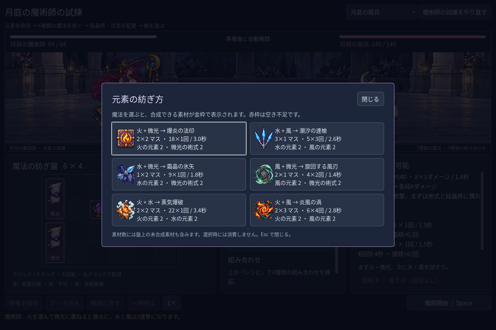
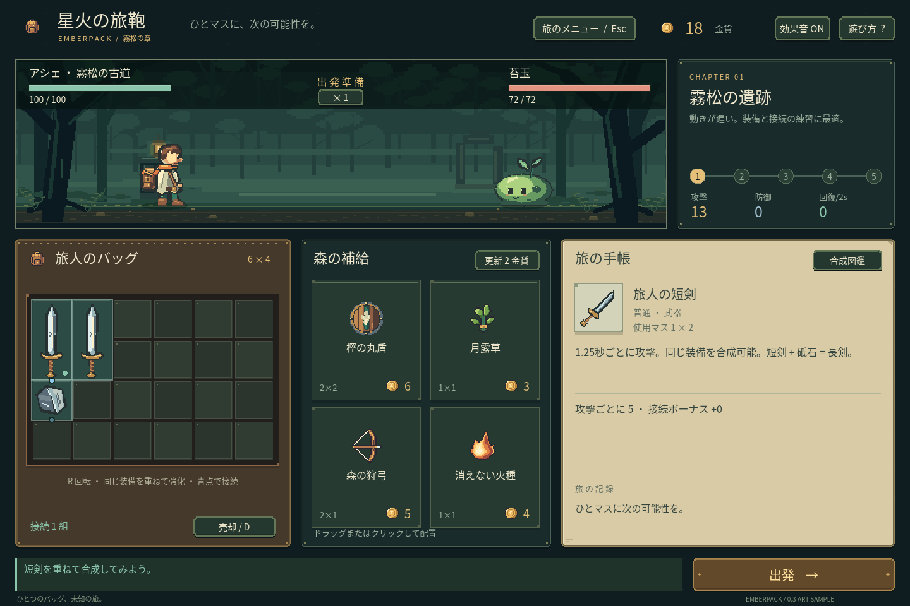

# 2026-11-02：魔法のレシピを見つけやすくし、画面を日本語にする

魔術師の元素パネルから「レシピ」を開くと、6種類の組み合わせ、使用マス、基本ダメージ、回数、間隔と取得可能な素材数を確認できます。カードを選ぶだけでは消費せず、盤上の材料を優先して選択し、実際の配置判定に基づいて金枠または赤枠を表示します。材料をクリックまたはドラッグして合成に成功すると完成品が短く光ります。空き不足なら素材は減りません。戦闘中はレシピ選択をロックし、Esc で閉じられます。

魔法使い、敵、術式、説明、保存エラー、旧森林ゲームの画面と報酬を日本語にしました。ゲーム内のウィンドウタイトルだけを変更し、Godot のプロジェクト名は維持しています。`user://` の保存先、アイテム ID と既存の保存形式を守るためです。収録フォントは既存の Noto Sans CJK SC で、日本語表示を Windows の実画面で確認しましたが、日本語専用字形の選定や他 OS は未確認です。

## 発見したことと修正

- 盤面ドラッグの自動テストで、ドラッグ開始後のドロップ判定が画面外を指し、109項目中2項目が失敗しました。イベント注入だけでは Godot の実際のドラッグ判定が参照する OS カーソルが動かなかったため、テスト側でカーソル位置を同期。再実行は109項目、失敗0です。人による操作テストの代わりではありません。
- 過去の C0 実行レポートには当時の中国語表示名が保存されています。記録を書き換えず、現在の日本語名をカタログと照合し、残る ID・戦闘統計を過去の数値と比較するようテストを分けました。
- 作業中の Godot は Cloud モード、Codex の設定は localhost を指しており、ローカル接続は拒否されました。直接起動したエディターにはプロジェクト用 SDK と MCP の環境が渡らないため、保存後に `npm run godot:open` から起動し直す必要があります。**この時点では再接続成功を確認していません。** 詳細は `MCP_SETUP.md` と `docs/ANIMATION_PLAN.md`。
- 昔の GIF は焼き込まれた中国語を日本語には再生成していません。元動画を残した上で、戦闘領域への切り出しと固定領域のモザイクを施した派生 GIF にブログ・日本語開発記録のリンクを変更しました。動く文字の位置は場面によって変わるため、一部の背景やエフェクトも隠れ、全フレームで文字が完全に読めないことまでは保証していません。生成元、矩形、長さとハッシュは派生版の `manifest.json` に記録しました。

## 検証

Windows、Godot 4.7.2 .NET、OpenGL Compatibility、NVIDIA GeForce RTX 3070 Laptop GPU：

| コマンド | 結果 |
|---|---:|
| `npm run game:test` | 949項目、失敗0 |
| `npm run game:classes:test` | 623項目、失敗0 |
| `npm run game:classes:art:test` | 618項目、失敗0 |
| `npm run game:mage:test` | 62項目、失敗0 |
| `npm run game:mage:vfx:test` | 49項目、失敗0 |
| `npm run game:mage:expansion:test` | 142項目、失敗0 |
| `npm run game:mage:discovery:test` | 109項目、失敗0 |
| `npm run game:classes:feedback:render:test` | 6項目、失敗0 |

合計2558項目。レシピカードの配置は1280×800、1440×960、1920×1080で自動確認しました。破損データの負例で既知の `Exponent too high` 警告が2件、画像の `Image.load_from_file` に Godot のエクスポート互換性警告があります。エクスポートや他プラットフォームの動作は今回確認していません。スクリーンショットと JSON は `screenshots/2026-11-02-japanese-v1/` に保存しています。

AnimationPlayer を本ゲームへ導入する PoC はまだ作っていません。レビューと候補は `docs/ANIMATION_PLAN.md` に記録しています。魔法使いの音、専用被弾姿勢や連戦は未実装です。
