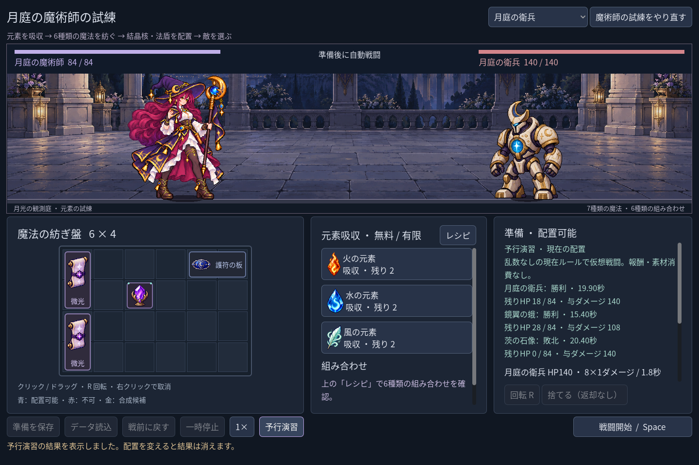
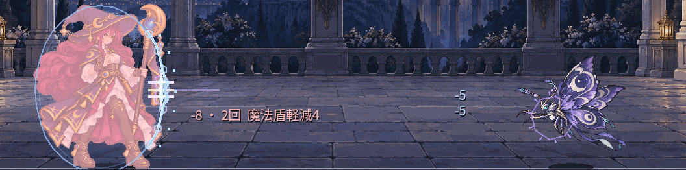

# 2026-11-02：被弾の動きと、三体を比較できる予行演習

魔術師の準備画面に「予行演習」を追加しました。現在の配置から、巡衛・鏡翼の蛾・茨の石像の三戦を別々の戦闘エンジンで最後まで計算し、勝敗、戦闘内時間、残りHP、有効ダメージを表示します。現在の敵と攻撃に乱数はないため、同じ構築・同じルールなら実戦と一致する見込みです。戦闘、素材、金貨、UID、保存データを進めず、報酬もありません。配置や素材の取得などを確定すると古い結果を消し、再実行を促します。持ち上げただけのプレビューは確定扱いにしません。

画面の初期構築の例では、巡衛は19.90秒で勝利・HP18、蛾は15.40秒で勝利・HP28、石像は20.40秒で敗北しました。これはルール内の予行結果であり、作業時間や実測性能ではありません。1280×800では第三の結果まで見るため詳細欄のスクロールが必要です。

## 受撃と法盾

アニメーション計画の受撃 PoC として、独立シーンの `AnimationPlayer` を魔術師の Sprite2D の親に置き、5つの整数位置を0.22秒で進める小さな後退と復帰を作りました。実際の敵の命中イベントだけで動き、同時の多段ヒットは一つの反応にまとめます。停止・1倍/2倍・戦前への復帰で座標が残らないことを検証しました。既存の Sprite2D の画像領域・位置・倍率は従来の表示コードが担当し、騎士の揺れには手を加えていません。

法盾の表裏と施法位置はこの受撃移動に追従し、実際に軽減した命中に限って外側の波紋、短い閃光と飛び散る光片を重ねます。盾のHPや状態異常は追加していません。上の GIF は実戦イベントで撮った5枚を手動の表示時計で進め、最初と最後の停止を延長した比較素材で、通常速度の連続録画ではありません。源画像、表示時刻、GIF の保持時間とハッシュは同じフォルダーの manifest に残しました。

アニメーション計画で最初に想定した独立 PoC を経て法師へ接続しました。作業時の Godot MCP は接続拒否だったので、プロジェクト内の Godot で実装・検証し、MCP からトラックを編集したとは主張しません。元の姿勢4枚はそのままで、腕や髪の新しい中間コマ、専用被弾姿勢はまだありません。

## 検証

Windows / Godot 4.7.2 .NET / OpenGL Compatibility / NVIDIA RTX 3070 Laptop GPU。下記は今回実行したチェック数です。

| コマンド | 結果 |
|---|---:|
| `npm run game:classes:test` | 623、失敗0 |
| `npm run game:classes:art:test` | 618、失敗0 |
| `npm run game:mage:test` | 62、失敗0 |
| `npm run game:mage:vfx:test` | 49、失敗0 |
| `npm run game:mage:expansion:test` | 142、失敗0 |
| `npm run game:mage:discovery:test` | 109、失敗0 |
| `npm run game:classes:feedback:render:test` | 6、失敗0 |
| `npm run game:mage:hit:test` | 27、失敗0 |
| `npm run game:mage:rehearsal:test` | 26、失敗0 |

合計1662。予行演習は3敵それぞれを独立した50ms刻みの実戦計算と比較し、保存ファイルのハッシュも前後で照合しました。受撃は実際の蛾の二段攻撃から発生する移動・盾位置・停止を確認し、完全な戦闘結果を独立エンジンと比較しました。1280×800、1440×960、1920×1080の実機画面を保存し、GIF の5フレームと遅延を再読み込みで確認しました。破損保存の負例には既知の指数警告、Godot には `Image.load_from_file` のエクスポート互換性警告が残ります。エクスポート、他OS、プレイヤーによる主観評価は未確認です。
