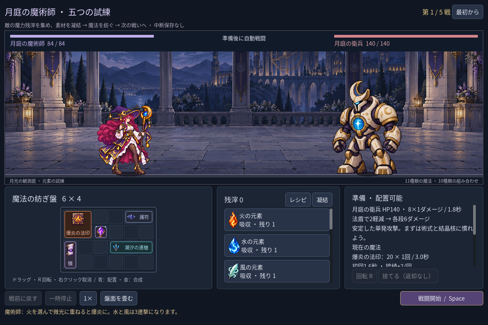
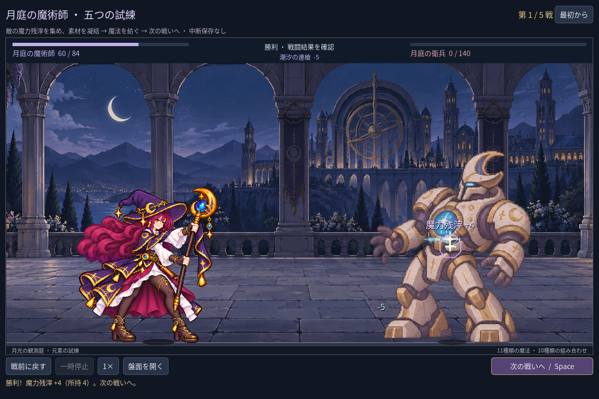
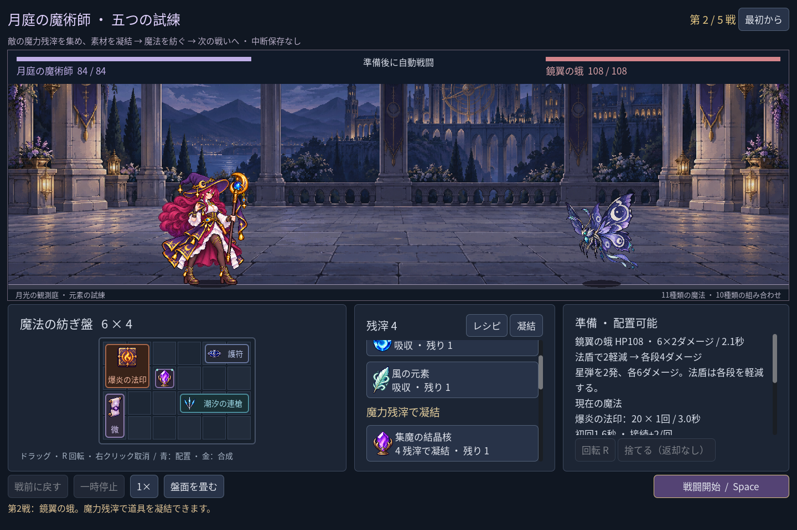
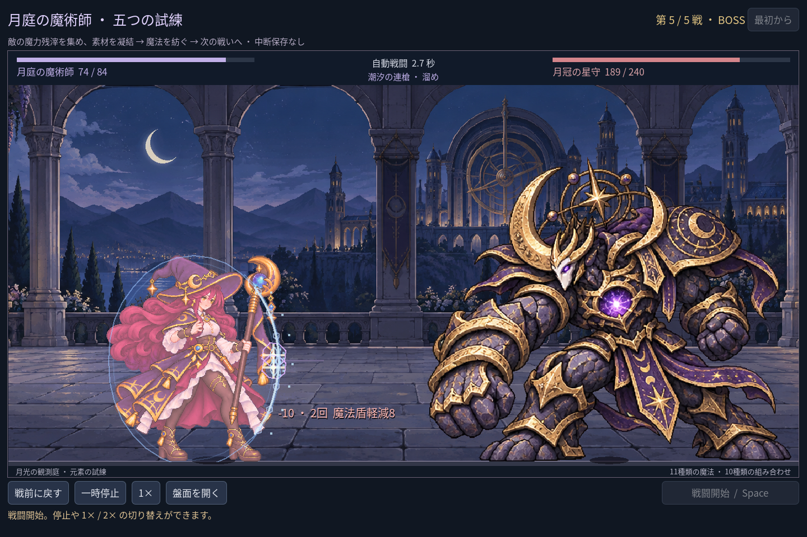

# 2026-11-03：五戦の遠征と、敵の魔力を紡ぐ仕組み

> 2026-11-07 追記：当時未対応だった中断保存は、その後[独立した遠征チェックポイント](2026-11-07-mage-campaign-save.ja.md)として実装した。
> 同日追記：当時の第四戦は衛兵の再利用だったが、ユーザーの指摘を受けて[独立した書霊](2026-11-07-mage-scribe.ja.md)へ変更した。

## 依頼と設計

ユーザーから、画像に写る衛兵の大きさが変わっていないこと、魔法の組み合わせを増やし、準備と成長を挟む五戦の最後に Boss を置くことを求められた。前回大きくしたのは石像だったため、今回の画像で選択されていた月庭の衛兵も拡大した。さらに「お金」より、敵から落ちる魔力を使って道具を作る設定の方が魔術師らしいという提案を受け、勝利報酬を「魔力残滓」に変更した。

`npm run game:mage` は五戦原型を起動する。戦いは衛兵→鏡翼の蛾→茨の石像→二連撃の強化衛兵→月冠の星守 Boss。第四戦の衛兵は既存図集の強化版で、独立した新原画ではない。Boss は新しい四姿勢と、星弾二連撃・重撃を交互に使う実際の攻撃パターンを持つ。

戦闘の勝利で魔力残滓を順に4・4・5・6個獲得する。最終勝利は踏破で、新たな購入段階はない。準備画面の「凝結」で残滓を有限の結晶核、護符、微光、火・水・風元素へ変えられる。初期の無料元素も有限であり、材料、残滓、盤の空きと方向支援を考える。各戦の勝利後は HP が全回復し、盤面・残滓・取得枠は引き継ぐ。敗北には報酬がなく、戦前に戻して再挑戦できる。勝利した戦いをやり直しても報酬は二重に増えない。

五戦原型は現時点で**中断保存に対応しない**。旧単戦のチェックポイントを拡張・上書きせず、旧単戦と予行演習は `npm run game:mage:trial` に残した。内部では既存の数値フィールドを残滓として使うが、五戦から旧保存処理を呼ばない。安全な独立遠征保存は次の課題。

## 追加した魔法

六つの異素材組み合わせに加え、火＋火「陽炎の三連星」、水＋水「氷晶の大槍」、風＋風「暴風の五重輪」、微光＋微光「星環の大魔法」を追加した。アイコン、占格、段数、速度、命中表現と実際の素材消費を持つ。合成ガイドは同素材を二つ要求し、有料素材を二つ凝結する場合も合計費用を確認する。十配方はいずれも元素編織内の構築差であり、召喚や奥術循環を新たに実装したという意味ではない。

Boss 図集と四術式アイコンは内蔵 imagegen を使用した別バージョンの素材。入力、原文プロンプト、実寸、SHA-256 は [`assets/art/mage-campaign-v1/`](../../assets/art/mage-campaign-v1/) に記録した。戦闘中は既存の AnimationPlayer 同期、法盾と新しい紫金の Boss 効果を使う。

## 実際の画面

すべて日本語 UI の Godot 実行画像。自動操作 fixture による初期資源の編織、実際の勝利報酬、実際の凝結購入と五戦目の画面で、生成コンセプトではない。

同フォルダーには十配方の画面、別の新術式、Boss の重撃と1280×800・1920×1080の戦闘画面も保存した。

## 検証と限界

- `npm run game:mage:campaign:test`: 154 checks, 0 failures。通常の元素取得と編織で五戦を通し、第一・二戦の残滓で結晶核と法盾を実際に凝結。もう一組の同元素三術式構築でも五戦を規則エンジンで通した。Boss の二連撃と重撃、実画面、敗北時無報酬、やり直しでの報酬重複防止、同素材のガイド、素材二個の費用、既存保存の不変も検証。
- 上記の一つの固定構築では、戦闘時間／残 HP は順に8.60秒／60、6.00秒／68、11.20秒／42、8.60秒／60、13.60秒／36。各戦前に全回復する現在のルールと、この配置での結果であり一般的なバランス保証ではない。
- `game:mage:layout:test` 64、`game:mage:discovery:test` 215、`game:mage:expansion:test` 146、`game:mage:cast-sync:test` 28、`game:mage:hit:test` 27、`game:mage:vfx:test` 49、`game:mage:rehearsal:test` 40、`game:mage:test` 62、`game:classes:test` 623、`game:classes:art:test` 618、`game:classes:feedback:render:test` 6 checks、いずれも失敗0。
- 三寸法で配方・凝結の操作領域を確認し、Boss の四姿勢と石像の四姿勢が舞台内に収まり人物と重ならないことを確認。衛兵の準備姿勢は各窓で法師の約1.36倍の高さ。拡大後に命中位置が足元へずれたため、衛兵の体の中心を基準に修正した。
- 同素材レシピ実装後、旧回帰の「火＋火は未登録」という前提が失敗した。未登録の火＋結晶核を検証するよう更新した。また予算判定の型推論エラーを明示型で修正し、全検査を再実行した。
- `node --check scripts/godot.mjs` と `npm run game:mage -- --quit-after 10` を実行し、新入口が起動することを確認。画像ロードの既存エクスポート警告は残っており、配布ビルドは未検証。全回復、固定報酬、Boss 数値、生成画像の品質と各流派の幅は今後の調整対象。
