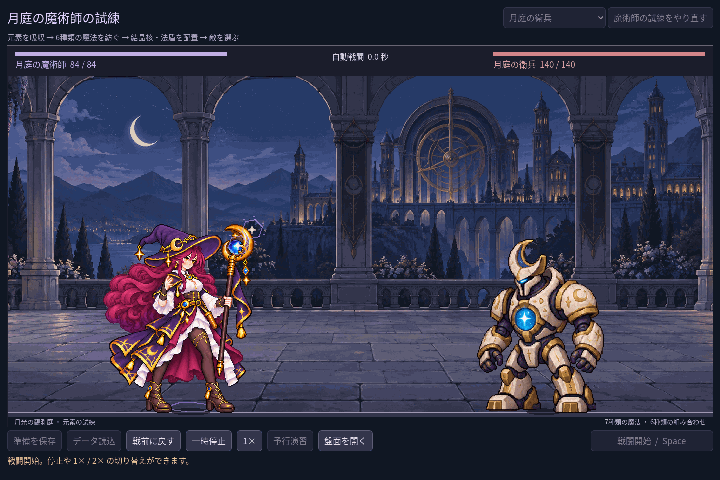
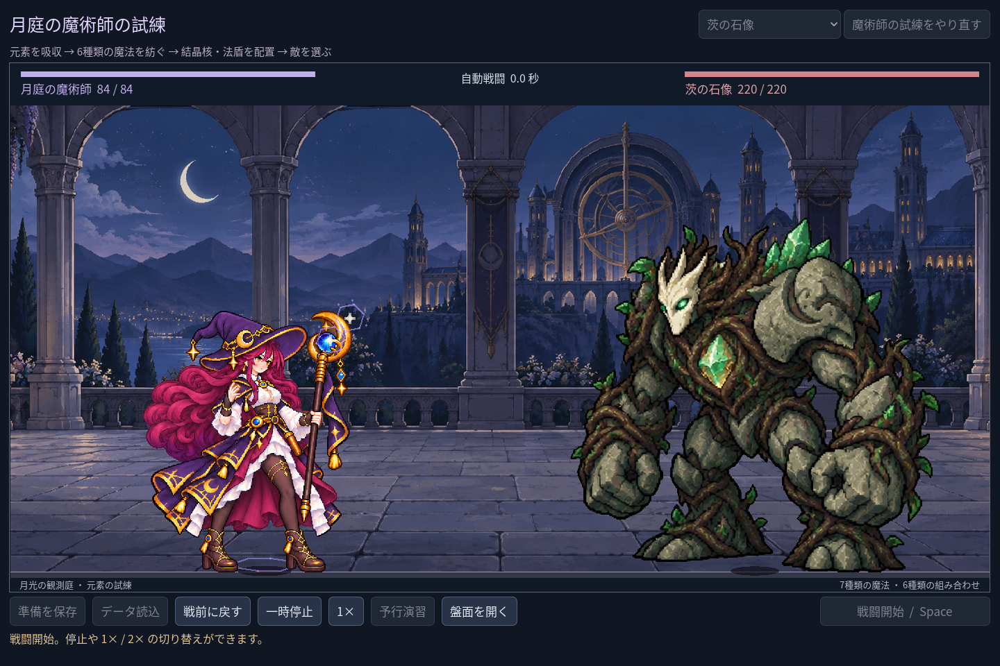

# 2026-11-03：詠唱姿勢と発射を合わせ、石像を大きくする

## 問題と実装

ユーザーから、動作が終わる前に魔法が飛び出すように見えること、石像がまだ主人公と同じくらいに見えることを指摘された。以前は弾の飛行を実際の命中の0.24秒前から予測表示する一方、魔法使いの発射姿勢は命中イベントが来てから始めていた。

`scenes/components/mage_cast_timeline.tscn` の独立した AnimationPlayer を追加した。予測された詠唱は待機・発射の姿勢を選び、飛行開始と同時に発射姿勢へ移る。命中は既存の実イベントから表示し、命中後に収勢する。タイムラインは手動で戦闘時間に合わせて進み、一時停止と2倍速にも従う。連続する発射は発射姿勢を優先し、次の溜めだけでは収勢を中断しない。同時刻の複数術式や多段命中は一つの収勢として扱う。

複数の道具が同時に発動するときは一つの姿勢を共有しつつ、装備順に対応する安定した別々の発射位置を使う。発射済みの弾の始点は発射フレームの杖先を基準にする。先に敵が倒れた等の理由で予測が消えた場合、予測の姿勢を取り消し、未発生の命中を捏造しない。ダメージ、クールダウン、実イベントの順序とセーブは変更していない。画面上の予測表示は既存の上限6発のままで、24道具の弾を全て同時に描くことは保証していない。

Godot MCP はローカル接続を確認し、`rql-mutate` で新しいシーンを別タブに開いて `rql-query` でノードを取得した。`script-execute` で AnimationPlayer の `cast` が1.06秒、`.:pose` 1トラック、4キーと読めることを確認。実装ファイルは通常のプロジェクト編集で作成したもので、MCP が生成したとは記さない。

石像は共通フレーム倍率と床の接地位置を維持したまま拡大。準備画面での待機姿勢は1280×800・1440×960・1920×1080において魔法使いの約1.45〜1.48倍高く、幅は約1.89〜1.93倍。姿勢や画面寸法によって実寸は変わる。小窓の旧職業実験で魔法使いが小さくなりすぎたため最小の表示高さを設けた。

## 実行画像

以下は日本語 UI の実際の Godot 戦闘画面。初期構築の微光二つが同時に発動する fixture を50ms刻みで手動進行し、17枚を各50ms、720×480へ最近傍縮小して GIF にした。実時間の録画や性能測定ではない。

同フォルダーに発射・実命中・収勢の静止画像と、3画面寸法の石像画像を保存した。過去の画像は変更していない。

## 実測と残課題

- `npm run game:mage:cast-sync:test`: 28 checks, 0 failures。実 AnimationPlayer、同時発射、同刻の収勢重複防止、近接する次の発射、予測キャンセル、実戦での発射姿勢と未発生ダメージ、停止、2倍速、独立ルールエンジンとの全結果一致、保存データ不変を確認。GIF は17フレーム、各50msと解析して確認。
- `npm run game:mage:layout:test`: 61、`npm run game:mage:legs:test`: 17、`npm run game:mage:hit:test`: 27、`npm run game:mage:vfx:test`: 49、`npm run game:mage:expansion:test`: 142、`npm run game:mage:discovery:test`: 109、`npm run game:mage:rehearsal:test`: 40、`npm run game:mage:test`: 62 checks、失敗0。石像は3寸法・4姿勢で画面内と人物との分離も確認。
- `npm run game:classes:test`: 623、`npm run game:classes:art:test`: 618、`npm run game:classes:feedback:render:test`: 6 checks、失敗0。変更した GDScript 4ファイルも MCP `script-validate` でエラー0・警告0。
- 離散キーのタイムラインを収勢から過去に seek した際、古い発射キーが適用されずポーズが戻らなかった。0秒から目的時刻までキーを順に進める修正を加え、近接発射のテストで確認した。
- 元の四姿勢自体は増やしておらず、滑らかな手・腕や衣服の中間コマは今後の課題。画像読み込みに関する既存のエクスポート警告も未解消で、配布ビルドは未検証。
