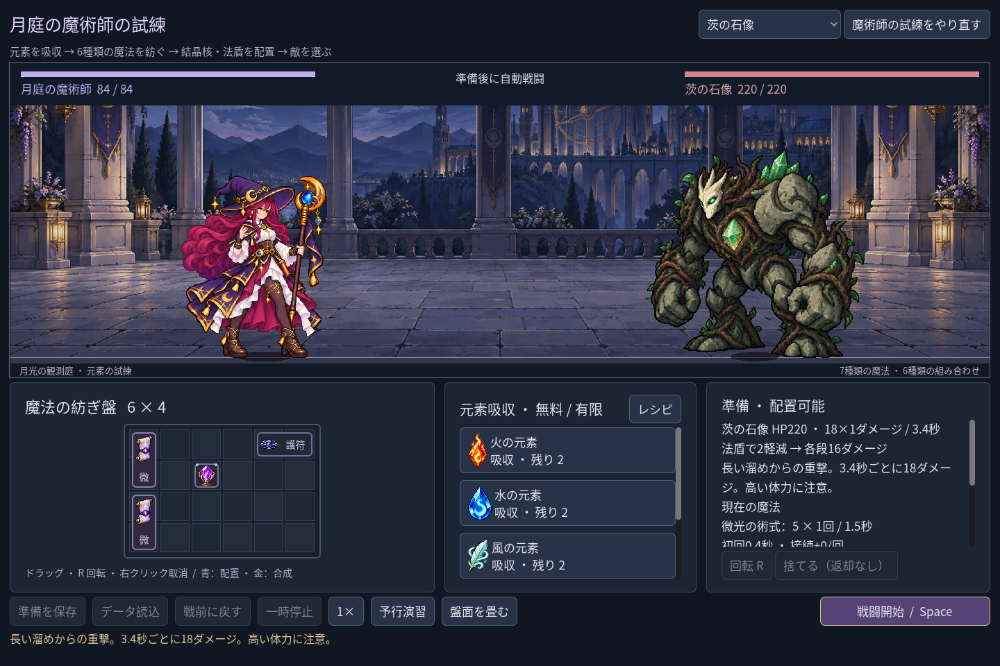
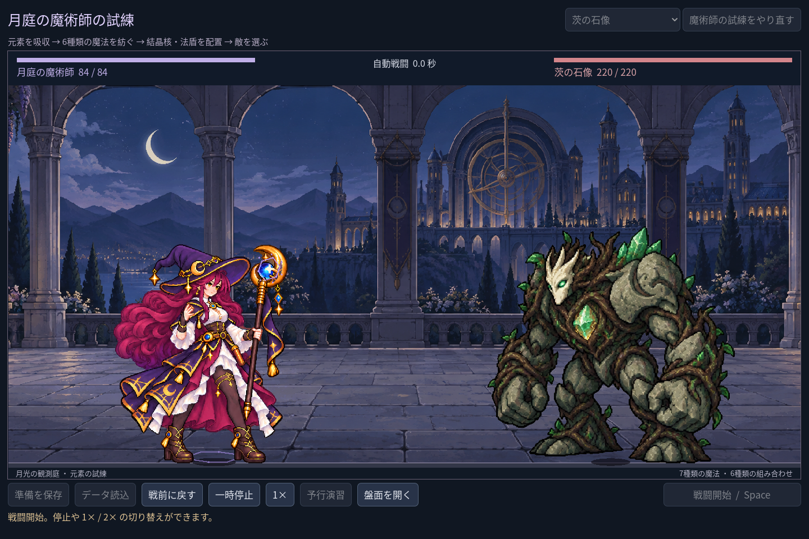

# 2026-11-03：戦闘舞台を広げ、敵の体格を変える

## 背景と変更

ユーザーから、道具 UI が画面を占めすぎること、主人公と怪物が同じ大きさに見えることを指摘された。魔術師の準備画面では盤面の高さと説明行を整理し、残った高さを上の戦闘舞台に割り当てた。戦闘開始時は盤面を自動で畳み、「盤面を開く」で戦闘中も確認できる。戦前に戻すと盤面が再表示される。折り畳みは表示だけで、構築内容や戦闘計算は変えない。開始ボタンには紫と金の強調色を加えたが、UI 全体の最終美術ではない。

舞台の高さに合わせて法師を拡大し、蛾は小さく、石像は大きく表示する。各図集の全フレームで共通倍率と足元を保ち、姿勢ごとに大きさを変えない。1280×800、1440×960、1920×1080 の準備画面で、石像の待機時の見かけの高さは法師の約1.13〜1.14倍、幅は約1.49倍だった。腕をつく攻撃姿勢では高さが変わるため、全姿勢で同じ高さに見えるわけではない。表示倍率は敵の能力値と無関係。

## 実行画面

日本語 UI を有効にした Godot の自動操作 fixture。戦闘画像は開始直後の0.0秒で、実際の敵選択・戦闘開始を使用した。過去の画像は変更していない。

1280×800、1920×1080 の戦闘開始画像も同じフォルダーに保存した。

## 実測と修正

- `npm run game:mage:layout:test`: 46 checks, 0 failures。3画面寸法、3敵の分離と表示範囲、石像と蛾の体格、盤面の開閉、戦闘時の自動折り畳み、構築を保つ戦前復帰を検証。
- `npm run game:mage:discovery:test`: 109、`npm run game:mage:rehearsal:test`: 40、`npm run game:mage:hit:test`: 27、`npm run game:mage:expansion:test`: 142、`npm run game:mage:vfx:test`: 49、`npm run game:mage:test`: 62 checks、いずれも失敗0。
- `npm run game:classes:test`: 623、`npm run game:classes:art:test`: 618 checks、いずれも失敗0。既存騎士の規則、表示や保存の回帰も確認。
- Godot MCP の `script-validate` で `class_lab.gd`、`class_arena.gd`、`class_grid.gd`、`test_mage_layout.gd` を個別に検査し、4ファイルともエラー0・警告0。
- 初回の石像倍率では待機フレームの実際の高さが法師の約1.047倍にしかならず、目標検査に失敗。図集内の最大フレームを基準に共通倍率を決めているため、待機フレームを実測して倍率を調整した。
- 小画面の単マスアイコンは余白が大きくなりすぎ、可読性検査が失敗した。単マスのみ余白を縮めて再検証した。マウスを使う GUI 検査を他のウィンドウ操作を伴う検査と同時実行するとドラッグが失敗したため、最後は順番に実行した。
- 既存の画像読み込みに Godot のエクスポート警告が残る。配布ビルド、1280×800 より小さい画面、タッチ操作、専用被弾姿勢は未検証。UI の装飾、情報の階層とアニメーションは引き続き改善する。
