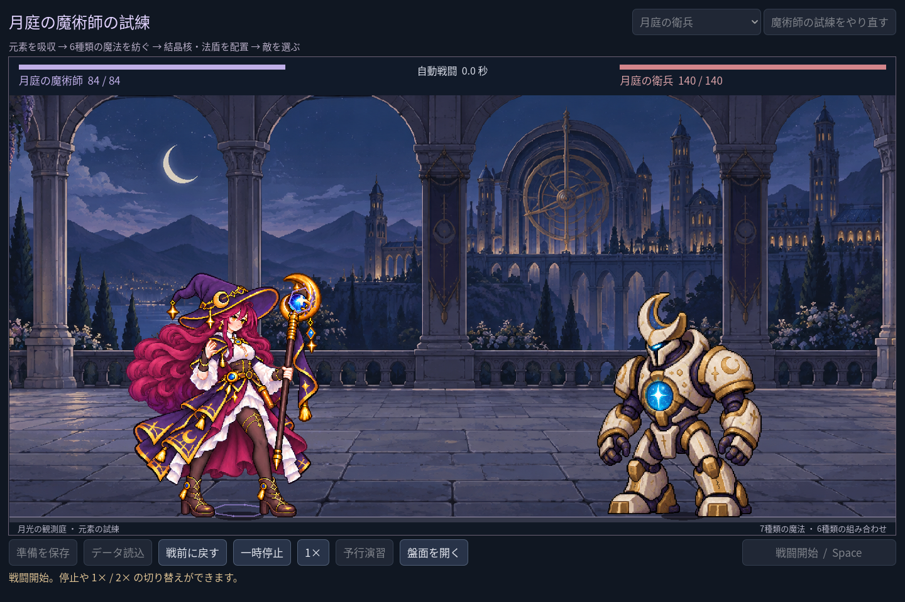
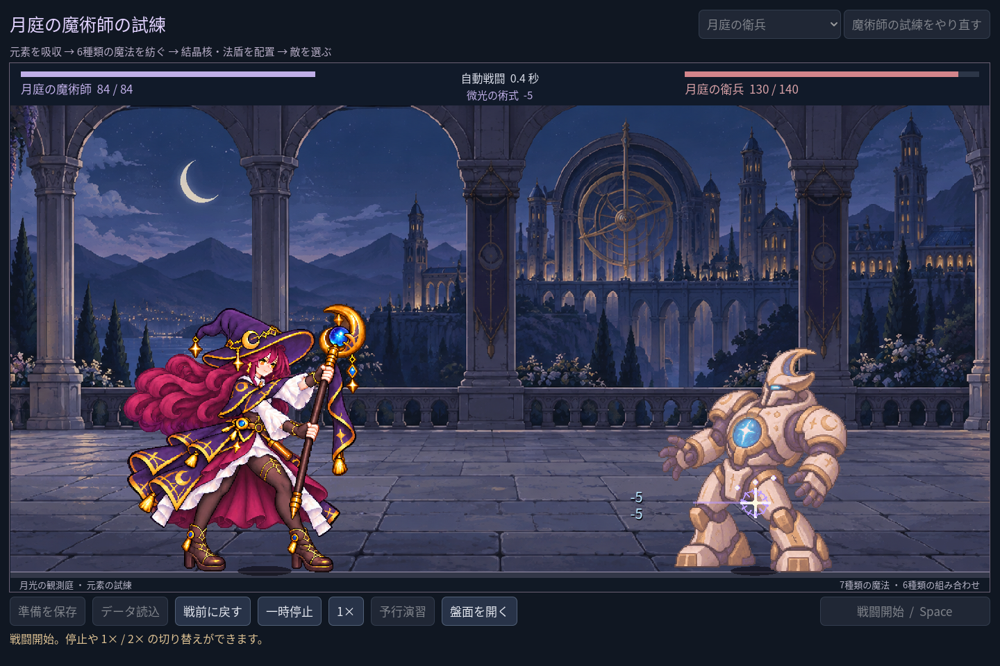

# 2026-11-03：魔術師の脚と衣装の重なりを描き直す

## 依頼と判断

ユーザーから、魔術師の左右の脚が不自然に見えると指摘された。確認すると、ゲームの法師は静止原画ではなく4姿勢の施法図集を通常表示しており、スカートの下で奥側の脚がどこから伸びているか読み取りにくく、足の向きも姿勢間で変わっていた。外観を保ちながら股関節、膝、足首と裾の重なりが読めることを目指し、内蔵 imagegen で既存画像を編集した。新しい4姿勢図集と静止原画は各1122×1402、透明背景。元画像は残し、新しい別フォルダーの素材へ参照を切り替えた。

図集は腕、二つの握点、長い月杖、顔や衣装を保つよう指示した。生成画像は全画素が元と同一ではなく、脚と裾以外にも細かな変化がある。詳細な人体の自然さは自動検査で保証できない。入力画像、生成プロンプトと SHA-256 は [`assets/art/mage-leg-revision-v1/`](../../assets/art/mage-leg-revision-v1/) に記録した。既存の手・杖や生成物のフレーム間整合性には引き続き目視確認が必要。

## 実行画像

日本語 UI の Godot 実行画面。初期構築で実際に戦闘を開始し、ゲームの時間を50ms刻みで手動進行して各状態を撮影した fixture。実時間動画ではない。

同フォルダーに予備動作と収勢も保存した。手動進行した四枚は、動作の滑らかさや人体品質の最終合格を示すものではない。

## 検証

- `npm run game:mage:legs:test`: 17 checks, 0 failures。実戦イベントで待機・予備・命中・収勢を通り、各状態で新図集、画面内の姿勢、杖の施法点、実画像の保存を確認。
- `npm run game:mage:layout:test`: 46、`npm run game:mage:hit:test`: 27、`npm run game:mage:vfx:test`: 49、`npm run game:mage:expansion:test`: 142、`npm run game:mage:discovery:test`: 109、`npm run game:mage:test`: 62 checks、失敗0。
- `npm run game:classes:art:test`: 618 checks、失敗0。全四姿勢の取区・共通倍率・足元、騎士表示、被弾や停止/倍速も回帰確認。
- MCP `script-validate` で `class_art.gd`、`class_motion.gd` と撮影テストを個別検証し、3ファイルともエラー0・警告0。これは文法検証であり人体の品質審査ではない。
- 過去からの `Image.load_from_file` エクスポート警告は未解消で、配布ビルドは未検証。画像は透明だが、源の論理ピクセル密度や縁色の統一も未完成。
