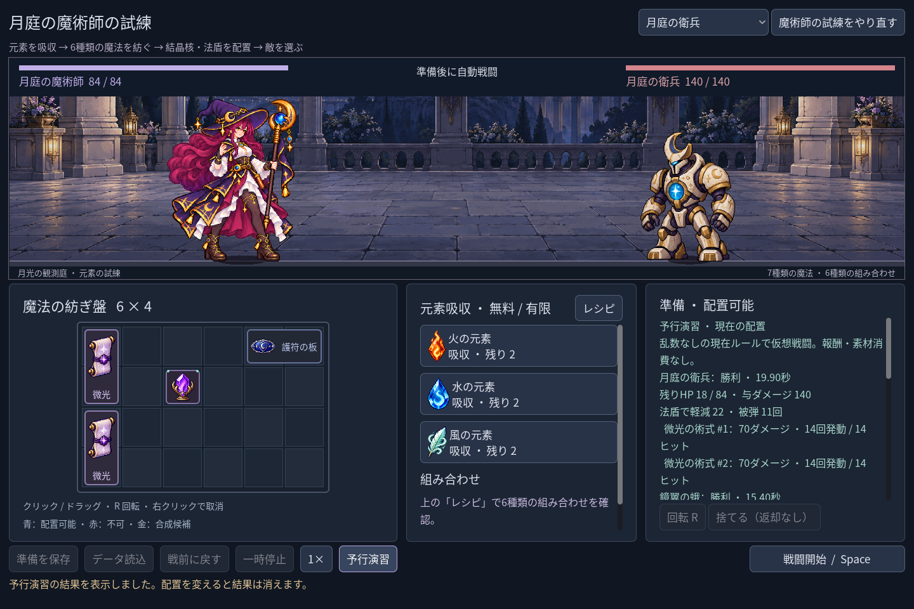
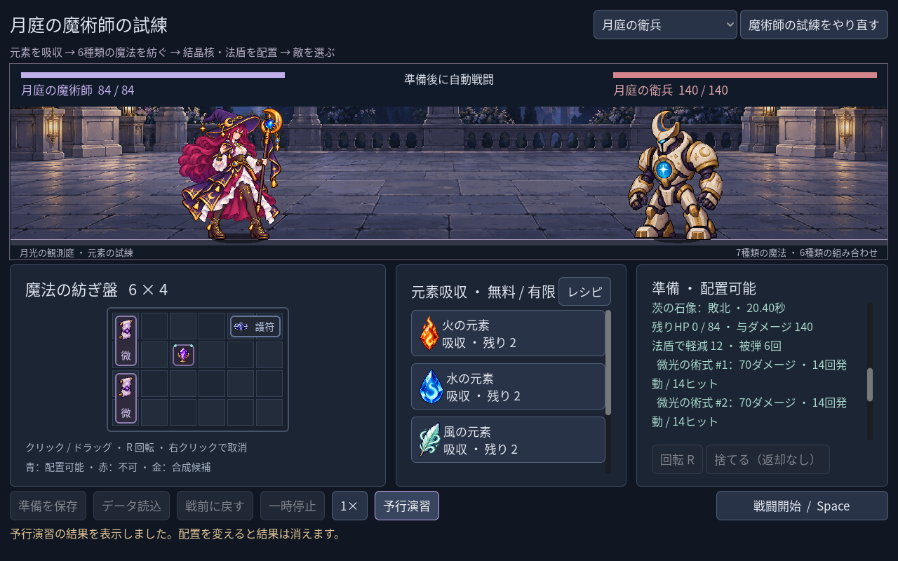

# 2026-11-03：MCP とアニメーションの実測、予行演習の内訳

## 作業と判断

開いていた Godot エディターは Cloud 接続を要求しており、ローカルの MCP ポートは接続拒否だった。エディターを閉じずに AI Game Developer ドックを Custom に切り替え、インストール済みのローカルサーバーを起動し、プロジェクトの接続設定を更新した。`npm run godot:status` は接続成功。MCP プロトコル 2025-03-26 の初期化とツール一覧取得に成功し、サーバー 9.2.13.0 の15ツールを確認した。設定や認証情報はリポジトリへ含めない。

MCP の `rql-mutate` で `res://scenes/components/mage_hit_motion.tscn` を別タブに開き、`rql-query` で `MageHitMotion` / `AnimationPlayer` を確認した。既存の `main.tscn` はもう一つのタブに残した。`script-execute` で `hit` の長さ0.22秒、`.:position` の1トラックと5キーを読み、Animation のメモリー上の複製で第2キーを `(-5, 0)` → `(-6, 0)` → `(-5, 0)` と変更・復元した。元の Animation の値は `(-5, 0)` のまま。MCP 経由で Godot API からキーを読書きできることの検証であり、製品のキーを書き換えて保存した検証ではない。専用 Animation Tools 拡張とゲーム内エラー取得も未検証。Codex のこの会話には Godot ツールが動的には現れなかったため、ローカルの独立 MCP クライアントと HTTP ツール API で実行した。

以前の受撃 PoC は MCP 不通時にプロジェクト内の Godot ツールで実装した。今回の接続後に作ったとは記さない。MCP 接続先は認証なしのローカル用であり、外部公開しない。

## 魔術師の予行演習

三体それぞれの勝敗・時間・HPに加え、実際の法盾軽減量と被弾回数、各術式の有効ダメージ・発動数・ヒット数を表示する。同名術式も UID で区別し、多段の発動数と命中数を分けた。数値は戦闘規則の集計から取得し、予行演習は従来どおり素材、保存データ、実戦を変更しない。盤面変更後は以前の予測を消す。

以下は日本語 UI の Godot 実行画面。自動操作した初期盤面の fixture で、予測結果であり実戦の動画ではない。1280×800 では右欄をスクロールして後半を読む。

## 検証結果と残課題

- `npm run game:mage:rehearsal:test`: 40 checks, 0 failures。三体の独立した50ms刻み実戦計算と予測を比較し、各術式・各敵の表示値、護符を外した場合の軽減0、配置変更時の無効化、プレイヤー保存の不変、1280/1440/1920 の表示とスクロールを確認。
- `npm run game:mage:hit:test`: 27 checks, 0 failures。被弾アニメーション、同時多段、停止、倍速、実戦結果、盾の追従を確認。
- `npm run game:mage:test`: 62 checks, 0 failures。`npm run game:mage:discovery:test`: 109 checks, 0 failures。MCP `script-validate` は変更した `class_lab.gd` 1ファイルを精密検査し、エラー0・警告0。
- テストに追加したスクロールバー変数は最初に型推論エラーとなったため `VScrollBar` を明示し、再実行して通過した。Godot のスクリプト読み込みエラーでもプロセス終了コードだけでは失敗を検出できないケースがあったため、出力中の実際のテスト結果を確認した。
- 既存の `Image.load_from_file` に、エクスポート時に使えないという Godot の警告が出た。実行画面では描画されたが、配布ビルドは検証しておらず、リソース読み込みの修正が必要。
- 予行演習は現行の乱数なし一戦モデルの結果であり、将来の敵のランダム行動や連戦を予言するものではない。新規の召喚や奥術循環、専用身体アニメーションは今回追加していない。
