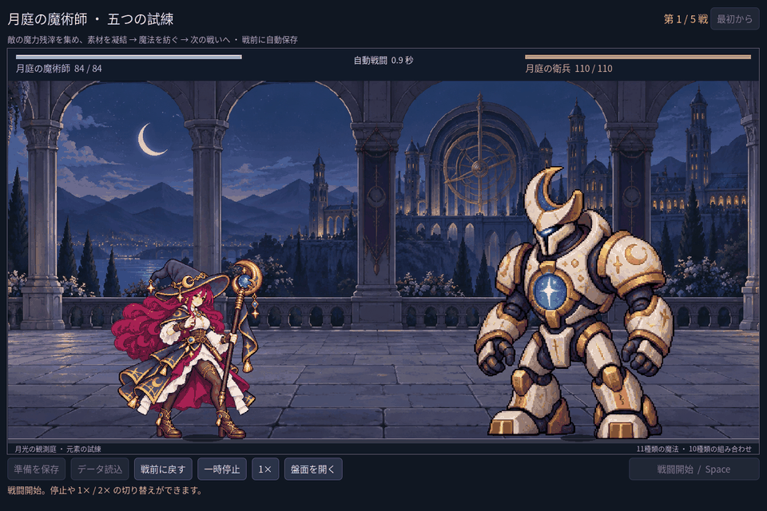

# 2026-11-07：五戦の難易度と魔術師の二つの新しい動作

## 方針

ユーザーは新しい詠唱待ち・魔力システムよりも、難易度の段階的な上昇と主人公の動きを優先した。自動発動、同時発動、道具の冷却と戦闘ルールは維持し、五戦の敵と表示アニメーションを調整した。新しい咏唱待ちや戦闘用魔力は追加していない。

## 五戦の調整

旧単戦の衛兵・蛾・石像はそのままにし、遠征用に別の敵定義を用意した。遠征の敵 HP は `140 / 108 / 220 / 170 / 240` から `110 / 145 / 190 / 210 / 260` に変更。第一戦の衛兵は攻撃6、第三戦の石像は重撃16にした。報酬や準備中の保存形式は変えていない。既存遠征は戦数から敵を決めるので、再開後の戦いには新しい難易度が適用される。

まず初期盤面と二つの合法な盤面を、毎戦 HP 全回復という遠征ルールで個別に同じ戦闘エンジンへ入れた。初期盤面の第一戦は以前 HP18 で勝利し、第二戦では HP28 が残っていた。調整後は第一戦 HP52、第二戦 HP4 で勝利、第三戦は敗北。戦前に元素を組み合わせる理由が見えるようにした。

混合構築（火＋微光、水＋風、残りの微光、初期の法盾）は報酬を追加購入せず、五戦の残り HP が `72 / 52 / 42 / 39 / 10`、戦闘時間が `6.40 / 8.60 / 11.20 / 13.60 / 16.40` 秒だった。初期の全元素から火火・水水・風風の三術式を作る強い構築は `80 / 76 / 70 / 66 / 54` HP、`3.40 / 3.50 / 5.90 / 6.00 / 7.20` 秒で勝利した。いずれも決定論的な二つの配置の計測であり、全構築の難易度や実際のプレイヤーの体感を保証しない。特に後者はまだ強く、元素供給と多段支援のバランスを実プレイで継続確認する。

## 新しい動作と画像の確認

魔法使いには従来の基本施法に加え、杖を引いて振る四姿勢と、手を上げて前へ伸ばす四姿勢を追加した。火系などは `swing`、水・風系などは `gesture`、微光は従来の `cast` を使用する。`scenes/components/mage_cast_timeline.tscn` の AnimationPlayer が各姿勢を切り替え、飛行開始時に発射姿勢、実際の命中後に収勢へ移る。複数の術式が重なった場合は従来どおり一人の魔法使いが共通の動作を表示し、各道具の実際の命中は独立したまま。

画像はゲーム内テストで実際に描画した画面を縮小して GIF にしたもので、リアルタイム録画ではない。各図集の入力、プロンプト、寸法と SHA-256 は [`assets/art/mage-motion-v2/`](../../assets/art/mage-motion-v2/) に保存。四姿勢それぞれの両腕・手・脚、杖の頭部と先端、服装、セル境界を目視し、ゲーム内の発射・収勢も確認した。最初の手勢案は下段で杖頭が消えたため不採用、次の案も下段で杖の位置が反対側へ飛ぶため不採用とした。採用版では四姿勢の杖が同じ側にある。発射点と表示範囲も自動確認したが、手指の自然さや動作の滑らかさは自動検査では保証できない。新素材は四つの離散姿勢で、連続した中間原画ではなく、姿勢間の切り替わりには改善余地が残る。

## MCP と検証

Godot MCP の `script-execute` で、保存済みシーンをキャッシュを無視して読み、AnimationPlayer に `cast / gesture / swing` があること、新しい `gesture` と `swing` が各1トラック5キーであることを確認した。MCP の `script-validate` は変更したタイムライン、アート、画面の各スクリプトでエラー0・警告0。シーンの編集はファイルで行い、MCP からのキー書き込みはしていない。

旧職業試験の小さな画面で、全動作の共通倍率を適用すると待機画像が検査上128px未満になる問題が出た。新倍率と新しい動作選択を魔法使い専用試練・遠征に限定し、旧職業試験のスケールを維持した。第一戦を易しくしたため、既存の敗北テストでは単一微光でも勝つようになり、通常の破棄操作で法盾も外す負けの配置に更新した。

- `npm run game:mage:motion-v2:test`：88項目、失敗0。実戦の両動作、発射と命中、一時停止・倍速、独立戦闘エンジンとの結果一致、および三画面寸法で各四姿勢の配置を確認。
- `npm run game:mage:balance:test`：39項目、失敗0。初期盤面と二つの合法構築、旧単戦の敵定義を確認。
- `game:mage:cast-sync:test` 28、`game:mage:campaign:test` 205、`game:mage:save:test` 97、`game:mage:layout:test` 64、`game:mage:vfx:test` 49、`game:mage:expansion:test` 146、`game:mage:legs:test` 17項目はいずれも失敗0。
- `game:classes:art:test` は合計618項目、`game:classes:test` は合計623項目、いずれも失敗0。

画像生成物の手・足・武器・一貫性と実画面を確認するというユーザーの指示は `AGENTS.md` に追記した。既存の画像読み込みに関する配布時の警告は残り、書き出しビルドは検証していない。
