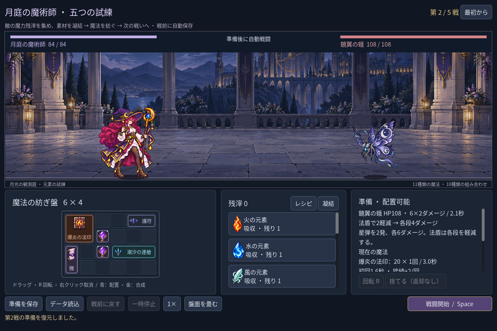
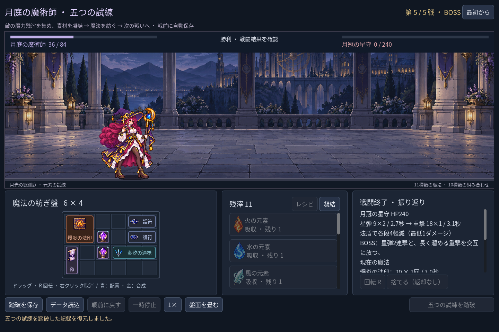

# 2026-11-07：魔法使いの五戦遠征を中断・再開する

## 目的と変更

五戦原型は一度終了すると最初からやり直す必要があった。そこで `scripts/classes/mage_campaign_save.gd` に、旧森林・職業試作・魔法使い単戦とは別の `user://mage-campaign-run.json` を用意した。魔法使いの盤面、位置・向き、素材や凝結の残数、魔力残滓、戦いの番号、乱数シードと廃棄素材を保存する。実装は準備状態のチェックポイントであり、戦闘の進行そのものは保存しない。

配置・取得・合成・廃棄の確定後と戦闘開始前に自動保存し、勝利直後には報酬を含めた**次戦の準備**を保存する。画面を閉じて再開するとこの状態から始まる。勝利後に「戦前に戻す」を選んだ場合は、報酬を取り消した本戦の準備を保存し直すため、報酬を重複して得られない。最終 Boss 勝利時は踏破状態と実際の残り HP を記録する。起動時の自動読み込みに加えて、手動の保存・読み込みも使える。

画像は `tests/test_mage_campaign_save.gd` が Godot 上で勝利・凝結・復元を自動操作した fixture。初戦の報酬で結晶を得た後、第二戦を復元している。プレイヤーの手動プレイを撮影したものではない。

## 安全性と確認した問題

読み込み前にデータ形式、戦数、盤面の重複、アイテムと素材の収支、在庫、残滓と HP などを検証し、失敗時は現在の盤面を変更しない。保存では一時ファイルを検証してから置き換え、元ファイルまたはバックアップを保護する。既存ファイルが破損・別形式の場合や一時ファイルが残っている場合は上書きしない。準備の変更後に保存できなかった場合は画面で知らせ、必要な戦前保存が失敗したままでは戦闘を開始しない。

開発中、勝利後に次へ進む前に終了すると報酬を失う問題があったため、勝利直後に次戦のチェックポイントを作るよう変更した。最終勝利も通常の準備として扱うと踏破が消えるため、踏破フラグと残り HP を別に記録するようにした。

最終勝利時の保存が失敗した場合にも、その画面で「踏破を保存」を再試行できるようにした。追加直後は GDScript が変数の型を推論できず、MCP の検証が2箇所の構文エラーを返した。`bool` を明示した後、同じ MCP 検証でエラー0・警告0を確認した。

## Godot MCP

2026-11-07 に接続中の Godot MCP の `rql-query` で、開いている `res://scenes/components/mage_cast_timeline.tscn` に `AnimationPlayer` があることと、ゲームが停止中であることを確認した。`script-validate` は `res://scripts/classes/mage_campaign_save.gd` と `res://scripts/classes/class_lab.gd` の各1ファイルについて、エラー0・警告0（Precise）を返した。この確認はスクリプト検証とノードの読取であり、今回 AnimationPlayer を編集したものではない。

## 自動検証

- `npm run game:mage:save:test`：97 項目、失敗0。隔離した保存先で、勝利報酬、復元、再挑戦、破損データ、一時ファイル、最終勝利時の保存失敗と再試行を確認。実際のプレイヤー用保存ファイルは前後のハッシュが変化しないことを確認した。
- `npm run game:mage:campaign:test`：158 項目、失敗0。`game:mage:layout:test`：64 項目、失敗0。
- 既存の魔法使い discovery 215、expansion 146、cast-sync 28、hit 27、VFX 49、rehearsal 40、trial 62 項目はいずれも失敗0。旧職業ロジック・保存・UI は合計623項目、美術・動作は合計618項目、GPU feedback は6項目で失敗0。これらの全回帰は最終勝利画面の再保存ボタン追加前に実施し、追加後は上記の保存・遠征・レイアウトを再実行した。

## 残る制約

戦闘の途中経過、個別術式の戦果内訳は保存しない。戦闘中の終了は戦前からの再挑戦になる。保存の収支検証は現在の報酬・素材定義に依存するため、後からルールを変える際は形式バージョンと移行方法の検討が必要。異常な JSON を検出する仕組みであって改ざん防止ではない。既存の `Image.load_from_file` に関する配布ビルド警告は今回の対象外で、書き出し版の動作は確認していない。
