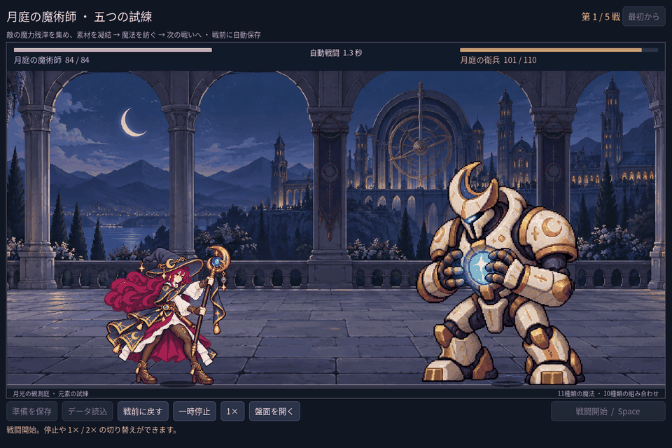

# 2026-11-07：魔術師の動作間で身長が変わる問題を修正

## 指摘と原因

ユーザーから、違うアニメーションが再生されると人物の大きさが変わると指摘があった。三つの図集を同じ倍率で描いていたが、元画像内の人物自体の大きさは揃っていなかった。帽子の上端から靴底までを原画上で確認すると、従来・手勢の姿勢はおよそ560〜575px、杖振りはおよそ489〜505pxだった。杖や髪を含む画像全体の外枠を揃えても、人物の見かけの身長は揃わない。

## 修正

`class_motion.gd` に各姿勢の帽子上端と靴底を基準にした測定値を追加し、`class_arena.gd` で三図集・十二姿勢の人物の高さを共通基準に合わせた。足元のアンカーを固定し、拡大後の杖を含む最大範囲を使って画面からのはみ出しを抑える。発射位置はその姿勢と同じ倍率を使って計算し、別の姿勢の倍率を誤って使わないようにした。戦闘処理や画像ファイル自体は変更していない。旧職業試験にはこの魔法使い専用調整を適用しない。

画像は Godot の戦闘画面をテストで固定し、三種類の姿勢を手動で切り替えて撮影した比較 fixture。各静止画を縮小し1秒ずつ表示しており、実際の連続戦闘録画ではない。元の[基本](screenshots/2026-11-07-mage-scale-v1/mage-cast.png)、[杖振り](screenshots/2026-11-07-mage-scale-v1/mage-swing.png)、[手勢](screenshots/2026-11-07-mage-scale-v1/mage-gesture.png)も保存した。

表示範囲に杖を収めると準備画面の魔法使いの見かけの高さが変わり、既存の画面検証で蛾が相対的に大きく見えることが判明した。蛾の描画サイズを校正後の人物の高さに基づいて制限し、石像・衛兵の大きさの定義は維持した。

## 確認と限界

Godot MCP の `script-validate` で変更したスクリプトの構文を確認。三つの画面サイズで十二姿勢の測定した人物高さ、足元、表示領域を確認し、実際の手・杖の発射姿勢と弾の発射点も照合した。測定は作画の目印に基づくものであり、顔や衣服の細部まで完全に同じことを保証するものではない。別々の生成図集による姿勢間の輪郭差と、離散コマの切り替わりは残る。

- `npm run game:mage:motion-v2:test`：187項目、失敗0。三画面寸法で三図集の四姿勢を確認し、帽子から足元までの表示高さ、足元、発射点と描画領域を検査。
- `game:mage:layout:test` 64、`game:mage:cast-sync:test` 28、`game:mage:vfx:test` 49、`game:mage:campaign:test` 205、`game:mage:legs:test` 17項目はいずれも失敗0。
- `game:classes:art:test` は旧職業の静止画・盤面ラベル・動作・演出の合計618項目、失敗0。
