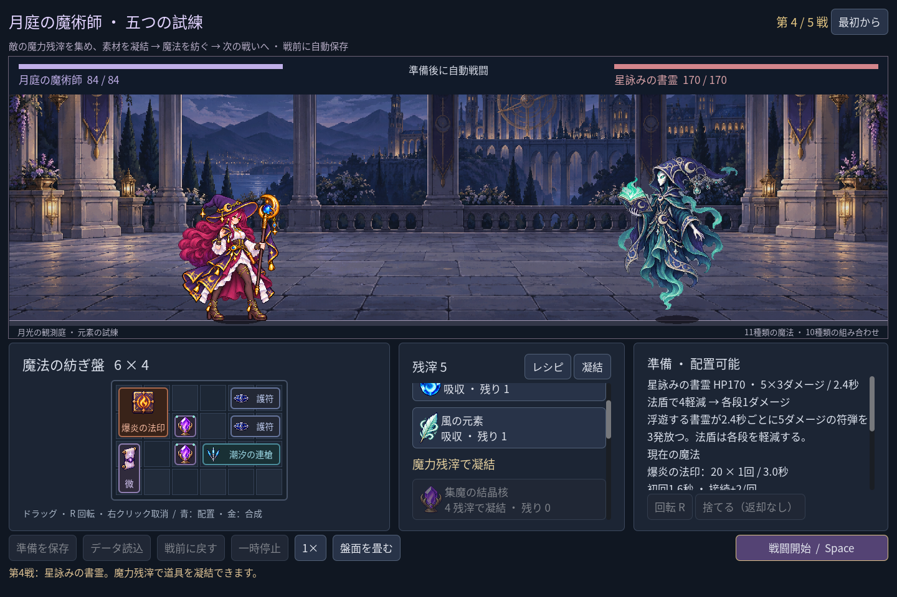
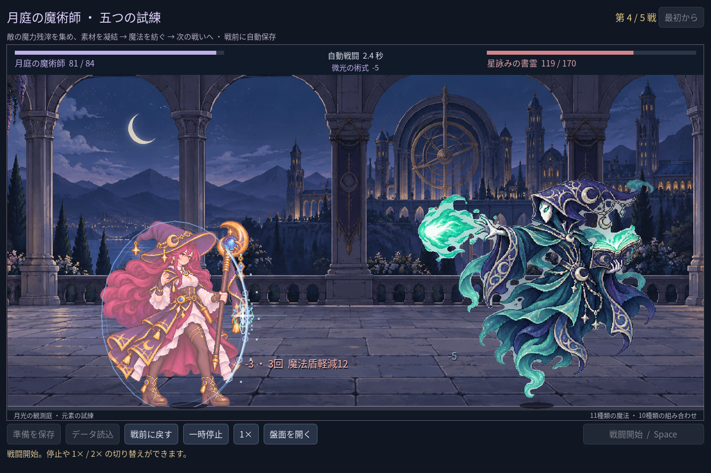

# 2026-11-07：第四戦に独立した敵「星詠みの書霊」を追加

## 指摘と変更

ユーザーから「五場の戦闘なら五種類の敵では」と指摘を受けて確認したところ、第四戦は別の名称と数値を持ちながら、第一戦の衛兵の図集を再利用していた。五つの ID が存在しても見た目は四種類だった。

第四戦を、浮遊する魔法書の精霊「星詠みの書霊」に変更した。衛兵、鏡翼の蛾、茨の石像、書霊、月冠の星守 Boss の五体は、それぞれ別の画像を使う。書霊は HP 170、2.4 秒ごとに5ダメージの符弾を3発放ち、法盾は各段を軽減する。敵の姿勢と発射演出には青緑色の魔法を使う。難易度は今後もプレイを通じて調整する。

どちらも `tests/test_mage_campaign.gd` で五戦を自動進行した Godot の実行画面。後者は実際の攻撃イベントの命中後であり、手動プレイの撮影ではない。

## 素材と保存互換

内蔵 imagegen に茨の石像を画風と2×2配置の参照として渡し、書霊の待機・詠唱・攻撃・被弾の四姿勢を生成した。採用画像、入力、プロンプト、寸法、SHA-256 は [`assets/art/mage-scribe-v1/`](../../assets/art/mage-scribe-v1/) に記録した。生成図集の α が128以上の範囲は各コマ内に収まり、従来と同じ閾値で輪郭を描画する。姿勢は別画像の切り替えであり、新しい中間アニメーションの連続コマは制作していない。

遠征のチェックポイントは敵の ID ではなく戦数を保存するので、既存の第四戦の準備を読み込むと新しい敵が表示される。旧 `sentinel_elite` 定義は残し、旧形式の保存ファイルは変更しない。

## 検証

Godot MCP の `script-validate` で変更した敵定義、敵アート、戦闘画面、魔法効果の GDScript は各1ファイル、エラー0・警告0（Precise）。MCP は接続中のエディターで使用し、今回の素材はファイルとして追加した。

- `npm run game:mage:campaign:test`：204 項目、失敗0。五戦の画像パスがすべて異なること、書霊の三連撃と法盾の各段軽減、実戦イベントによる効果表示、三つの画面サイズでの四姿勢、二つの合法構築での五戦を確認した。
- `npm run game:mage:save:test`：97 項目、失敗0。隔離したチェックポイントから五戦を進めて復元し、プレイヤーの保存ファイルが変化しないことを確認した。
- `game:mage:expansion:test` 146 項目、`game:mage:vfx:test` 49 項目、`game:mage:layout:test` 64 項目はいずれも失敗0。

最初の画像検査では、既存の衛兵が画像セルの端に接する姿勢まで「余白1px必須」としたため1項目が失敗した。既存素材はセル内に収まることを検査し、新しい書霊はさらに1pxの余白を検査するよう修正して再実行した。ゲーム本体の不具合と取り違えないよう記録する。

既存の `Image.load_from_file` に関する書き出し版の警告は残っており、今回も配布ビルドは未検証。生成画像の姿勢の自然さと難易度は、自動検査だけでは保証できない。
