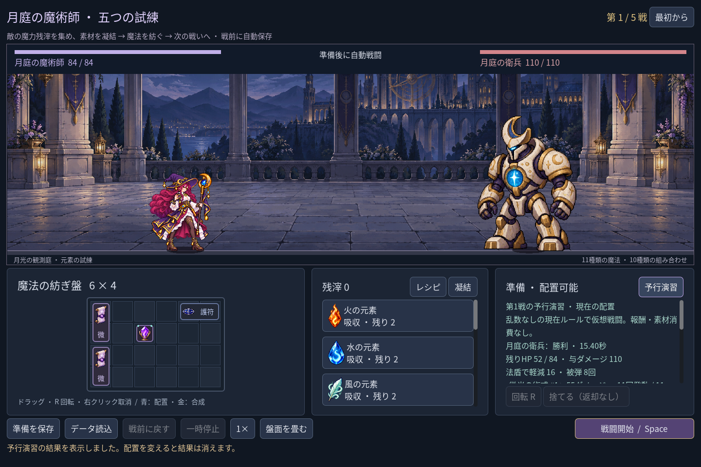
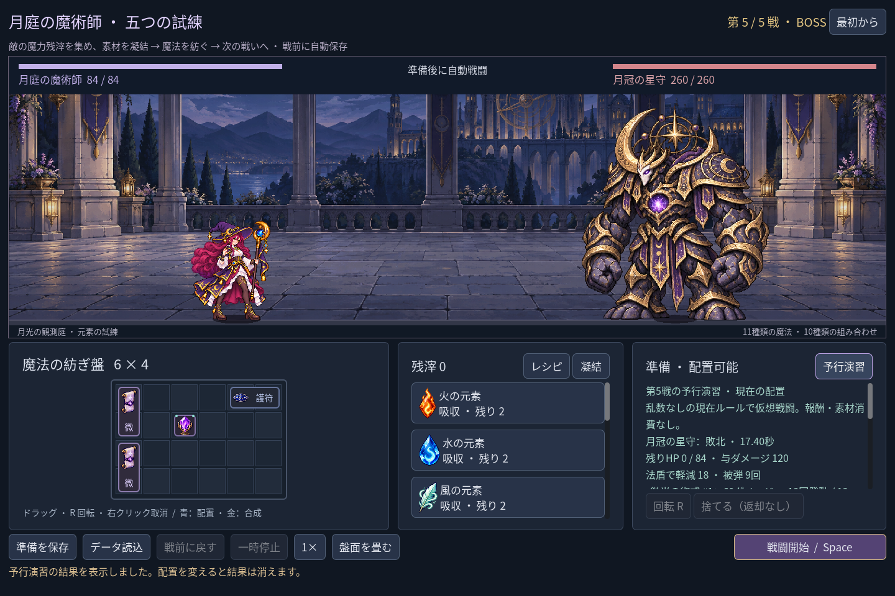

# 2026-11-08：五戦遠征の現在の敵を予行演習する

## 背景と実装

旧単戦には三体を比較する予行演習があったが、五戦遠征の準備画面にはなかった。現在の配置が目の前の敵に通用するか、敗北後や次戦前の調整を判断しやすくするため、右側の準備見出しに「予行演習」を追加した。

現在の配置から**その戦いの敵だけ**を別の `ClassBattle` インスタンスで最後まで計算し、勝敗、残り HP、与えたダメージ、法盾の軽減と被弾回数、各術式の発動・ヒット・ダメージを表示する。報酬は発生せず、素材・残滓・盤面・現在の戦闘・保存ファイルを変えない。盤面、在庫、HP、戦数または敵が変わると古い結果は失効する。戦闘中やレシピ画面表示中は実行しない。旧単戦は従来どおり三体をまとめて試算する。

画像は Godot の自動操作テストによる実行画面。第二の画像は第五戦の表示を直接指定した検証 fixture で、ユーザーが第一戦から到達したプレイ記録ではない。

## MCP と制約

作業開始時に編集者も MCP サーバーも停止していたため、プロジェクト内 SDK を使う `npm run godot:open` でエディターを起動した。ビルド成功、旧 Dock API の非推奨警告3件。`godot:status` で接続を確認し、MCP の `rql-query` で編集中の `mage_cast_timeline.tscn` とゲーム停止状態を確認した。MCP の `script-validate` では変更した二つの GDScript とテストの各1ファイルについてエラー0・警告0だった。Codex セッションに Godot MCP の直接ツールがないため、同じローカル MCP をプロジェクトの CLI 経由で呼んだ。グローバル npm パッケージは導入していない。

- `npm run game:mage:campaign:rehearsal:test`：45項目、失敗0。五体について別エンジンを50ms刻みで進めた結果と全戦果を比較し、三画面サイズ、実際のクリック、盤面と敵の変更による失効、無効な配置と戦闘中の拒否を確認。隔離したチェックポイントと実際のプレイヤー保存ファイルのハッシュも確認した。
- `game:mage:rehearsal:test` 40、`game:mage:campaign:test` 205、`game:mage:save:test` 97、`game:mage:layout:test` 64、`game:mage:discovery:test` 215、`game:mage:balance:test` 39項目はいずれも失敗0。
- `game:classes:test` は旧職業のルール、戦闘、保存、画面の合計623項目、失敗0。

予行演習は現行の乱数なしルールの結果であり、必勝を保証する別システムではない。将来ランダム要素や敵の隠れた状態を導入する場合は、予測の条件と表示を再設計する必要がある。現時点では内訳を縦に並べているため、術式が多いとスクロールが必要。既存の `Image.load_from_file` の書き出し警告は残り、今回も配布ビルドを検証していない。
