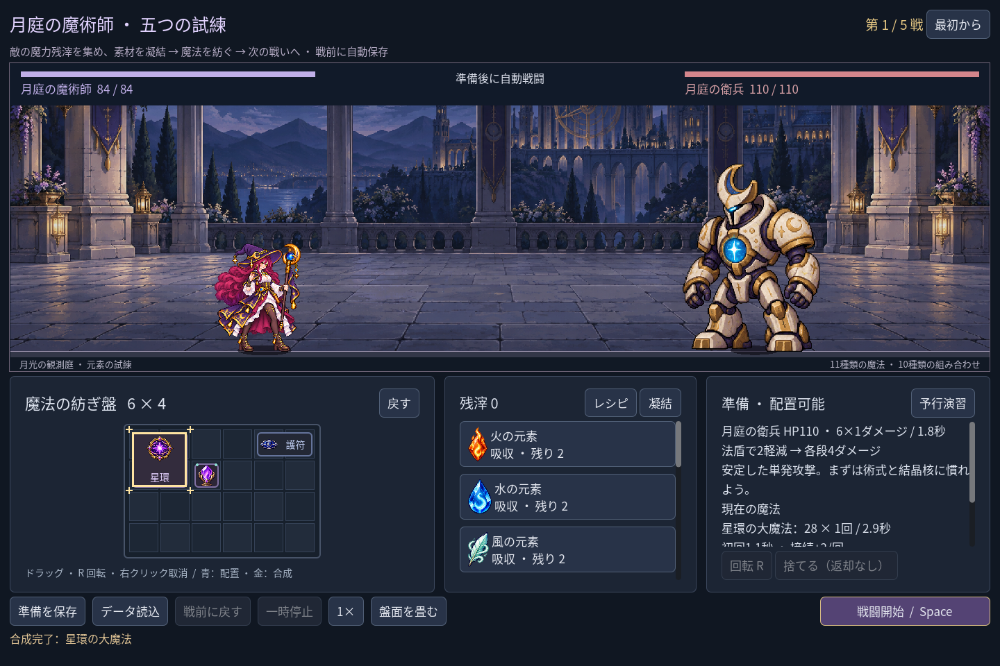
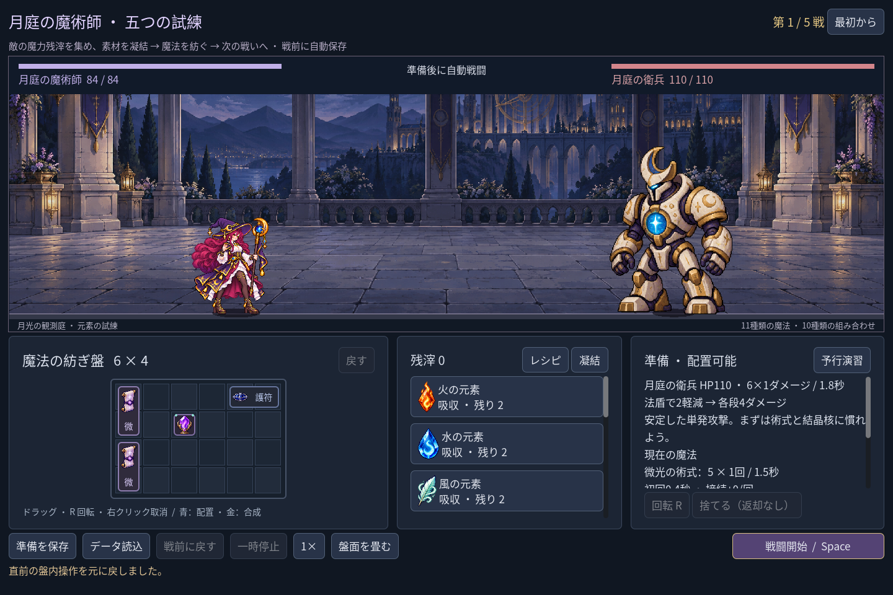

# 2026-11-08：魔法使いの盤内操作を一手戻す

## 実装した範囲

魔法使いの遠征・単戦の準備盤に「戻す」と Ctrl+Z を追加した。すでに盤上にあるものの移動、確定した回転、盤内アイテム同士の合成を**直前の一手だけ**戻す。二つの微光を星環の大魔法にした場合は、二つの元の微光を UID、位置、向きとともに復元する。結果画面には実際に戻った盤面を表示する。

二枚とも Godot の自動操作テストによる実行画面。素材を吸収して作ったアイテムそのものを取り消した画面ではない。

## 境界と保存

吸収・残滓での凝結・廃棄・戦闘開始・成功した読み込み・新しい遠征・戦間移行は履歴を消す。報酬や資源の取得後に古い盤面を復元して素材を複製しないためである。盤内操作の失敗や同じ位置・向きへの無変更操作では直前の有効な履歴を残す。履歴はメモリー上に一つだけあり、再起動や読み込み後には戻せない。

遠征では取り消し後の盤面も既存の独立チェックポイントへ自動保存する。保存に失敗した場合は元のチェックポイントを保持し、画面に失敗を知らせ、保存できるまで戦闘開始を拒否する。履歴を作った後に盤面外の状態が予期せず変化した場合も、署名の不一致で取り消しを拒否する。予行演習を表示中に取り消すと、古い予測は盤面変更として失効する。

## 検証と制約

Godot MCP の `script-validate` は変更した `class_lab.gd` をエラー0・警告0と報告。新テストの初回検証ではローカル変数の型推論エラーが1件あり、配列型を明示して修正した。新規図像の生成は行っていない。

- `npm run game:mage:undo:test`：38項目、失敗0。実際のボタン入力、Ctrl+Z、移動・回転・盤内合成の復元、失敗した配置、無変更操作、一手制限、モーダル、吸収・購入・廃棄・開戦・読み込みの境界、保存衝突と復旧、旧単戦、三画面サイズを確認。テストは隔離チェックポイントを使い、実プレイヤーの保存ファイルはハッシュが変わらないことを確認した。
- `game:mage:campaign:rehearsal:test` 45、`game:mage:discovery:test` 215、`game:mage:campaign:test` 205、`game:mage:save:test` 97、`game:mage:layout:test` 64、`game:mage:rehearsal:test` 40項目はいずれも失敗0。
- `game:classes:test` は合計623項目、`game:classes:art:test` は合計618項目で失敗0。

現時点では一手のみで、複数回の取り消しややり直し履歴はない。既存の画像読み込みに関する書き出し警告は残り、配布ビルドは未検証。
