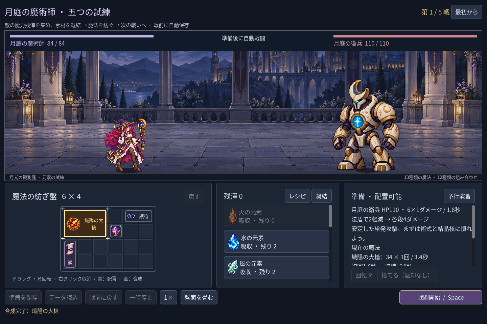
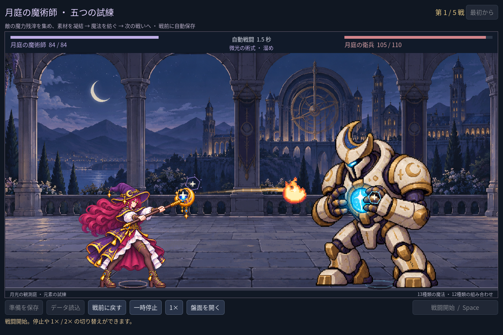
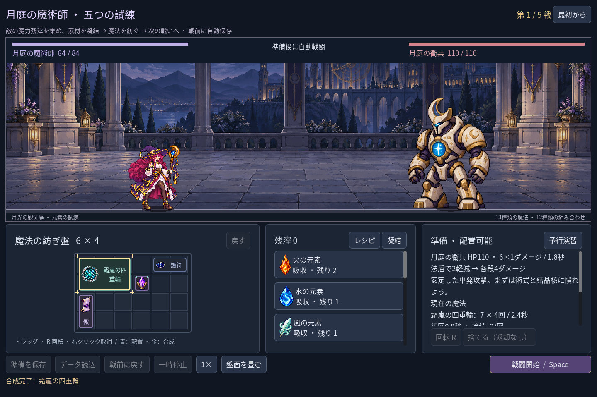
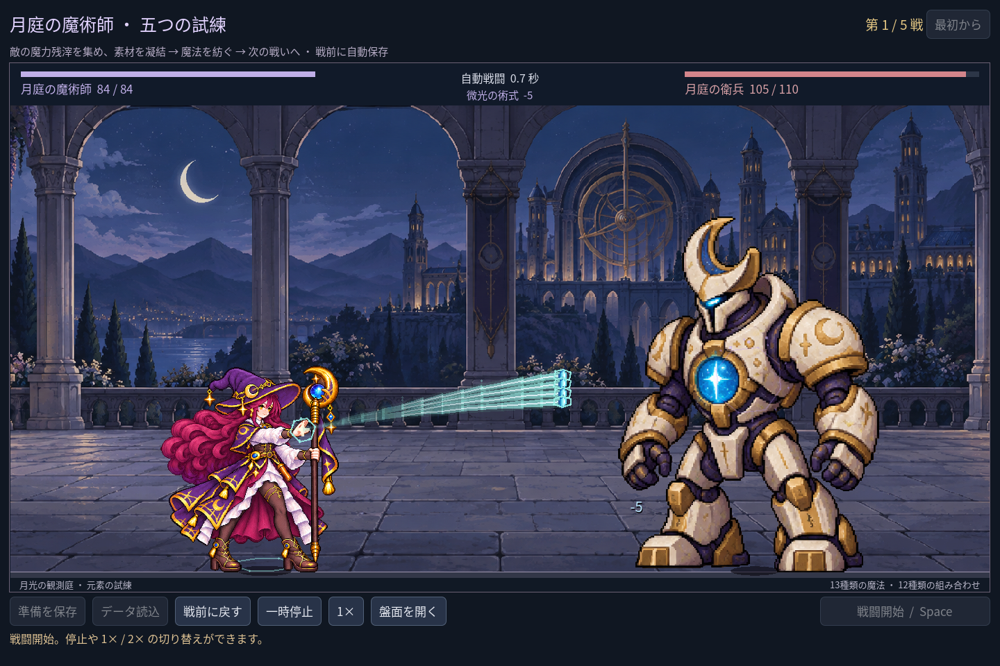

# 2026-11-09：基礎術式から二つの進階魔法を紡ぐ

## 目的と実装

2026-11-08 から継続中の法師の構築拡張として、既存の自動戦闘と同じ合成操作を二段階で使う魔法を二つ追加した。戦闘中の新しいリソースや複雑な詠唱規則はない。

- **熾陽の大槍**：微光と火で作った爆炎の法印に、さらに火を重ねる。完成品は3×2マス、初回1.6秒、その後3.4秒ごとに32ダメージの単発。左右に結晶核が接すれば一発に支援が加わる。
- **霜嵐の四重輪**：微光と水で作った氷矢に風を重ねる。完成品は3×2マス、初回0.8秒、その後2.4秒ごとに5ダメージの四連撃。結晶核は各段に加わる。

両方とも先に基礎術式を作ると十二種のレシピ一覧から選べる。完成品の位置・向き・空きマスを通常のプレビューと同じルールで検査し、空きがなければ素材を消費しない。元素を先に盤面に置いてから組み合わせた場合は、直前の盤内合成として取り消せる。供給から直接投入した吸収は既存の方針どおり取り消し対象外。

いずれも Godot の自動操作 fixture が通常の合成と実戦イベントから撮影した画面で、手動プレイの録画ではない。画像は2026-11-08に作成した版を保持している。

## 画像と演出

内蔵 imagegen で二つの専用アイコンを作り、透明領域と両アイコンの境界、縮小時の識別性を確認した。最初の霜嵐アイコンは氷片が三つで実際の四連撃と合わなかったため、編集版を生成して四つに修正して採用。初案と採用版、各プロンプト、寸法と SHA-256 は [`assets/art/mage-advanced-v1/`](../../assets/art/mage-advanced-v1/) に記録した。人間の手や武器を描く素材ではなく、人物の新原画も生成していない。

大槍は既存の杖振り、霜嵐は手勢の AnimationPlayer に接続し、実際の飛行と命中にそれぞれ火・氷風の表現を加えた。四連撃は実際のヒット数に合わせて表示し、途中で敵が倒れれば存在しないヒットを追加しない。新しい効果は既存の描画部品による表現で、専用音声はまだない。

## 検証と限界

二つの合法構築を初期の有限元素だけで組み、五戦をそれぞれ実際の規則エンジンで測定した。大槍＋潮汐＋残りの微光は、残 HP `76 / 60 / 56 / 48 / 24`、時間 `5.00 / 8.40 / 8.60 / 11.20 / 13.80` 秒。霜嵐＋爆炎は残 HP `72 / 60 / 42 / 48 / 10`、時間 `5.60 / 8.00 / 10.40 / 10.60 / 15.20` 秒。戦間の HP 全回復を適用し、途中報酬の購入は使っていない。これは二つの固定配置の測定で、各敵の攻撃の違いにより残 HP が必ず単調に減るわけではなく、全構築の平衡を保証しない。

2026-11-08 の作業時に Godot MCP の `script-validate` で術式に関係する catalog、art、effects、motion、timeline を各1ファイル、エラー0・警告0と確認した。翌日もプロジェクト内 SDK でエディターを再起動し、起動直後は接続拒否されたがサーバーの待機後に再接続、catalog、art、effects、追加テストを各1ファイル、エラー0・警告0と確認した。最初の統合テストでは戦闘中に新しい遠征を始めようとして拒否され、その後空の辞書を参照するテスト側のエラーが出た。戦前に戻してから再開し、素材の存在を確認して参照するよう修正。出力の「失敗0」だけでなくスクリプトエラーも監視して再実行した。

- `game:mage:advanced:test`：99項目、失敗0。二段階合成、レシピ、空き不足、支援、実ヒット、旧単戦と遠征の保存復元、所有素材の合成取り消し、二構築での五戦、実画面と実際の保存ファイル不変を検証。
- `game:mage:discovery:test` 286、`game:mage:campaign:test` 205、`game:mage:save:test` 97、`game:mage:undo:test` 38、`game:mage:campaign:rehearsal:test` 45、`game:mage:expansion:test` 148、`game:mage:vfx:test` 49、`game:mage:balance:test` 39項目はいずれも失敗0。
- `game:classes:test` は旧職業の合計623項目、失敗0。既存の画像読み込みに関する書き出し警告は残り、配布ビルドは未検証。
