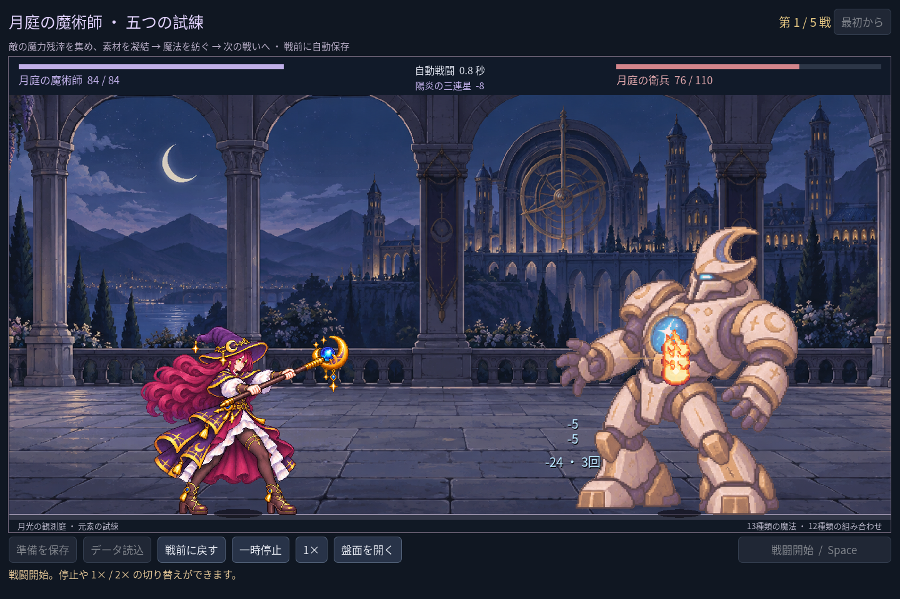

# 2026-11-09：同元素の三術式と五戦の強さ

## きっかけと変更

戦後の購入なしで火・水・風をそれぞれ二つずつ紡ぐ固定配置を測ると、最終ボスを7.20秒、残HP54で倒していた。もう一つの混合配置は16.40秒、残HP10で、同じ有限の初期元素から作れる選択肢の差が大きい。いずれも決定論的な特定の配置による比較で、すべての構築や実際のプレイヤーの強さではない。

同元素三術式の基礎ダメージと間隔を調整した。初回の発動時刻、ヒット数、占格、素材、支援の適用方法は変更しない。

| 術式 | 変更前 | 変更後 |
| --- | --- | --- |
| 陽炎の三連星 | 各8 × 3回 / 2.6秒 | 各6 × 3回 / 3.0秒 |
| 氷晶の大槍 | 20 × 1回 / 2.4秒 | 16 × 1回 / 2.8秒 |
| 暴風の五重輪 | 各3 × 5回 / 2.2秒 | 各2 × 5回 / 2.6秒 |

どちらも Godot 自動操作 fixture の0.8秒時点の画面。三連星の実表示は支援込みで各10から各8になり、三段の合計は30から24になった。画面上の敵 HP は他の微光によるダメージも含む。新しい原画は生成していない。

## 実測と範囲

同元素構築は、変更前の残HP `80 / 76 / 70 / 66 / 54`、時間 `3.40 / 3.50 / 5.90 / 6.00 / 7.20` 秒から、変更後は残HP `76 / 68 / 70 / 57 / 40`、時間 `3.80 / 5.80 / 6.80 / 7.90 / 9.80` 秒になった。各戦はHP全回復、報酬を追加購入しない固定盤面。敵の攻撃回数と間隔が違うため第三戦のHPは第二戦より高い。変更後も同元素構築は混合配置より強く、難易度が完成したと断言しない。

混合配置の残HP `72 / 52 / 42 / 39 / 10`、時間 `6.40 / 8.60 / 11.20 / 13.60 / 16.40` 秒は変更前後で一致。初期盤面は第一戦にHP52で勝ち、第三戦は敗北。二つの進階魔法を含む合法構築もそれぞれ五戦を通過した。比較は通常の素材取得・合成と実戦ルールを用い、戦後の購入は使っていない。操作の難しさ、他の全配置や人間による体感は未検証。

術式ID、素材台帳、保存形式は変更していないため、既存の保存盤面は新しい数値で戦闘する。三術式の説明も数値に合わせて更新した。

## 検証

- `game:mage:balance:test` 41、`game:mage:campaign:test` 220、`game:mage:advanced:test` 99、`game:mage:campaign:rehearsal:test` 45、`game:mage:discovery:test` 286、`game:mage:save:test` 97、`game:mage:vfx:test` 49、`game:mage:expansion:test` 148、`game:mage:layout:test` 64項目、いずれも失敗0。
- `game:classes:test` は既存職業の合計623項目、失敗0。戦役テストは実プレイヤーのセーブが不変であることも確認。
- Godot MCP の `script-validate` で術式定義と平衡テストを各1ファイル検査し、エラー0・警告0。
