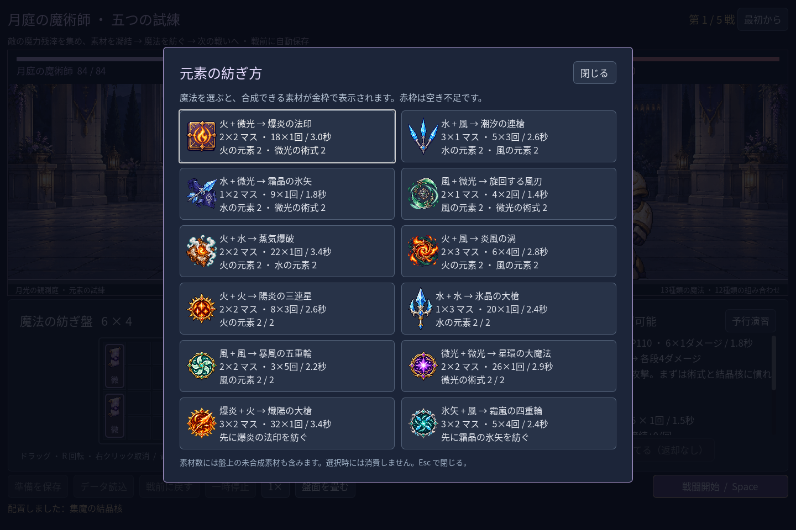
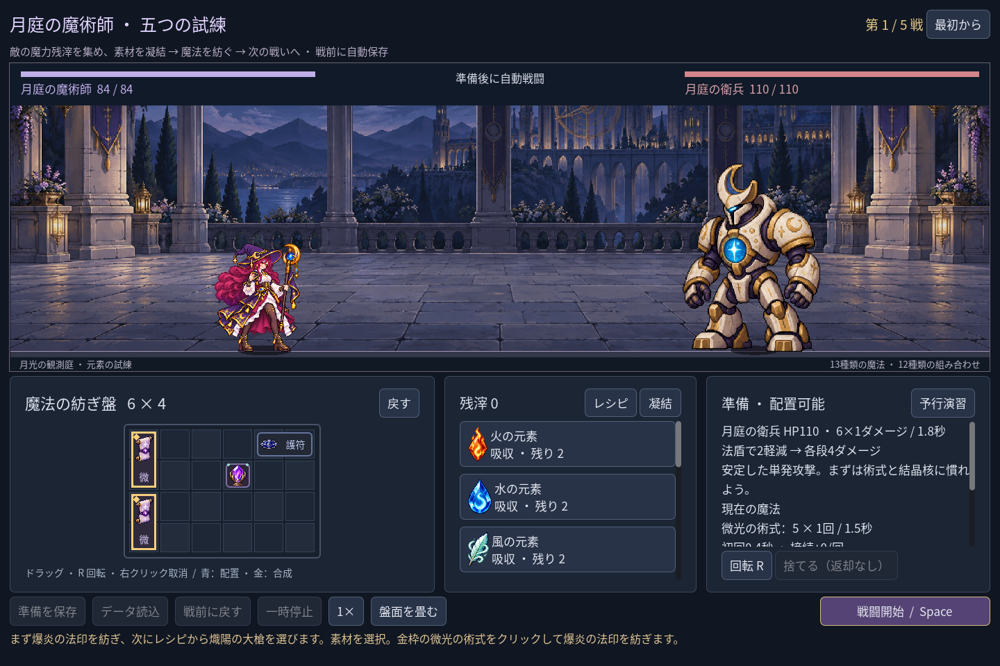

# 2026-11-09：進階魔法を二段階で案内する

## 目的と変更

前回追加した二つの進階魔法は、先に基礎術式を作らないとレシピを選べなかった。素材が足りていても道筋が見えないため、レシピ帳で「先に爆炎の法印を紡ぐ」「先に霜晶の氷矢を紡ぐ」と表示し、選択すると既存の基礎術式の配置・合成案内に進むようにした。基礎術式を完成させてから再び進階レシピを選び、通常の操作で完成させる。

両段階に必要な所有物と有限の供給をまとめて数え、同じ火元素などを二重に数えない。複数の有料供給がある場合は必要数の合計費用を算出し、残滓が足りなければ選択できない。案内を選んだだけでは素材、残滓、在庫、保存データを変更しない。

いずれも実際の Godot 画面を自動操作 fixture で撮影した。素材は予約しないため、その後に別の合成へ使えば案内は再計算される。また、将来の盤面の空きを保証する機能ではなく、各合成時に通常の配置プレビューで確認する。戦闘規則やセーブ形式は変更していない。

## 検証と観察

Godot MCP の `script-validate` でガイド、画面スクリプト、テストをそれぞれ検査し、いずれもエラー0・警告0だった。プロジェクト内 SDK とローカル MCP を使用した。

- `game:mage:chain-guide:test`：27項目、失敗0。実際の画面クリックで二系統を始め、選択時の非消費、両段階の有限素材、共通予算、素材不足、完成品の空き不足、戦闘中の拒否、実セーブファイル不変を確認。
- `game:mage:advanced:test` 99、`game:mage:discovery:test` 286、`game:mage:campaign:test` 205、`game:mage:save:test` 97、`game:mage:undo:test` 38、`game:mage:campaign:rehearsal:test` 45、`game:mage:layout:test` 64、`game:mage:expansion:test` 148、`game:mage:vfx:test` 49、`game:mage:balance:test` 39項目はいずれも失敗0。
- `game:classes:test`：既存職業の合計623項目、失敗0。

最初の新テストは、レシピ帳を開いた直後に二回目の実クリックを送り、レイアウトが安定する前に押して失敗した。三フレーム待ち、ポインターを対象位置へ移して再実行すると通過した。連続回帰中には既存 discovery テストのドラッグ操作2項目が失敗したが、単独で再実行すると286項目すべて通過した。Windows のネイティブ入力を使う試験は実行タイミングの影響が残り、原因を確定した修正とは扱わない。既存の画像読み込みに関する書き出し警告は残り、配布ビルドも未検証。
