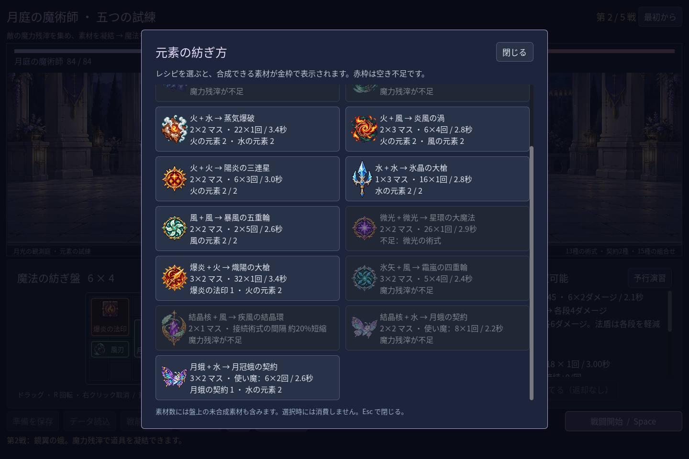
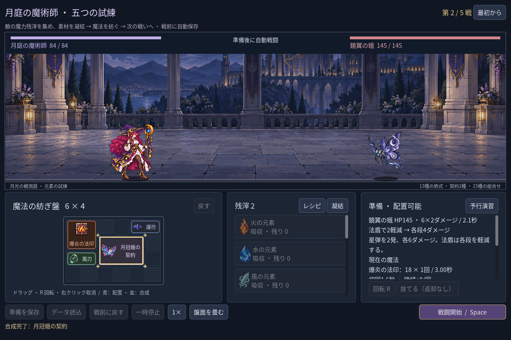
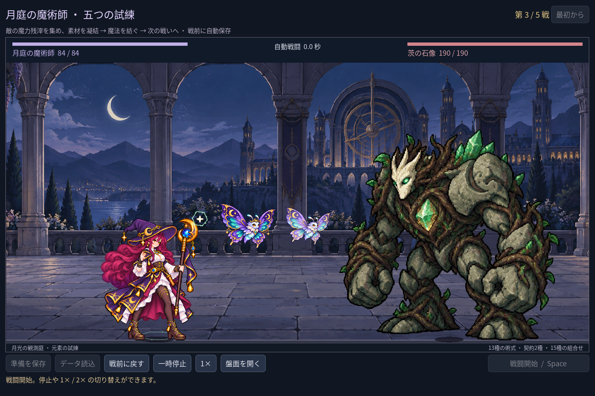
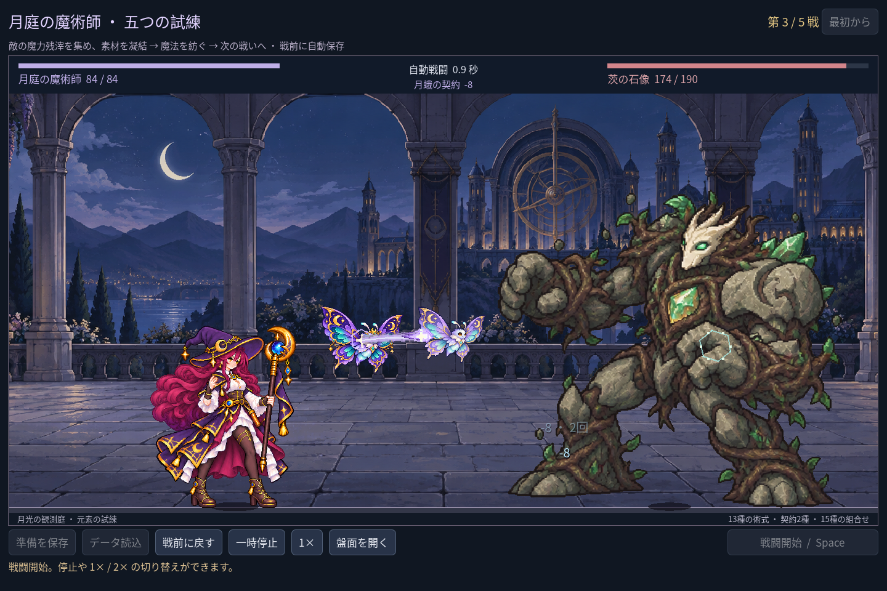

# 2026-11-09：月蛾の契約を育てる

## 目的とルール

召喚を一種類の固定火力で終わらせず、配置と素材の選択を作る。月蛾の契約に水の元素をもう一つ編み込むと「月冠蛾の契約」になる。通常の契約は 2×2 マス、初回 0.8 秒、以後 2.2 秒ごとに 8×1 ダメージ。強化後は 3×2 マス、初回 1.1 秒、以後 2.6 秒ごとに 6×2 ダメージ。どちらも契約一つにつき使い魔一体で、二種類の合計上限は二体。強化後の二段攻撃は一体から発生する。

新遠征では開始時の水は一つだけ。第一戦の勝利で得る残滓 4 のうち 2 を水に凝結すると、第二戦前から強化できる。別の使い魔を作るには追加の結晶核と水が必要で、盤面と残滓を競合する。既存の遠征セーブは従来の初期資源ルールを維持する。選んだ配方以外の合成先に金枠を出さず、強化後に空きマスが足りなければ素材を消費しない。

## 表現と実際の戦闘

通常の月蛾を参照して強化画像を生成し、目、触角、翅のつながり、冠、星飾り、欠けや不要物を目視確認した。元 PNG は 1536×1024、alpha は 0〜254、alpha 128 以上の範囲は (260,100)〜(1271,920)（右下は排他的）。実機では通常種の 1.18 倍の高さにし、二体の最大幅で間隔を確保する。1280×800、1440×960、1920×1080 の fixture で画面内、互いと敵・主人公の重なりを確認した。生成指示と SHA-256 は [manifest](../../assets/art/mage-familiar-upgrade-v1/manifest.json) に保存した。

第三戦では強化種と通常種が別 UID と別のタイマーで攻撃する。強化種は二本の弾道と実際のヒット数に応じた着弾を表示する。とどめの一段目で敵が倒れれば二段目のダメージを生成しない。使い魔の予告・攻撃では法師側の AnimationPlayer を動かさない。戦闘終了・敗北・戦前復帰で使い魔は消える。

今回の画像は単一ポーズで、上下に浮遊する表現のみ。翅の逐帧アニメーション、敵が使い魔を攻撃する挙動、使い魔の独立 HP は未実装。結晶核の加傷や疾風結晶環の加速は使い魔には作用しない。

## 検証と修正

- 通常の操作と報酬で七つの固定構成を五戦通した。強化種＋通常種の構成は各戦の残 HP が 68 / 52 / 56 / 48 / 30、時間が 7.4 / 8.7 / 8.9 / 10.6 / 12.9 秒。敵は戦闘ごとに異なり、最後はボス。これは決定的な fixture の結果であり、人間による難易度評価ではない。
- `game:mage:progression:test`：225 checks、`game:mage:familiar:test`：65 checks、いずれも 0 failures。素材と残滓、配方誘導、空き不足時の原子性、保存・復元、攻撃間隔、二段目の打ち切り、使い魔の上限、独立 UID と実機表示を確認。プレイヤーの実セーブは変更しない。
- 主な回帰：campaign 226、discovery 418、chain guide 29、haste 38、campaign save 98、undo 38、advanced 103、expansion 151、VFX 49、cast sync 28、campaign rehearsal 45、layout 64、balance 41 checks、全て 0 failures。既存クラスと旧ゲームのテストも成功。
- 画像の読み込みは、元 PNG が存在しない隔離 PCK fixture で 7 checks、cold fixture で 1 check が成功。これはゲーム全体の配布用 export の検証ではない。
- Godot MCP の `script-validate` を使って対象 12 GDScript を個別検査し、すべて Ok、エラー 0、警告 0。途中、arena の同一スコープ内の変数名重複による構文エラーを検出し、`familiar_source` に変更して解消した。

残る課題は、プレイヤーが戦闘結果を見て編成の良し悪しを理解できる導線、実プレイによる難度調整、召喚固有のさらなる選択肢。
