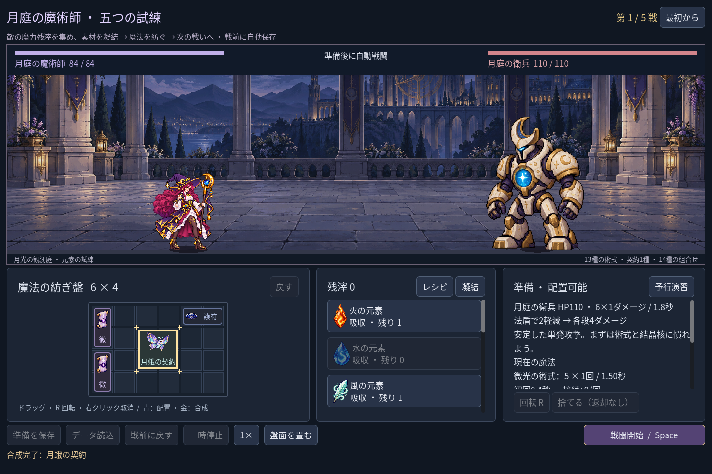
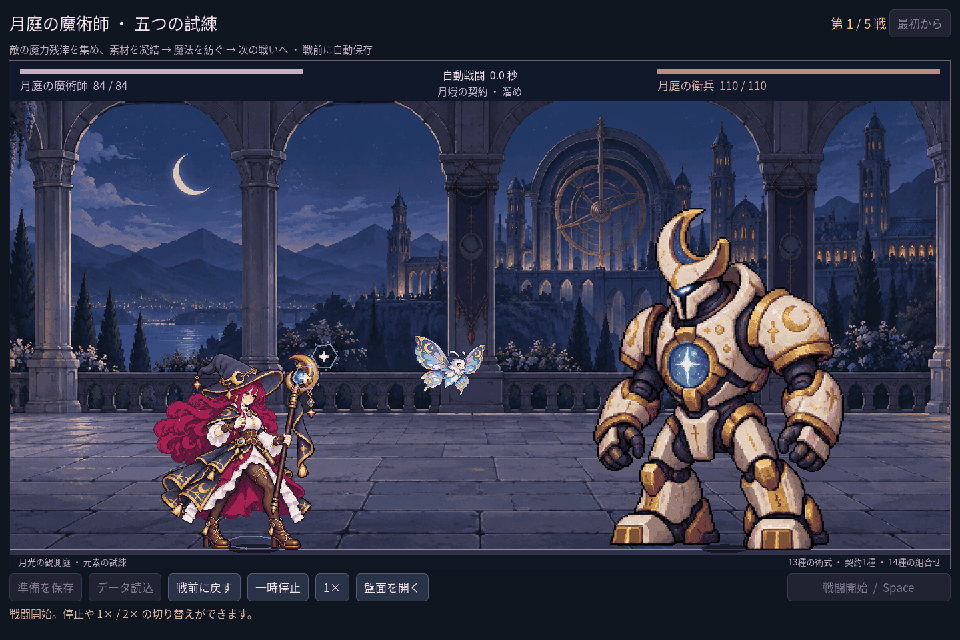
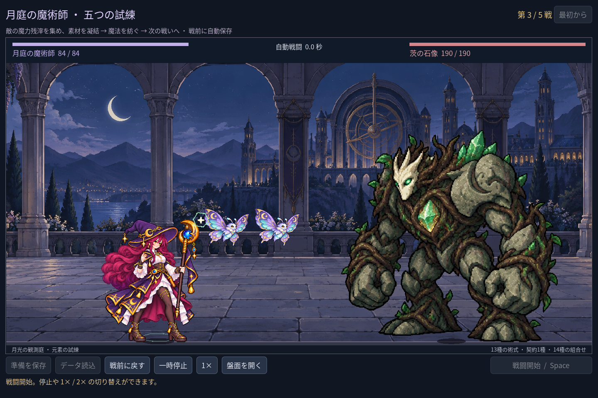

# 2026-11-09：月蛾の契約と使い魔の試作

## ルールと実装

元素を組み合わせるだけでなく別の戦い方を作るため、水元素と集魔の結晶核から **月蛾の契約** を紡ぐ。契約は2×2マスを占め、結晶核の各段+2は失われる。戦闘開始時に契約一つにつき月蛾一体が現れ、最大二体。それぞれ契約の UID を持ち、初回0.8秒、その後2.2秒ごとに8ダメージを自動で与える。法師自身の術式とは別の攻撃元として、戦闘結果と予行演習に記録する。

敵は現時点では法師だけを攻撃し、月蛾は独立HP、被弾、死亡、再召喚や自分の成長を持たない。結晶核の威力支援と疾風の結晶環の速度支援は使い魔には適用されない。戦闘終了または戦前復元で戦闘中の使い魔は消え、保存するのは契約と素材台帳である。これは一種類の使い魔による召喚の入口であり、完全な召喚流派や複数種類の契約を実装したわけではない。

いずれも Godot の自動操作 fixture。GIFは1440×960の実フレームを最近傍で960×640に縮小し、50ms間隔で記録したもので、リアルタイム録画ではない。使い魔は一枚絵を戦闘時計に合わせて上下に浮かせる表現で、翅の逐帧アニメーションではない。弾道は使い魔自身の位置から出し、その予測・命中では法師の AnimationPlayer を動かさない。法師自身の別の術式は通常どおり動く。

## 成長と画像の確認

新遠征で最初の水と結晶核から契約を作り、火の爆炎と風刃を併用。第一戦と第二戦の報酬を貯めて二つ目の結晶核と水を凝結し、二体目の契約を作った。第三戦後は護符を追加する。実際の報酬と占格を守った五戦では、残HP `68 / 52 / 56 / 48 / 30`、時間 `7.4 / 9.6 / 9.6 / 11.5 / 13.6` 秒で勝利した。第三戦の二体はそれぞれ40ダメージ、ボス戦はそれぞれ48ダメージを与えた。戦間は全回復で、これは固定盤面の実測であり他の配置や実際の人間の体感を保証しない。

新しい画像は built-in imagegen で生成した単体の戦闘用候補。紫・青緑の翼が体につながり、二本の触角と二つの目、翼端が見えることを目視した。人物の手足や武器は含まない。原寸1536×1024、alpha 0〜254、alpha 128以上の範囲は `(285,107)`〜`(1253,917)`（右下非包含）。薄い背景光のalphaは下端まで残るが、はっきり見える翼・体は切れていない。原PNGは変更せず、実行時はその固い境界から表示する。1280×800、1440×960、1920×1080の実画面で人物・敵との重なり、縮小時の輪郭と攻撃位置を確認した。素材のピクセル密度や細部は最終原画品質としては未検収。生成プロンプト、画像と SHA-256 は [素材 manifest](../../assets/art/mage-familiar-v1/manifest.json) に残した。

## 検証と修正

新しい配方を追加した直後、水を選ぶと氷矢だけでなく契約も成立するため、氷矢レシピの選択後に関係ない結晶核まで金枠で示されることを発見した。レシピから選んだ場合はその結果になる対象だけを表示するよう変更。素材を直接選んだ場合は、従来どおりすべての合法な組み合わせを表示する。選択時の消費はなく、別の対象を実際にクリックした際の通常の配置プレビューと合成規則も維持する。

- `game:mage:familiar:test`：50項目、失敗0。素材消費・プレビュー、単戦と遠征の保存、予行演習の使い魔別集計、使い魔ごとの時刻・傷害・UID、最大2体、上限超過の原子的拒否、勝敗時の消去、敵の攻撃対象、停止、法師の AnimationPlayer との独立、三画面サイズ、実画面と実プレイヤーセーブ不変を確認。
- `game:mage:progression:test`：182項目、失敗0。実報酬から二体を作る五戦、異なるUIDの戦闘結果、完成済み遠征の保存復元、二体の三画面配置を確認。
- `game:mage:discovery:test` 372、`game:mage:campaign:test` 226、`game:mage:haste:test` 38、`game:mage:save:test` 98、`game:mage:undo:test` 38、`game:mage:chain-guide:test` 29、`game:mage:advanced:test` 103、`game:mage:expansion:test` 150、`game:mage:vfx:test` 49、`game:mage:cast-sync:test` 28、`game:mage:layout:test` 64、`game:mage:campaign:rehearsal:test` 45、`game:mage:balance:test` 41項目はいずれも失敗0。
- `game:classes:art:test` は静止画146、盤面ラベル170、モーション264、フィードバック62項目、`game:classes:test` は旧職業623項目、`game:test` は森林949項目、すべて失敗0。`game:classes:image-pack:test` は未インポート1項目と原PNGのない小さなPCKでの画像6項目が失敗0。ただし完全なゲームの配布ビルドではない。
- Godot MCP は最初接続拒否となり、エディターが動いていなかった。プロジェクト内 SDK で再起動後、関連スクリプトとテスト12ファイルを個別に `script-validate` し、各エラー0・警告0。C# プラグインのビルドには非推奨APIの警告3件が残る。
