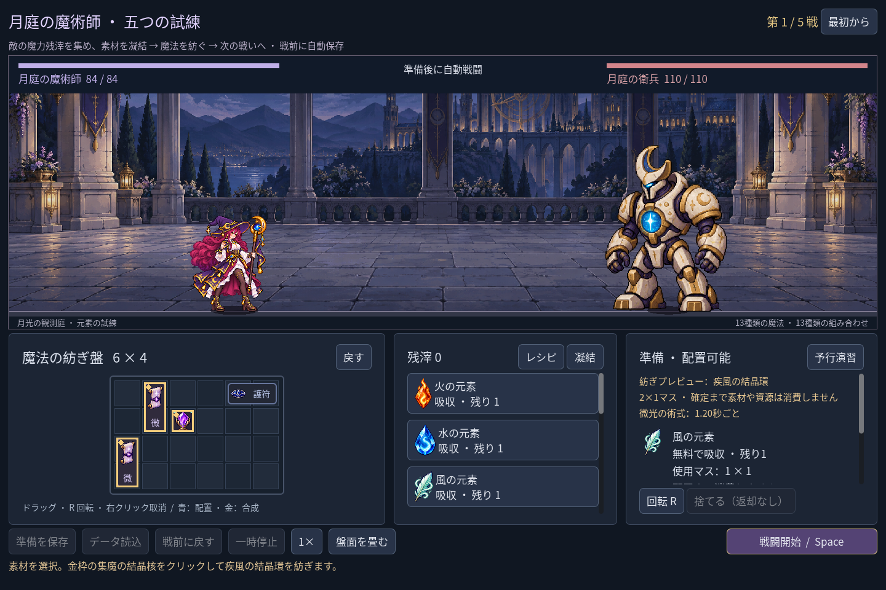
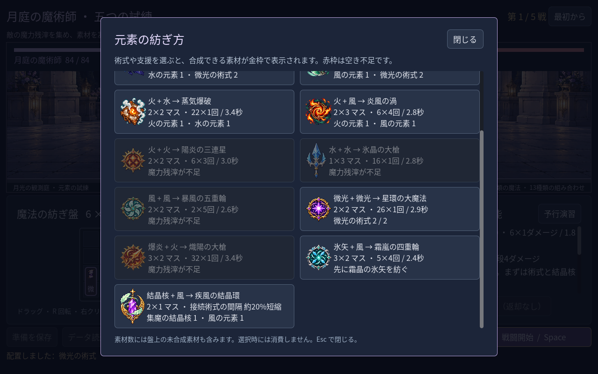
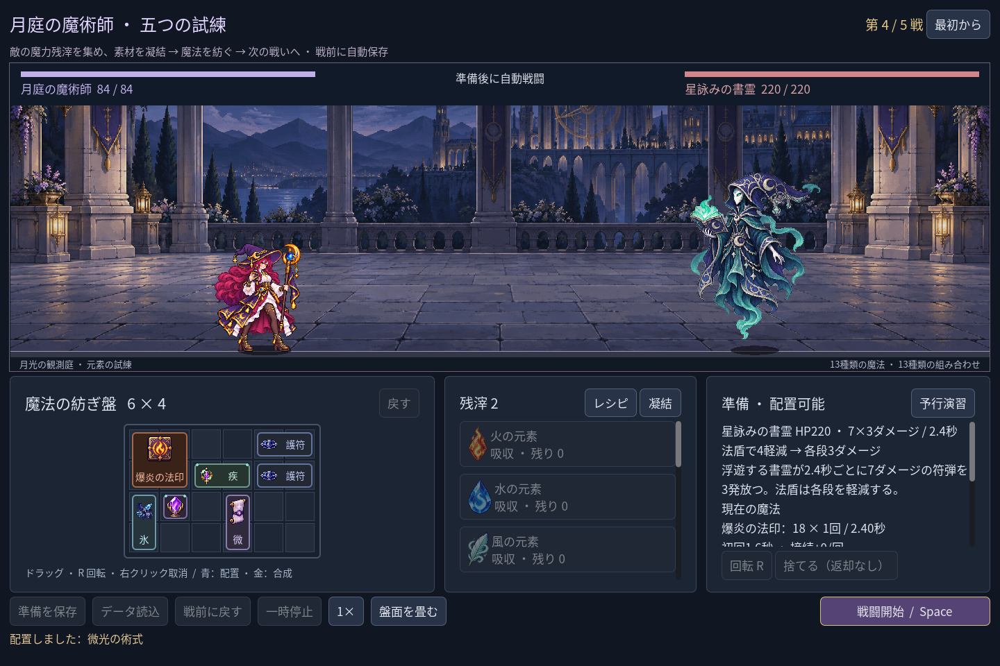

# 2026-11-09：風と結晶核で発動間隔を変える

## 構築の選択

ユーザーの「構築をもっと面白く」という要望を受け、数値の大きい攻撃を足すだけでなく、同じ素材の用途を分けた。**疾風の結晶環**は集魔の結晶核と風元素を合成し、2×1マスを使う支援物。向きに接した術式の繰り返し間隔を0.8倍にする。回転すると左右接続から上下接続になる。もとの結晶核は消費するので、各段+2の強化は失われる。初回の発動時刻、ヒット数、ダメージ確定時刻のルールは変えない。

複数の結晶環が接した場合は倍率を乗算し、最短0.6倍に制限する。実際の戦闘時計は0.05秒刻みのため、短縮後の間隔はその単位で切り上げ、初回までの時間より短くならないようにする。たとえば1.4秒×0.8は1.12秒だが、画面と戦闘の両方では1.15秒になる。プレビューも接続後の実際の間隔を示す。

いずれも Godot 自動操作 fixture による実画面。配方は攻撃12種に支援1種を加えた13種で、背の低い窓でもスクロールして選べる。画面は一例であり、全構築の面白さやすべての解像度を保証しない。

## 強さと画像

結晶核を接続した微光は7ダメージ／1.5秒、結晶環に変えると5ダメージ／1.2秒になり、単純な継続火力は下がる。一方、爆炎の法印は20／3秒から18／2.4秒となり、継続火力が上がる。初回や敵の残HP、他の接続によって実戦結果は変わるため、この比較は万能の評価ではない。

新しい遠征で結晶環・爆炎・氷矢を作り、第一戦後に結晶核、第二戦後に護符、第三戦後に微光を通常どおり凝結した固定構築は、残HP `68 / 44 / 48 / 39 / 18`、時間 `8.8 / 11.2 / 13.6 / 13.1 / 15.4` 秒で五戦を通過した。各戦前に全回復し、実際の残滓と盤面を使っている。別の選択や手動プレイの難易度は引き続き検証が必要。

アイコンは built-in imagegen で透明背景付きの紫水晶、金の月枠、二枚の風の羽として生成した。人物や武器は含まない。原寸1536×1024、alpha 0〜254、alpha 128以上の範囲は `(426,15)`〜`(1090,1000)`（右下は非包含）。上端も途中で切れていないことを目視した。薄い透明光が外側に残るため、ゲームは不透明寄りの境界から表示範囲を求め、原PNGを書き換えない。羽と結晶、金枠は配方帳と実盤面の縮小表示で確認したが、源画像は厳密に統一された論理ピクセルや最終原画の品質とは限らない。プロンプト、原画像と SHA-256 は [素材 manifest](../../assets/art/mage-haste-v1/manifest.json) に記録した。

## 検証と修正

- `game:mage:haste:test`：38項目、失敗0。選択・配置プレビューの非消費、支援方向と回転、ダメージとの取捨、実際の `0.4 / 1.6 / 2.8 / 4.0` 秒発動、0.05秒丸め、二つの支援の乗算、単戦・遠征の素材台帳、UI、戦闘結果と実プレイヤー保存不変を確認。
- `game:mage:progression:test` 148、`game:mage:campaign:test` 226、`game:mage:discovery:test` 329、`game:mage:chain-guide:test` 29、`game:mage:advanced:test` 103、`game:mage:expansion:test` 149、`game:mage:save:test` 98、`game:mage:undo:test` 38、`game:mage:campaign:rehearsal:test` 45、`game:mage:layout:test` 64、`game:mage:vfx:test` 49、`game:mage:cast-sync:test` 28、`game:mage:motion-v2:test` 187、`game:mage:balance:test` 41項目はいずれも失敗0。
- `game:classes:art:test` は静止画146、ラベル158、モーション264、フィードバック62項目、`game:classes:test` は旧職業623項目、いずれも失敗0。Godot MCP の `script-validate` で定義、盤面、画像、UI、表示、テストを個別に検査し、各エラー0・警告0。

初回のテストは浮動小数点の時刻配列を完全一致で比較し、値の表現誤差により失敗した。実時刻を近似比較に変更し、四回の発動を再確認した。最初の実画面では配方の表示に `%` が二重に出たため修正し、再撮影した。アイコンの上端・下端の余白は大きくなく、今後の再描画では透明光と縮小品質も再確認する。
