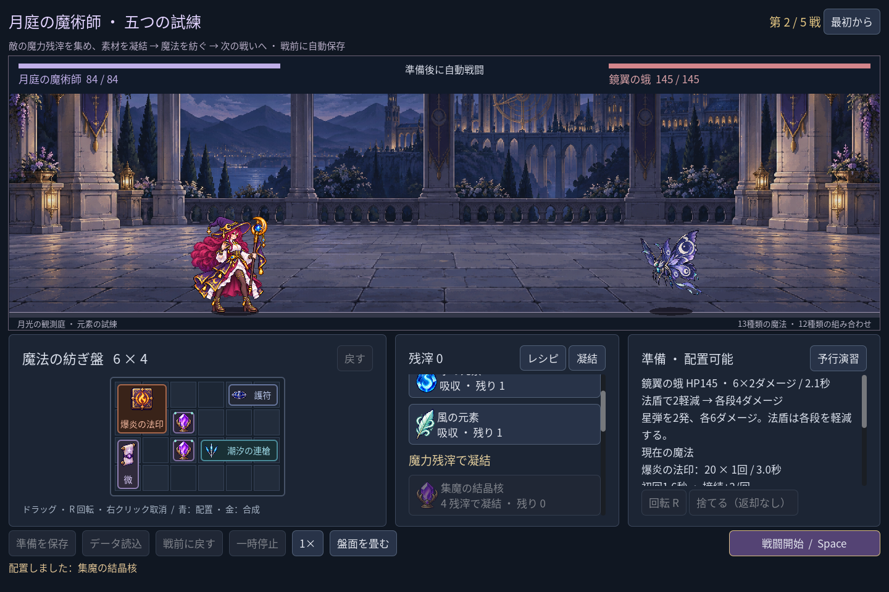

# 2026-11-09：戦闘素材を Godot リソースから読み込む

## 背景と対応

人物・敵・道具の絵は `Image.load_from_file()` で原画 PNG を直接開いていた。Godot はインポート済みの PNG をこの方法で読む際、書き出し時に使えないと警告していた。魔法使いと既存騎士の戦闘画像を共通のローダーに移し、インポート済みの `Texture2D` を `ResourceLoader` で読み、その画像から従来どおり境界と図集を作るようにした。元画像やアトラスの計測値は変更していない。

未インポートの新規チェックアウトを直接起動するとリソースがまだ存在しないことも確認したため、その場合だけ存在する原画 PNG にフォールバックする。PCK 内ではインポート済みリソースを使う。画像審査用の別画面の原画読み込みや旧森林の全配布経路は今回の対象ではなく、完全なゲームの配布版もまだ検証していない。

実際の Godot 画面を自動操作 fixture で撮影し、人物、敵、背景とアイコンを目視確認した。同じ fixture の変更前画像との比較では、1440×960 のうち323ピクセルに差があり、差分は盤面・アイコン付近、RGB 各チャンネルの最大差は6だった。差がゼロとは扱わず、この比較も全姿勢の美術品質を証明するものではない。

## 検証

- `game:classes:image-pack:test`：新しい独立 fixture を未インポートの状態で起動し1項目、インポート後に Windows Desktop 向け PCK を作成、原画 PNG が存在しない PCK 実行環境で魔法使い・衛兵・進階道具の3画像と不在パスを4項目確認。いずれも失敗0。これは素材ロードの小さな PCK 試験で、Windows 用実行ファイルの配布テストではない。
- `game:classes:art:test` は静止画146、盤面ラベル146、モーション264、フィードバック62項目、`game:classes:test` は旧職業623項目、いずれも失敗0。`game:mage:legs:test` 17、`game:mage:motion-v2:test` 187、`game:mage:cast-sync:test` 28、`game:mage:layout:test` 64項目も失敗0。
- `game:mage:campaign:test` 211、`game:mage:advanced:test` 99、`game:mage:discovery:test` 286、`game:mage:expansion:test` 148、`game:mage:vfx:test` 49、`game:mage:save:test` 97項目はいずれも失敗0。
- Godot MCP の `script-validate` で共通ローダー、静止画像、モーション、魔法使いの4スクリプトを各1ファイル確認し、すべてエラー0・警告0。

最初に試験用エディターを直接起動した際、ローカル SDK の環境変数を渡し忘れて .NET SDK 不在のエラーが出た。試験を `scripts/godot.mjs` に組み込み、既存のプロジェクト内 SDK 環境で再実行した。PCK 作成と起動はその再実行で成功している。

テスト実行中、存在しない npm スクリプト名の打ち間違いにより npm がユーザー側の既定キャッシュへエラーログを作ったことに気付いた。`.npmrc` に `.tools/npm-cache` を指定し、`npm config get cache` がこのプロジェクト内を指すことを確認した。既存のユーザー側キャッシュは削除していない。
