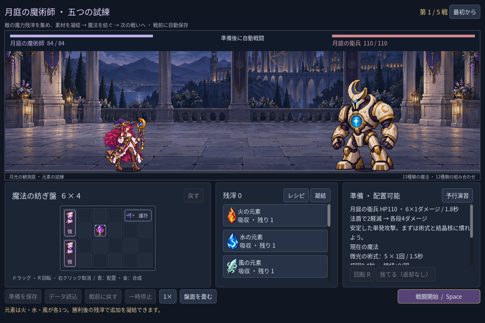
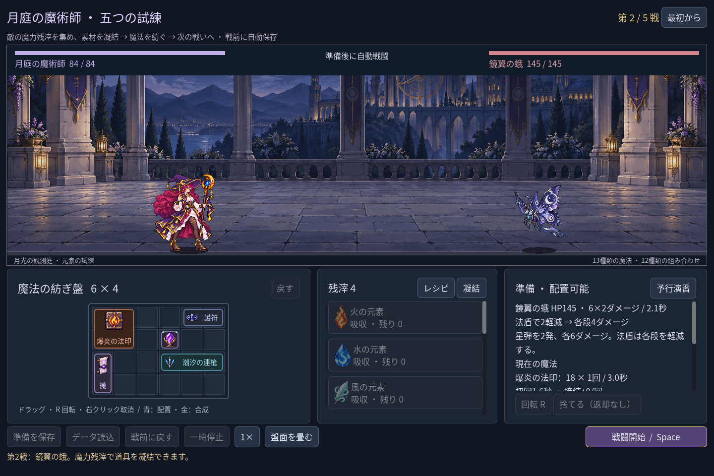
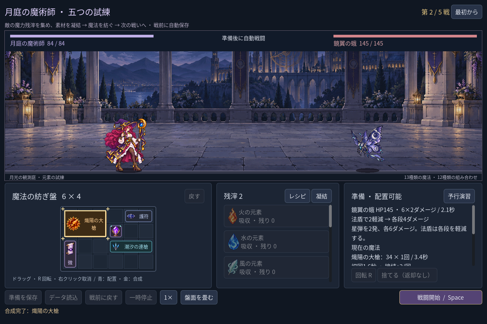

# 2026-11-09：初期元素と五戦の成長を見直す

## 目的と決定

ユーザーから、初期資源が多く、構築も戦闘も段階的に育っていないのではないかと指摘を受けた。確認すると、以前は火・水・風を各二つずつ無料で取り、第一戦前に三種類の同元素魔法を完成できた。

新しい五戦遠征では、初期元素を火・水・風それぞれ一つにした。初期の微光二つ、結晶核と護符、戦後の魔力残滓と凝結の価格・在庫は維持する。たとえば火の進階大槍に必要な二つ目の火は、第一戦の勝利後に残滓2で凝結できる。同じ残滓を結晶核や護符へ使うか、元素と成品へ使うかで、その後の盤面と戦い方が変わる。五戦は引き続き五種類の敵と最後のボスで構成し、戦数の追加は実測と構築の拡張を踏まえた今後の課題とする。

画像は Godot の自動操作 fixture が通常の取得、第一戦の勝利、報酬と合成を通して撮影したもの。生成画像や手動プレイの録画ではない。

## 敵と固定構築の測定

防護重視の構築では書霊の三段攻撃が各1ダメージになり、第四戦が第三戦より大幅に軽くなっていた。書霊は HP210→220、各5×3→各7×3 に、ボスは星弾を各9×2→各10×2、重撃を18→19にした。攻撃間隔や段数、専用演出は変えていない。二つの護符でも書霊の各段を4軽減できる。

以下は四つの固定構築を実際の有限在庫、各勝利後の報酬と配置によって進めた結果。各戦の前に HP は全回復し、数値は残HP／戦闘秒数。購入は決められたルートで行い、戦闘は独立した同じルールエンジンとも照合した。

| 構築と戦後の選択 | 第1戦 | 第2戦 | 第3戦 | 第4戦 | 第5戦 |
| --- | --- | --- | --- | --- | --- |
| 混合、結晶核→護符 | 72 / 6.4 | 60 / 7.6 | 48 / 10.6 | 48 / 11.2 | 30 / 13.8 |
| 火の大槍、追加火→結晶核 | 68 / 7.6 | 60 / 8.4 | 56 / 8.4 | 39 / 9.4 | 18 / 11.8 |
| 氷風、風を投入→結晶核 | 64 / 10.6 | 60 / 8.0 | 42 / 10.4 | 24 / 10.6 | 18 / 13.6 |
| 同元素、追加火→追加水 | 52 / 15.4 | 52 / 9.8 | 56 / 9.4 | 24 / 9.8 | 18 / 12.4 |

戦後の強化や敵の攻撃形態によって、時間や残HPが全行で単調になるわけではない。初期盤面は第一戦にHP52で勝ち、第三戦には負ける。購入しない旧来の混合固定配置は調整後の第四戦HP9、ボスHP2で勝つため、旧遠征でも現在の敵数値により厳しくなる場合がある。四つの例は元素編織内の構成であり、召喚や奥術循環の完成、全配置の平衡、人による面白さの検証を意味しない。

## セーブ互換と検証

新遠征は資源台帳のバージョン2として保存する。旧バージョン1は各二つの初期元素を使った既存の台帳として検査し、そのままロード・保存・次戦チェックポイント・戦前復元を行う。新遠征だけが各一つの台帳を使い、旧データを新バージョンと偽装しても素材収支の検査を通らない。ロード時にも旧資源ルールの継続を表示する。敵の現行数値は両バージョンに共通で、盤面や所持素材は書き換えない。

初期元素を減らした最初の回帰では、進階大槍や同元素術式の描画試験が初戦で二つ目を無料取得しようとして失敗した。第一戦を普通に勝ち、得た残滓で追加元素を凝結する fixture に更新した。旧単戦の初期元素は変えず、従来の素材・セーブの試験も残している。

- `game:mage:progression:test`：121項目、失敗0。四構築の五戦、初期の不足と勝利後の解放、素材・残滓の消費、v2の四種類の実盤面保存復元、v1の保存・UI再開・勝利後・戦前復元、改ざん拒否と実プレイヤーのセーブ不変を確認。
- `game:mage:campaign:test` 226、`game:mage:save:test` 98、`game:mage:undo:test` 38、`game:mage:chain-guide:test` 29、`game:mage:advanced:test` 103、`game:mage:campaign:rehearsal:test` 45、`game:mage:balance:test` 41、`game:mage:layout:test` 64、`game:mage:discovery:test` 286、`game:mage:expansion:test` 148、`game:mage:vfx:test` 49、`game:mage:scribe:test` 19項目はいずれも失敗0。
- `game:classes:test` は旧職業623項目、`game:test` は森林サンプル949項目、いずれも失敗0。Godot MCP の `script-validate` で資源、遠征、保存、画面、敵定義と追加テストを個別に検査し、各エラー0・警告0。
