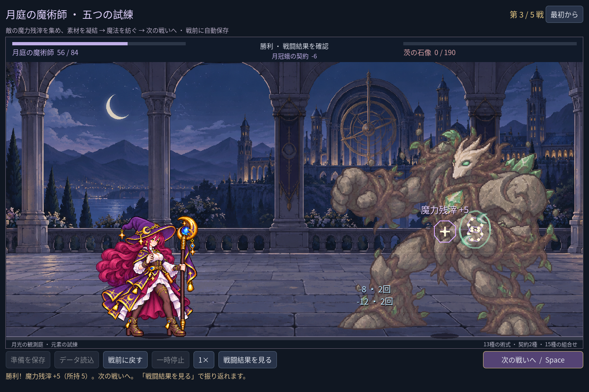
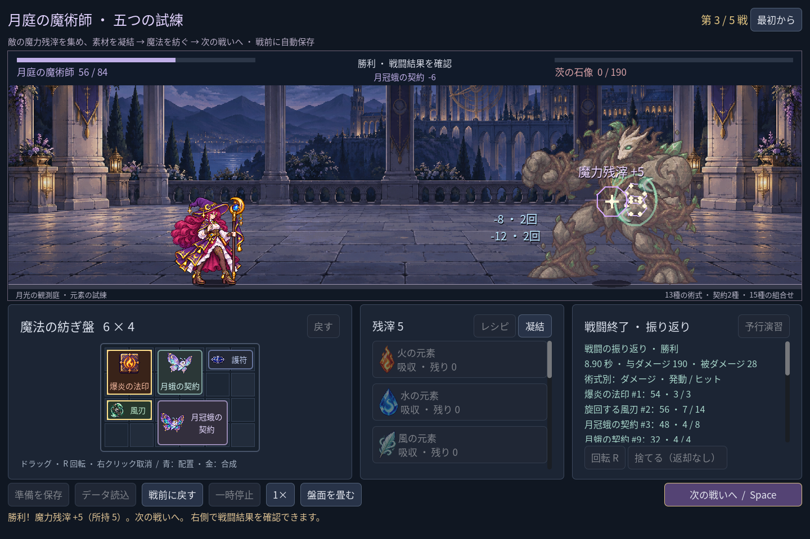
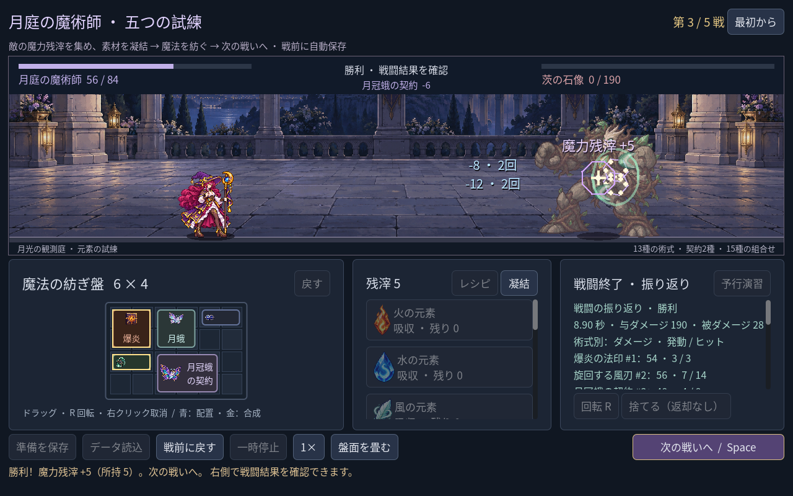

# 2026-11-09：戦闘結果への導線

## 課題と変更

戦闘後のダメージ内訳は存在していたが、戦闘中に盤面を畳むため結果も見えず、場所が分かりにくかった。勝利または敗北後、畳まれた盤面のボタンを「戦闘結果を見る」に変更し、下部に操作案内を表示する。押すと盤面と内訳を開き、内訳を右側スクロール欄の先頭に置く。戦闘終了時に自動で画面の大きさを変えず、必要な時に開閉できる。

内訳は実戦の経過秒数、与・被ダメージ、各 UID のダメージ・発動・ヒット、勝利報酬。通常と強化の使い魔も別の攻撃源として表示する。スクリーンショットの第三戦では、月冠蛾 #3 が 48 ダメージ、月蛾 #9 が 32 ダメージ。1280×800 では長い行が途中で不自然に分かれたため、共通見出し「ダメージ · 発動 / ヒット」と短い値に変更した。内訳が長い時は右側をスクロールする。

次の戦い、戦前復帰、新規開始、保存の読み込みでは前回結果への導線を解除する。踏破済みセーブには過去の詳細な攻撃履歴を保存していないため、読み込み後に内訳を捏造しない。

## 検証

- `game:mage:progression:test`：233 checks、0 failures。七構成の五戦、勝利時の案内、内訳の先頭表示、開閉、次戦での解除、プレイヤーのセーブ非変更を確認。
- `game:mage:campaign:test`：229 checks、0 failures。敗北時の案内、結果表示、戦前復帰の解除を確認。
- `game:mage:save:test`：98、`game:mage:layout:test`：64、`game:mage:campaign:rehearsal:test`：45、既存クラスの run 96・battle 143・save 269・UI 115 checks、すべて 0 failures。
- Godot MCP `script-validate` で変更した UI とテスト 3 件を個別に検査し、エラー 0、警告 0。1440×960 と 1280×800 の実機 fixture を目視確認。

今後は実プレイで結果の理解しやすさを確認する。結果だけで戦略の良否を自動判定したり、保存後に過去の詳細履歴を復元する機能はない。
