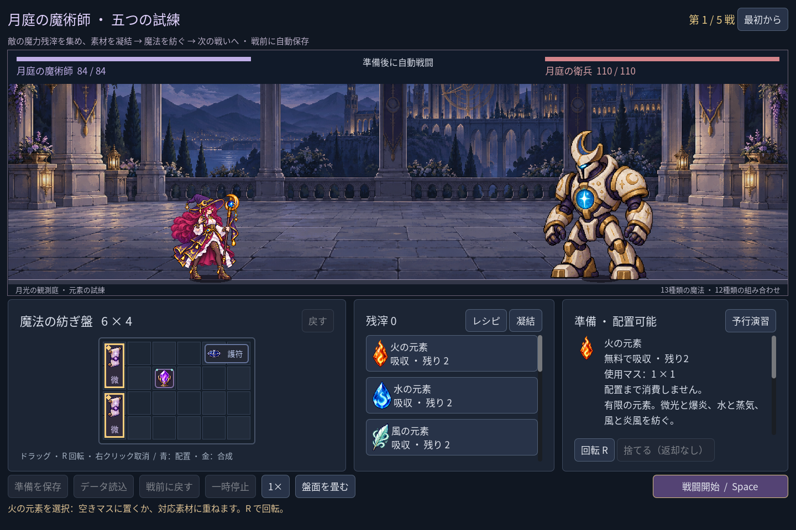
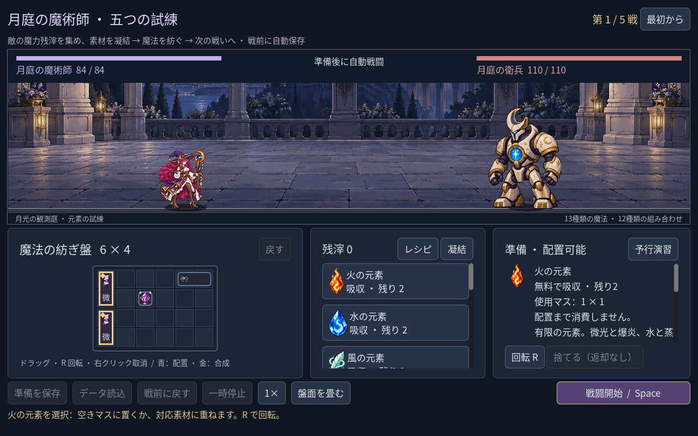
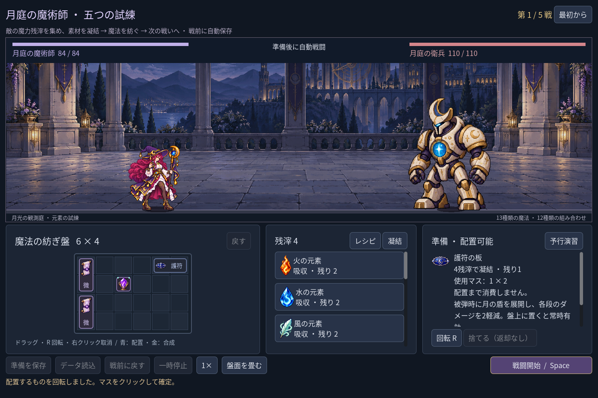

# 2026-11-09：元素と凝結素材の選択情報

## 変更

これまでは元素や凝結素材を選んでも右側には敵の概要が残り、元素の組み合わせや護符の効果は一覧のツールチップから探す必要があった。法師の準備画面では、選んだ素材のアイコン、名前、残り数、無料吸収または必要な残滓、現在の向きの占格、効果説明を右側に表示する。選択時点ではまだ消費されないことも明記した。R で回すと表示する占格も変わる。選択を解除すると敵の概要へ戻る。

最初の実画面確認では大きなアイコンが説明の上に一行を占め、肝心の占格が見えにくかった。アイコンを説明と横に並べ、価格と占格を先に表示した。説明が長い場合は既存の右側スクロールで続きが読める。予行演習の結果は保持し、素材選択時にはその下へ移して素材説明を先に出す。

いずれも Godot の自動操作 fixture による撮影。小さい画面では用途説明の続きにスクロールが必要だが、価格、占格、非消費は先に表示される。護符の画面は試験中だけ残滓を4に設定した状態であり、初戦の実際の報酬や所持量を示すものではない。新規画像の生成はない。

## 検証

- `game:mage:campaign:test`：220項目、失敗0。無料元素と有料護符の説明、価格と残数、回転後の占格、選択時の非消費、予行演習結果の保持、選択解除、実セーブ不変を確認。
- `game:mage:discovery:test` 286、`game:mage:chain-guide:test` 27、`game:mage:campaign:rehearsal:test` 45、`game:mage:layout:test` 64項目、`game:classes:test` の旧職業623項目はいずれも失敗0。布局試験は1280×800、1440×960、1920×1080で既存操作部の範囲を確認するもので、全テキストの視認性を証明するものではない。
- Godot MCP の `script-validate` で準備画面のスクリプトを検査し、エラー0・警告0。
