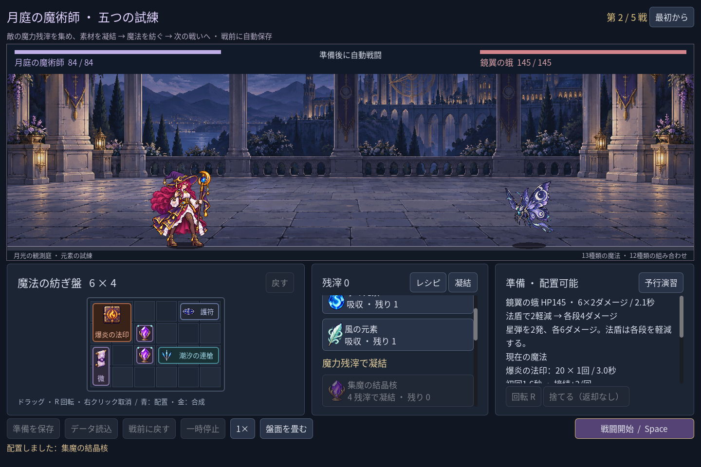

# 2026-11-09：元素と凝結素材のドラッグ境界を確認する

元素の選択後に、残滓が足りない別の素材のドラッグ処理を直接呼ぶと、選択失敗後に以前の素材を返すことがあった。通常の画面では残滓不足のボタン自体が無効になるため、これだけで実プレイの再現を断定はできない。処理側でも準備段階、添字、在庫、残滓を確認し、取得できない素材のドラッグは何も返さないようにした。選択中の素材、盤面、在庫、残滓は変えない。取得可能な素材は従来どおり選択した素材自身を返す。

画像は通常の戦役テストで撮影した参考画面で、残滓不足のドラッグを再現した画像ではない。

修正前は追加した試験で、残滓不足時に旧選択が返ることと負の添字が受理されることを確認した。修正後 `game:mage:campaign:test` は211項目、`game:mage:chain-guide:test` は27項目、`game:mage:discovery:test` は286項目、`game:classes:test` は既存職業の合計623項目、すべて失敗0。実プレイヤーのセーブはテスト前後で不変だった。Godot MCP の `script-validate` で変更した画面とテストを各1ファイル検査し、エラー0・警告0。
