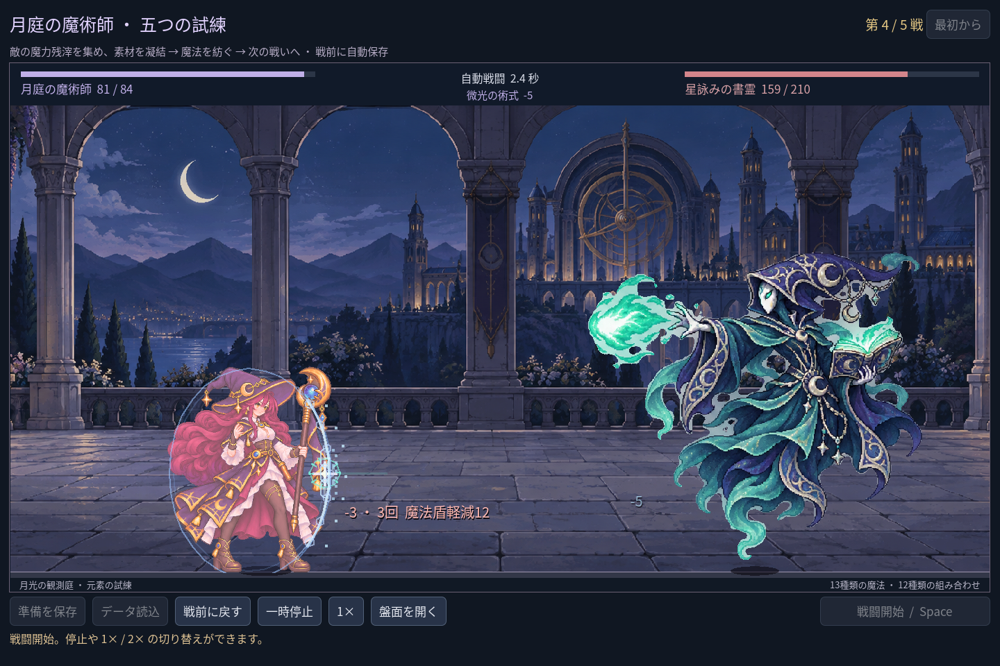
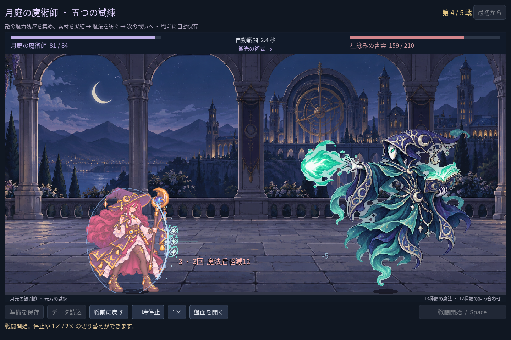

# 2026-11-09：第四戦の符弾が法盾に当たる表現

## 変更と画面確認

星詠みの書霊は専用の三連符弾を持つが、`scribe_rune` は命中表現の専用分岐に含まれず、汎用の粒子が表示されていた。命中時には青緑の角張った二重の符印と光点を描き、実際に記録された各段を法盾の前に並べるようにした。ダメージ、冷却、護盾の減算、発射タイミングは変更していない。

どちらも通常の五戦を進めた Godot 自動操作 fixture の第四戦2.4秒時点で、実際の三段攻撃に対する画面。描画はコードで作ったもので新規の生成画像ではない。最初の配置は盾の線と重なって符印が読みにくかったため、着弾方向へ少し出し、縦方向の間隔も広げて再撮影した。盾の中でなく手前に置く表現であり、盾がないときも被弾位置付近に表示される。

## 検証

実戦イベントから得た通常の三段は符印3個。HP4・護盾2の試験用戦闘では一段目3、二段目1で敗北し、実際の命中数2に対応する表現だけを生成する。最初の追加試験は同時に発生した味方の微光効果まで件数に含めて失敗したため、書霊の効果を選んで検証し直した。

- `game:mage:campaign:test`：223項目、失敗0。三段と致死時の二段、通常の五戦と独立した戦闘エンジンの結果一致、実セーブ不変を確認。
- `game:mage:vfx:test` 49、`game:mage:expansion:test` 148、`game:mage:cast-sync:test` 28、`game:mage:balance:test` 41、`game:classes:test` の旧職業623項目はいずれも失敗0。既存 VFX 試験は一時停止、倍速と実ダメージの整合も確認する。
- Godot MCP の `script-validate` で VFX と戦役テストを各1ファイル検査し、エラー0・警告0。

符印の形と配置は一つのゲーム画面で目視したが、すべての解像度と無盾状態の美術的な見え方までは検証していない。
