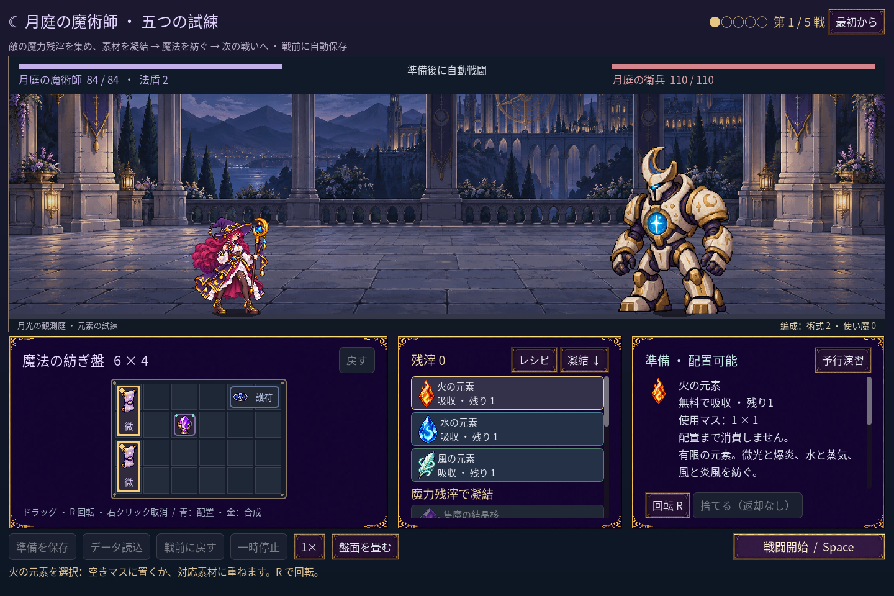
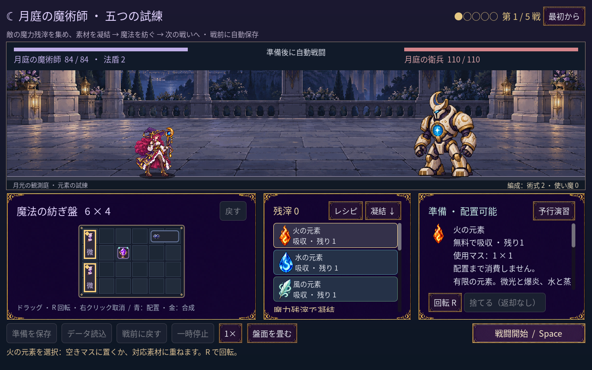
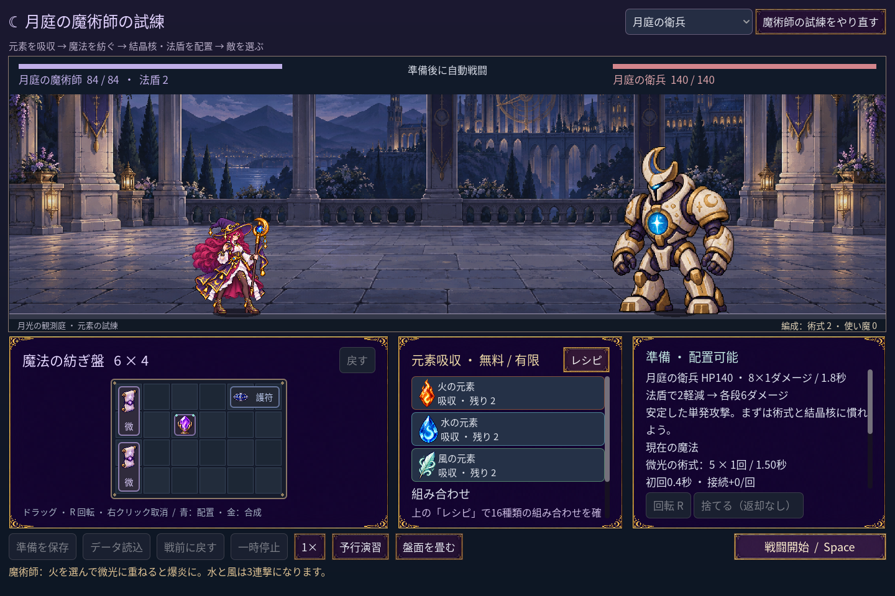

# 2026-11-10：操作ボタンの素材を揃える

月と星のパネルに対して、操作ボタンは汎用の単色枠のままだった。金の細い縁と紫の地を持つ横長ボタン素材を生成し、戦闘開始、盤面、素材、配方、予行演習、保存などの操作に九分割で使う。戦闘開始は少し明るく、ホバーと押下は色調を変え、使用できない操作は装飾を抑えた暗い単色にする。配方カードや元素カードは情報量と判読性のため既存スタイルを保つ。

生成した元 PNG は 2172×724。四辺と四隅、文字を置く中央、意図しない文字や切れを目視した。外周に微小な低 alpha の点があり、画像全体の通常の used rect はボタンを正しく囲まなかった。alpha 128 以上の実測範囲 (49,164,2074,393) を使い、実行時に 128×24 へ最近傍縮小する。元 PNG は変更していない。[生成指示とハッシュ](../../assets/art/mage-ui-button-v1/manifest.json)。

## 検証

- `game:mage:campaign:test` 246、discovery 491、layout 90、progression 269、chain guide 29、haste 41、familiar 76、save 98、undo 39 checks、すべて 0 failures。実際のマウス入力、使用可能・無効状態、1280×800、1440×960、1920×1080 のレイアウトを確認。
- 旧クラスの art 146、grid 194、motion 264、feedback 62、run 96、battle 143、save 269、UI 115 checks はすべて 0 failures。
- 元 PNG が存在しない隔離 PCK fixture の画像読み込みは 10 checks、cold fixture は 1 check、いずれも成功。ゲーム全体の配布版 export は未検証。
- Godot MCP の `script-validate` で UI とテスト二件を個別検査し、エラー 0、警告 0。

ホバー・押下は一枚の画像を色調整している。各状態に別の描き起こしや動きはまだない。
