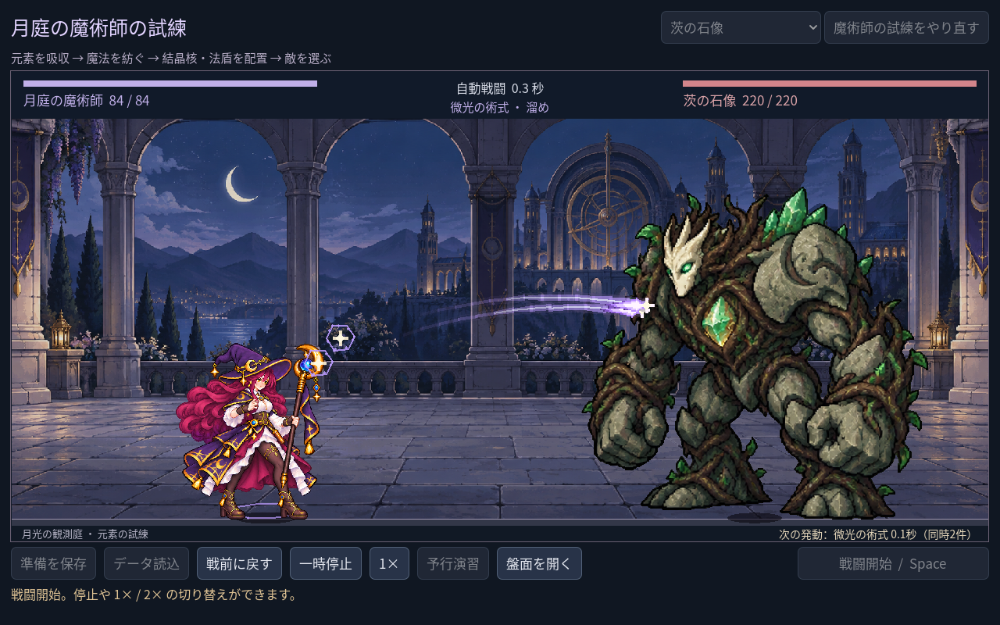
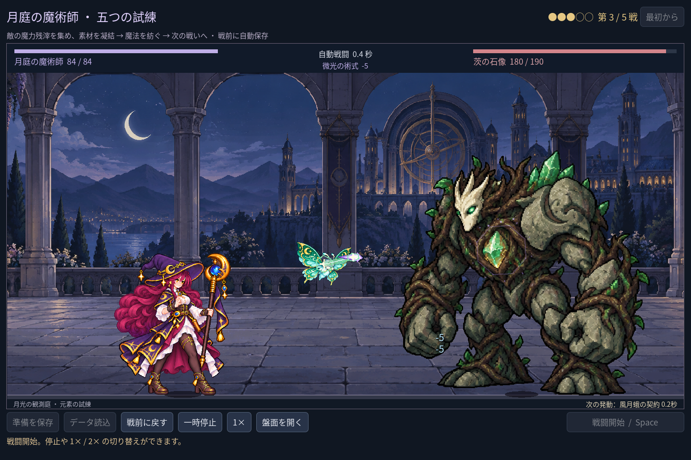

# 2026-11-10：戦闘中の次の発動を見せる

## 変更

戦闘中は盤面を畳んで舞台を広くするため、装備中の術式や使い魔の次の発動を追いにくかった。舞台下端の従来の全レシピ数表示を、準備中は実際の編成数、戦闘中は最も近い発動元と残り戦闘時間に変更した。同じ時刻に複数の発動がある場合は先頭の名称に「同時 N 件」を添える。これらは別々の時計であり、一つずつ順番に待機させるルールではない。

残り時間は実際の戦闘タイマーから読み取るだけで、ポーズ中は止まる。小数一桁への表示は切り上げて、まだ発動していない最後の 0.05 秒を 0.0 秒とは表示しない。倍速時も表示は現実時間ではなく戦闘時間。

## 検証

- `game:mage:layout:test`：82 checks、0 failures。1280×800、1440×960、1920×1080 の表示、同時二件、読み取りの非破壊性、時間の進行、停止、0.05 秒の切り上げを確認した。
- `game:mage:progression:test`：269 checks、0 failures。風月蛾の実際の発動まで 0.2 秒を表示し、八構成の五戦が独立した戦闘モデルと一致することを確認した。
- campaign 240、cast sync 28、VFX 49、familiar 76、campaign rehearsal 45 checks、すべて 0 failures。既存クラスの run 96、battle 143、save 269、UI 115 checks も成功した。
- Godot MCP の `script-validate` で arena とテスト二件を個別検査し、エラー 0、警告 0。画像は実行中の fixture から取得し、単発試練と遠征の画面を区別して記録した。

表示は最も近い一つの名称と同時件数であり、全術式の一覧や敵の次の行動の予測ではない。情報が小さすぎないかは今後の試遊で検証する。
