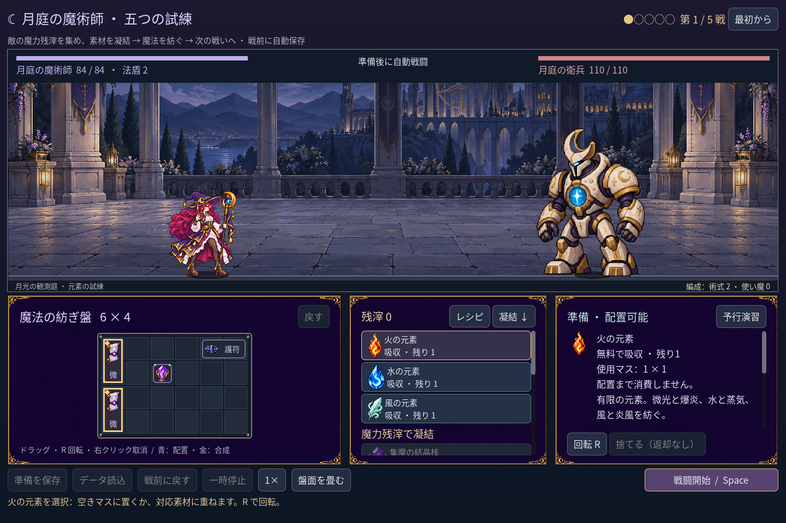
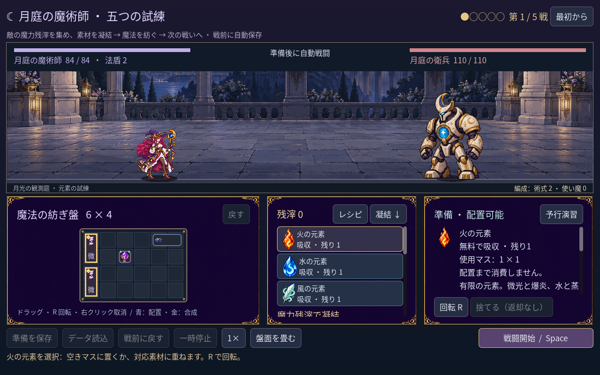
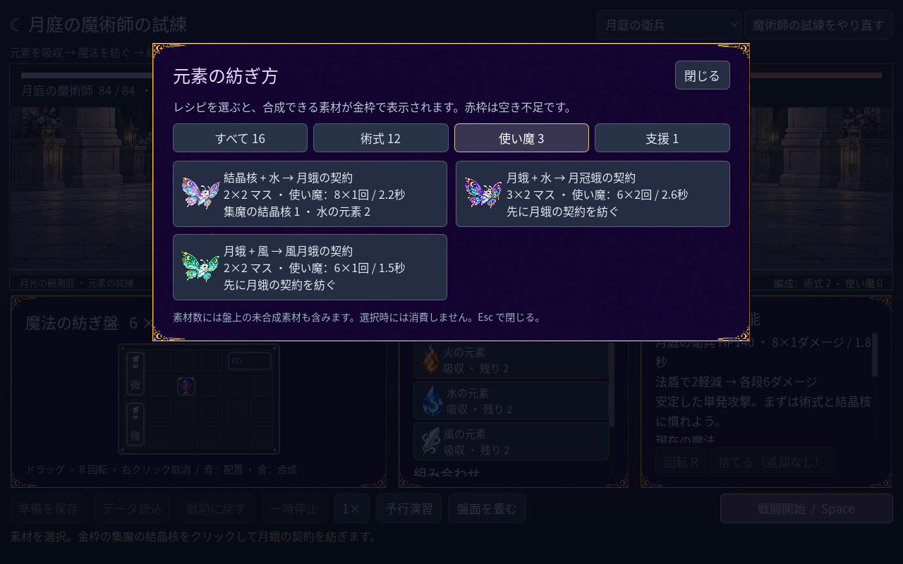
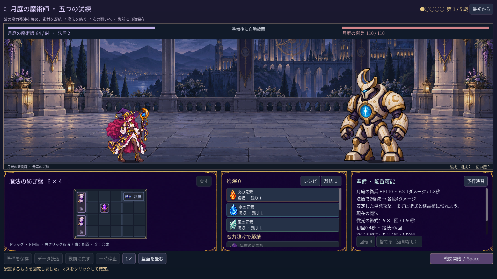

# 2026-11-10：月庭らしい画面へ

## 背景と変更

「まだ UI が簡素」という要望を受け、情報の追加だけでなく画面の見た目を一段階変更した。深い紫の地に金の月と星を配したパネル枠を作り、盤面・素材・詳細と配方帳に共通して使う。画面背景は暗い紫から青へ変化させ、ボタンの通常・ホバー・押下・キーボードフォーカスの色も整理した。舞台の金属色の縁と盤面の角飾りを揃え、見出しに月の記号を添えた。文字や操作は日本語のまま。

枠は imagegen で透明な外周を持つ 1536×1024 の単一 PNG として生成した。四辺の連続、四隅の月と星、中央の文字を置く余白、不要な文字や切れを目視確認した。元 PNG は変更せず、実行時に透明な周囲を除いて 160×104 に最近傍縮小し、25 ピクセルの九分割で伸縮させる。[生成指示とハッシュ](../../assets/art/mage-ui-frame-v1/manifest.json)を保存した。素材を読めない場合は装飾線付きの単色枠へ戻る。

## 検証と制約

- `game:mage:campaign:test` 245、layout 90、progression 269、discovery 490、haste 41、save 98、familiar 76、cast sync 28 checks、すべて 0 failures。実機 fixture で 1280×800、1440×960、1920×1080 のレイアウトと入力を確認した。
- 旧クラスの art 146、grid 194、motion 264、feedback 62、run 96、battle 143、save 269、UI 115 checks、および旧森林の run 126、save 148、UI 210、art 465 checks はすべて 0 failures。
- 画像の隔離 PCK fixture は 9 checks、cold fixture は 1 check、いずれも成功。これはゲーム全体の配布版 export の確認ではない。
- エディタと MCP が停止していたためプロジェクト内 SDK で再起動。ビルドは 0 errors、既存の obsolete API 警告 3 件。Godot MCP の `script-validate` で変更した GDScript 4 件を個別検査し、エラー 0、警告 0。

今回の枠は同じ素材を複数箇所で使う初版。配方カードやボタン自体は Godot の標準コントロールを色調整しており、専用の状態別アートではない。個別の質感や小さな盤面の文字は今後も改善できる。
