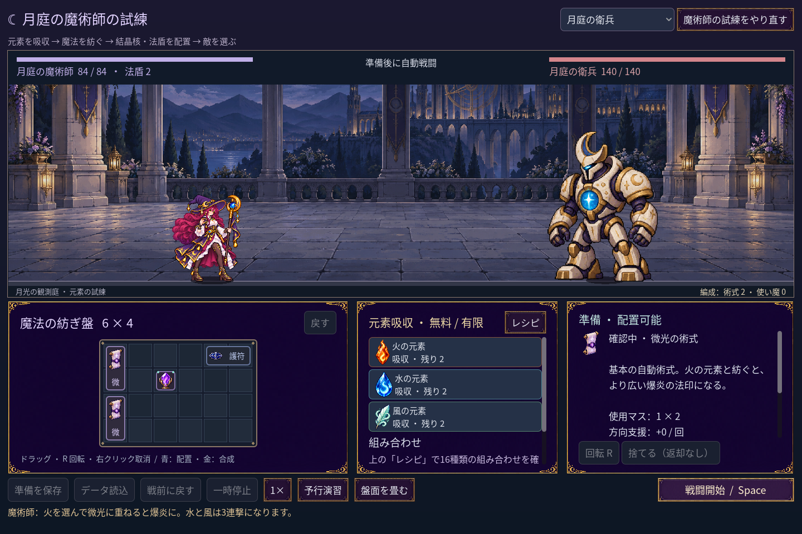
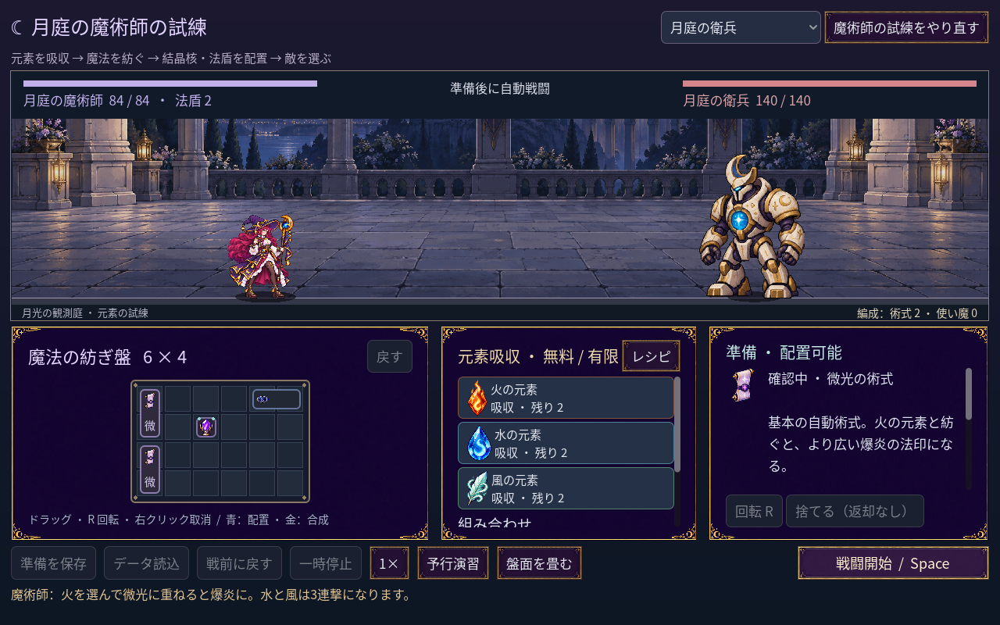

# 2026-11-10：小さな盤面の道具を確認する

## 課題と対応

舞台を広く保つ 1280×800 の配置では、一列の縦長アイテムの短縮名が「微」のように一文字になる。二文字を縦に並べる案も試したが、文字のためにアイコンが極端に小さくなり、実際の画面で改善と判断できなかったので採用しなかった。

代わりに、盤面の道具にマウスを載せると右側に「確認中」と完全な名称・説明・占格を表示する。選択や消費はせず、移動中の道具や選択中の素材がある時は、その操作の情報を優先する。カーソルを盤面から外すと敵の情報に戻る。予行演習の結果を出した後でも、道具を確認している間だけ詳細を先に出し、離れると結果を元の位置に戻す。

## 検証

- `game:mage:discovery:test`：497 checks、0 failures。実際のマウス移動による名前表示、盤面を離れた時の復帰、選択や素材消費がないこと、移動・合成中の情報優先を確認。
- `game:mage:campaign:test`：248 checks、0 failures。予行演習の結果を保持して道具確認後に復元することを確認。
- progression 269、campaign rehearsal 45、undo 39、layout 90、save 98、familiar 76 checks、すべて 0 failures。旧クラスの art 146、grid 194、motion 264、feedback 62、run 96、battle 143、save 269、UI 115 checks も成功。
- Godot MCP `script-validate` で UI、盤面、テスト二件を個別検査し、エラー 0、警告 0。

盤内の文字自体は狭い時に省略したまま。キーボード操作での個別セル選択や、タッチ用の長押し確認は未実装。
