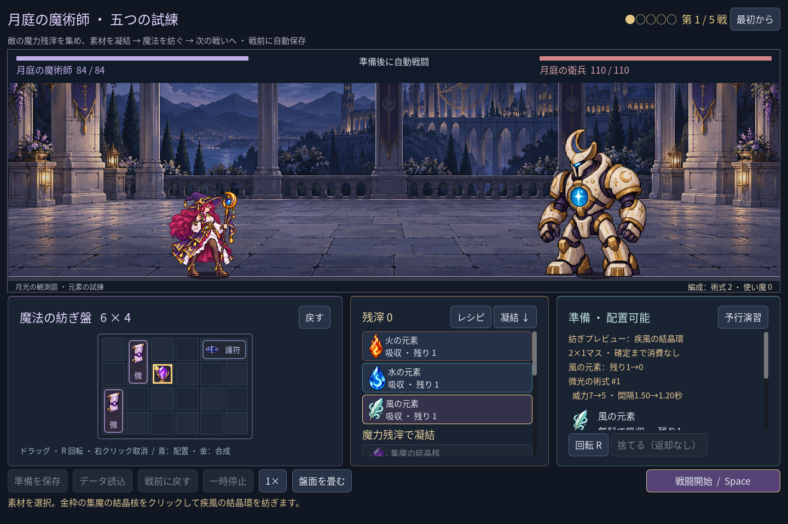
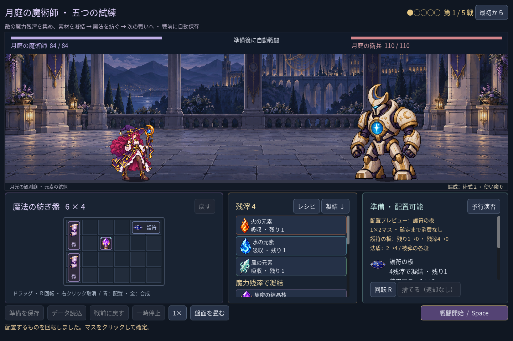
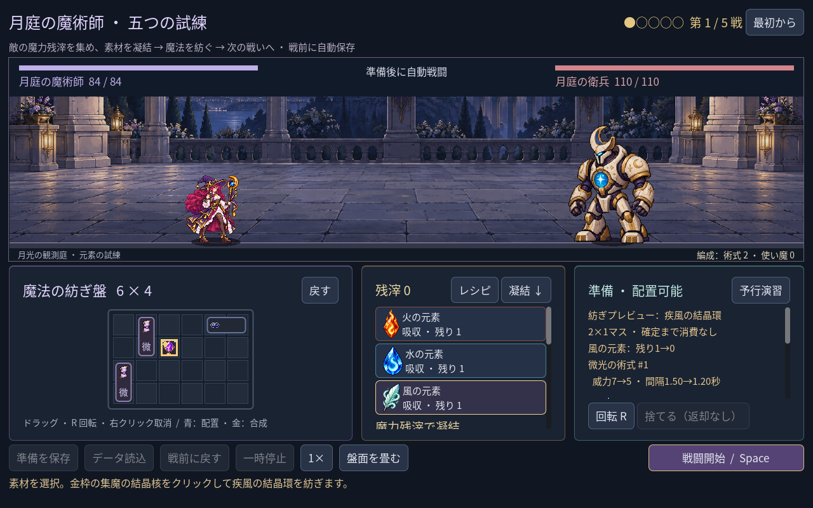

# 2026-11-10：配置前に変化を比較する

## 変更

配置・合成のプレビューは以前から完成品を見せていたが、結晶核を疾風の結晶環に変えると近くの術式の威力が下がることや、追加の法盾の効果と残滓の消費を同時に読み取りにくかった。実際の配置をコピー上で試す既存の仕組みに、配置後の残滓と素材在庫を追加した。UI は現在の戦闘設定とプレビュー結果を UID ごとに比較し、変化した威力・段数・間隔、各段の法盾軽減、合成で消費される既存術式を表示する。

移動した術式自身の接続変化も示す。購入素材の場合は配置前後の在庫と残滓を表示するが、確定前に実データは消費しない。下の護符の画像は表示確認のため第一戦の fixture に残滓 4 を設定したもので、実際の第一戦開始時の所持額ではない。

1280×800 では当初、文末の文字と秒数が不自然に単独で改行された。説明を短くし、術式名と変化を別行に分けた。内容が多い場合は右側をスクロールする。

## 検証

- `game:mage:haste:test`：41 checks、0 failures。自身の接続 5→7、結晶核を風に変えた時の 7→5 と 1.50→1.20 秒、素材非消費、小窓表示を確認。
- `game:mage:campaign:test`：241 checks、`game:mage:undo:test`：39 checks、いずれも 0 failures。護符と残滓の比較、既存術式を使う合成、プレビュー前後の状態不変と実行後の取り消し境界を確認。
- discovery 490、progression 269、chain guide 29、familiar 76、save 98 checks、すべて 0 failures。既存クラスの run 96、battle 143、save 269、UI 115 checks も成功。
- Godot MCP の `script-validate` で変更したルール、UI とテスト三件を個別検査し、エラー 0、警告 0。

この比較は盤面上の計算値であり、敵の行動を含む勝敗予測ではない。実際の戦闘を試すには別の「予行演習」を使う。
