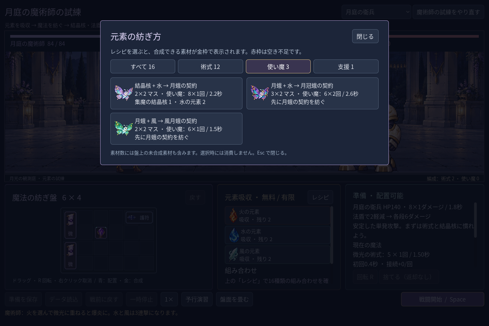
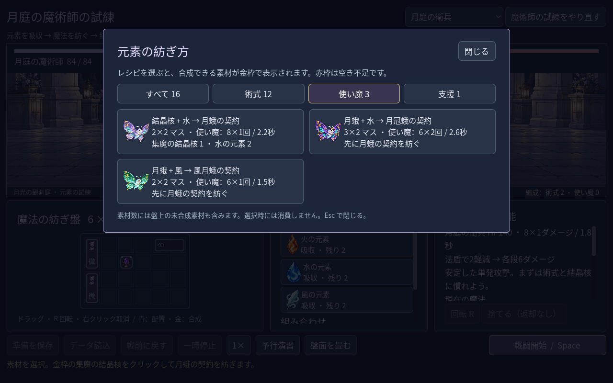

# 2026-11-10：配方を種類で探す

## 変更

配方が 16 種まで増え、長い一覧から召喚や支援を探しにくくなった。配方帳に「すべて」「術式」「使い魔」「支援」の切り替えと各種類の総数を追加した。数は利用可能数ではなく配方の総数で、素材不足のものは従来どおり無効表示される。分類を選んでも素材や盤面は変わらず、絞り込んだカードから従来の金枠・二段階合成の案内を使える。

表示数に応じて配方欄の高さを縮め、不要な空白を減らした。中央揃えのまま高さだけを変えると分類ボタンが上下に動いて連続操作しにくかったため、ダイアログの上端を固定した。配方帳を閉じて再度開くと直前の分類を保持し、スクロール位置は先頭に戻す。

## 検証

- `game:mage:discovery:test`：490 checks、0 failures。実際のマウス入力で各分類と件数、使い魔カードの合成案内、再表示時の分類保持、素材非消費、ボタン位置の安定を確認。1280×800、1440×960、1920×1080 で各ボタンと全カードの到達・非重なりを検証。
- campaign 240、progression 269、chain guide 29、haste 38、familiar 76、layout 82、save 98 checks、すべて 0 failures。既存クラスの run 96、battle 143、save 269、UI 115 checks も成功。
- Godot MCP の `script-validate` で UI とテストを個別検査し、エラー 0、警告 0。

カードの効果を直接比較する専用画面や、素材名での検索はまだない。分類名や件数が初見の人に伝わるかは今後の試遊で確認する。
