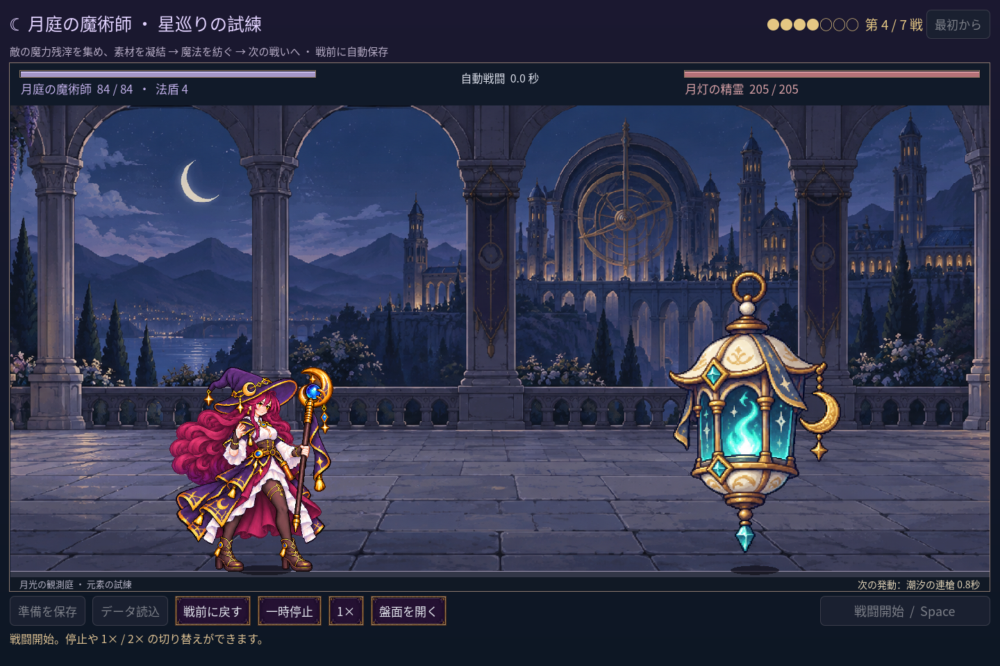
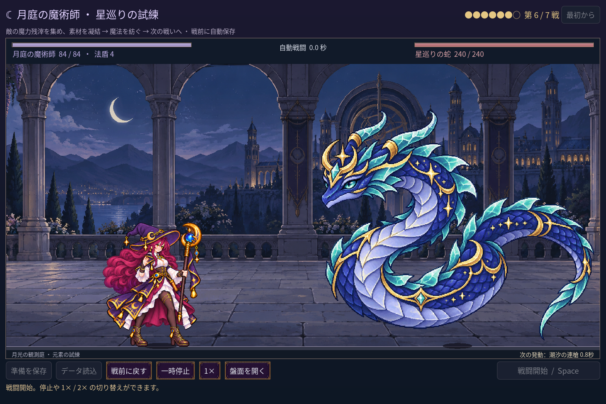
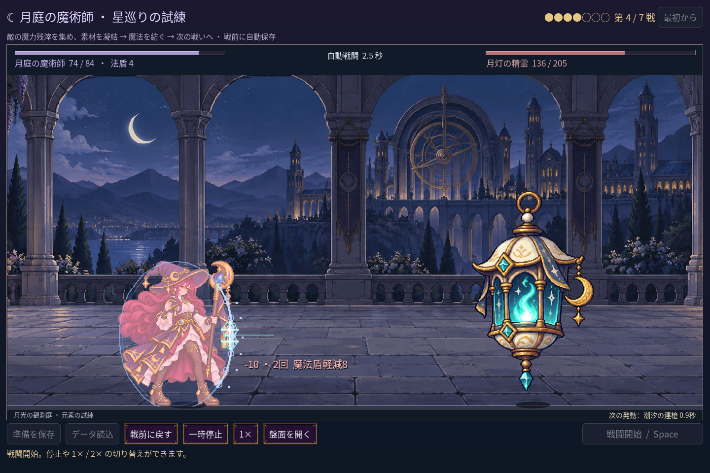
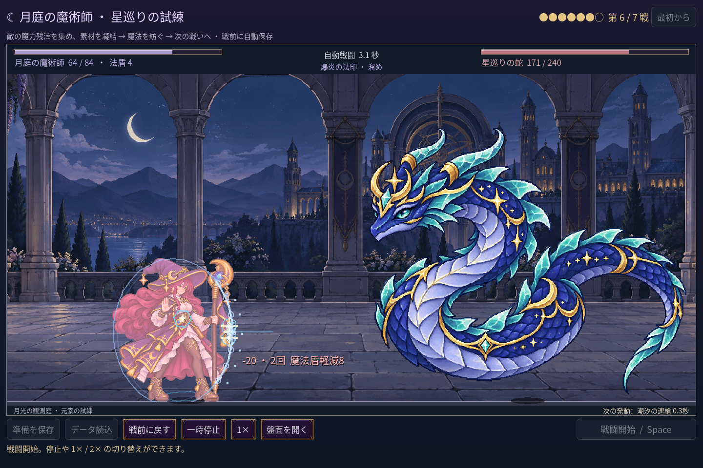

# 2026-11-10：七戦の遠征と二体の新しい敵

## 遠征と旧セーブ

新しく始める遠征を七戦に拡張した。順番は月庭の衛兵、鏡翼の蛾、茨の石像、月灯の精霊、星詠みの書霊、星巡りの蛇、月冠の星守。四戦目と六戦目に別々の敵を追加し、最後は従来と同じボスの七戦版とした。各戦後 HP は全回復し、盤面と残滓は維持する。

新遠征はルール v3、報酬は順に 4 / 4 / 5 / 4 / 6 / 5 / 0。初期の無料元素は各一つで、凝結在庫は結晶核・護符・微光を各二つ、各有料元素を三つに増やした。v1 / v2 セーブは五戦の敵順・報酬・在庫をそのまま保つ。途中と踏破済みの両方を元の最終ボスとして復元し、勝手に七戦へ移行しない。七戦を遊ぶには画面の「最初から」で新遠征を始める。

## 敵、表現、素材検査

月灯は HP 205、2.5 秒ごとに 9×2、蛇は HP 240、3.1 秒ごとに 14×2。各命中に法盾の軽減を適用する。青緑の灯火と青い星の攻撃は、実際の発動予告と命中イベントに合わせて描画し、二段目より前に戦闘が終わった場合は実際のヒット数だけを表示する。

両方とも imagegen の単一画像を使用し、頭・角・身体・尾、灯の輪と飾り、画面端の欠けと不要物を目視した。最初の灯画像は上端に接していたため採用せず、余白を指定して再生成した。採用画像の alpha 128 以上の範囲は、灯が (569,179)・392×641、蛇が (186,10)・1187×998。原画像・生成指示・SHA-256 は [manifest](../../assets/art/mage-seven-battles-v1/manifest.json) に保存した。1280×800、1440×960、1920×1080 で主役と重ならず画面内に収まることを確認した。

新しい二体はそれぞれ一枚の絵を浮遊・予備動作・被弾時に移動させる。専用の逐帧攻撃ポーズや AnimationPlayer は未制作で、魔法使いの既存 AnimationPlayer はそのまま使用する。

## 平衡と検証

七戦版の書霊は HP 245、ボスは HP 300、星弾 12×2 と重撃 21×1 を交互に使う。旧 v1 / v2 の書霊・ボスの数値は変えていない。第四戦前の報酬で合法的に作れる同一盤面を七敵に当てた比較では、残 HP が 80 / 76 / 60 / 54 / 48 / 24 / 18、戦闘時間が 4.0 / 6.0 / 7.6 / 7.6 / 9.8 / 9.8 / 12.7 秒だった。序盤にその強化済み盤面が使えるという意味ではなく、敵の圧力を切り分ける比較である。

正常な報酬で進む三構成の残 HP は次のとおり：

| 構成 | 1 | 2 | 3 | 4 | 5 | 6 | 7 |
| --- | --- | --- | --- | --- | --- | --- | --- |
| 元素混成 | 72 | 60 | 48 | 54 | 48 | 24 | 18 |
| 風月蛾 | 68 | 60 | 48 | 44 | 39 | 24 | 18 |
| 月冠蛾＋月蛾 | 68 | 52 | 56 | 44 | 48 | 24 | 18 |

固定盤面と自動操作の結果であり、人間による難易度・報酬量の評価ではない。強化が入るため、実際の残 HP が毎戦必ず下がるわけではない。

- `game:mage:seven:test`：223 checks、0 failures。三構成の七戦、二体の攻撃と盾、新旧セーブ、v3 の途中・踏破の自動保存と再起動、拡張在庫の保存を検証。既存プレイヤーセーブのハッシュは不変。
- 既存五戦 campaign 248、progression 269、save 98、campaign rehearsal 45、balance 78、haste 41、familiar 76、advanced 103、expansion 152、discovery 497、chain guide 29、undo 39、layout 90、cast sync 28、VFX 49、scribe 19 checks、すべて 0 failures。旧クラスと森林の回帰も成功。
- 隔離 PCK の画像読み込みは 12 checks、cold fixture は 1 check、いずれも成功。ゲーム全体の配布版 export は未検証。
- Godot MCP をプロジェクト内 SDK で再接続し、対象 11 GDScript を個別検査、エラー 0、警告 0。C# build は 0 errors、既存の obsolete API 警告 3 件。
