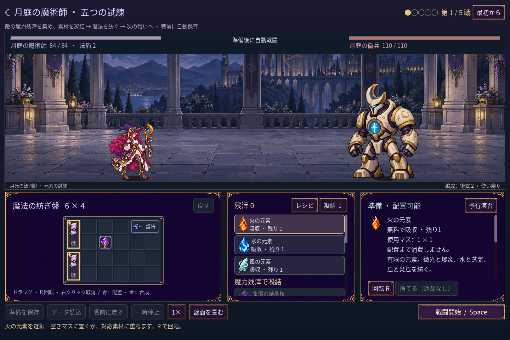
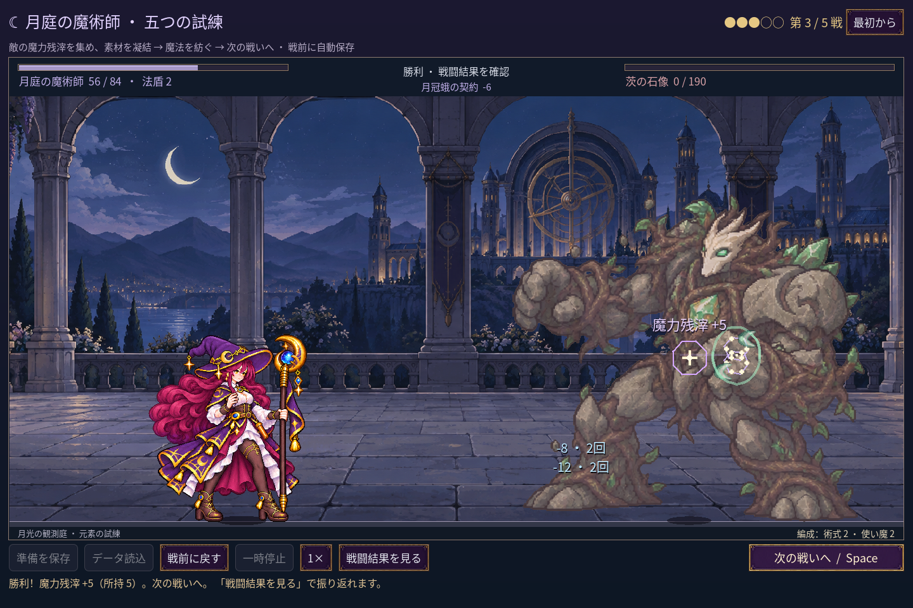
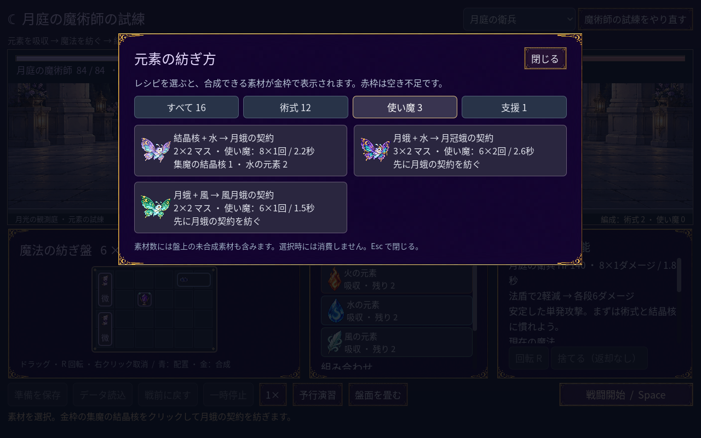

# 2026-11-10：生命バーとカードの色を揃える

月庭の枠とボタンに合わせ、生命バーに暗い下地、金色の縁、色の明暗を加えた。バーの長さは従来どおり実際の HP 割合で、0 の時に中身を描かない。元素カードと配方カードの地色も青寄りから紫寄りに調整し、元素ごとの枠色、選択中の金枠、無効状態、ホバーの違いを保った。

## 検証

- discovery 497、campaign 248、progression 269、layout 90、VFX 49、cast sync 28、familiar 76 checks、すべて 0 failures。実際のゲーム fixture で満 HP・減少・敵 HP 0 とカード表示を目視確認した。
- 旧クラスの art 146、grid 194、motion 264、feedback 62、run 96、battle 143、save 269、UI 115 checks も成功。
- Godot MCP `script-validate` で変更した UI と arena を個別検査し、エラー 0、警告 0。

色と枠の調整であり、HP やダメージの計算は変更していない。カード専用のイラスト枠や詳細なモーションは今後の課題。
